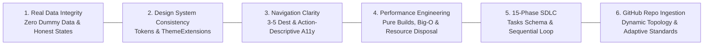
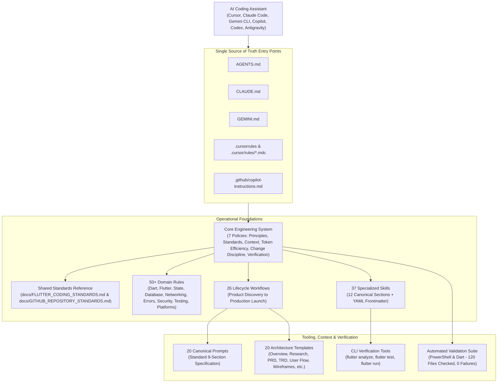

# Flutter Agent Kit 🚀

<div align="center">

```
  ███████╗██╗     ██╗   ██╗████████╗████████╗███████╗██████╗ 
  ██╔════╝██║     ██║   ██║╚══██╔══╝╚══██╔══╝██╔════╝██╔══██╗
  █████╗  ██║     ██║   ██║   ██║      ██║   █████╗  ██████╔╝
  ██╔══╝  ██║     ██║   ██║   ██║      ██║   ██╔══╝  ██╔══██╗
  ██║     ███████╗╚██████╔╝   ██║      ██║   ███████╗██║  ██║
  ╚═╝     ╚══════╝ ╚═════╝    ╚═╝      ╚═╝   ╚══════╝╚═╝  ╚═╝
              A G E N T   K I T   •   v 2 . 7 . 0
```

### The Universal Engineering Framework & Multi-Agent Knowledge System for Flutter & Dart

[](CHANGELOG.md)
[](LICENSE)
[](https://flutter.dev)
[](https://dart.dev)
[]()
[-brightgreen.svg)](docs/FINAL_QUALITY_AUDIT.md)
[](docs/AGENT_COMPATIBILITY.md)
[](https://github.com/valaprashant97/flutter-agent-kit)
[](CONTRIBUTING.md)

<p align="center">
  <b>A battle-tested operational toolkit and shared knowledge engine that empowers AI coding assistants to architect, build, debug, optimize, test, and release production-ready Flutter and Dart applications with zero hallucinations, zero dummy data, and strict software craftsmanship.</b>
</p>

[Quick Start](#-quick-start--installation) • [Key Features](#-key-features) • [Architecture](#%EF%B8%8F-system-architecture) • [Skills Catalog](#-specialized-skills-system-37-skills) • [Workflows](#-engineering-lifecycle-workflows-26-workflows) • [Documentation](#-documentation-reference-library)

</div>

---

## 📑 Table of Contents

- [💡 Why Flutter Agent Kit Exists](#-why-flutter-agent-kit-exists)
- [✨ Key Features](#-key-features)
- [🛡️ The 6 Core Invariant Systems](#️-the-6-core-invariant-systems)
- [🖥️ Interactive Demo & Agent Lifecycle](#%EF%B8%8F-interactive-demo--agent-lifecycle)
- [🏛️ System Architecture](#%EF%B8%8F-system-architecture)
- [🛠️ Tech Stack & Ecosystem](#%EF%B8%8F-tech-stack--ecosystem)
- [🤖 Multi-Agent Compatibility Matrix](#-multi-agent-compatibility-matrix)
- [📁 Project Structure](#-project-structure)
- [📦 What's Inside the Kit](#-whats-inside-the-kit)
  - [1. Core Engineering System (7 Policies)](#1-core-engineering-system-core)
  - [2. Specialized Skills System (37 Skills)](#2-specialized-skills-system-37-skills-in-skills)
  - [3. Engineering Lifecycle Workflows (26 Workflows)](#3-engineering-lifecycle-workflows-26-workflows-in-workflows)
  - [4. Project Planning Templates (20 Templates)](#4-project-templates-20-templates-in-templates)
  - [5. Standardized Prompts Library (20 Prompts)](#5-standardized-prompts-library-20-prompts-in-prompts)
  - [6. Domain Engineering Rules (50+ Rules)](#6-domain-engineering-rules-50-rules-in-rules)
- [🪟 Windows Desktop Specialization](#-dedicated-windows-desktop-engineering)
- [🚀 Quick Start & Installation](#-quick-start--installation)
- [💻 Usage Instructions & Prompting Playbook](#-usage-instructions--prompting-playbook)
- [⚙️ Configuration & Environment Variables](#%EF%B8%8F-configuration--environment-variables)
- [🏗️ Build & Deployment Instructions](#%EF%B8%8F-build--deployment-instructions)
- [🧪 Automated Quality & Validation Suite](#-automated-quality--validation-suite)
- [🤝 Contribution Guidelines](#-contribution-guidelines)
- [📄 License & Author](#-license--author)

---

## 💡 Why Flutter Agent Kit Exists

Standard AI coding assistants struggle with production Flutter applications beyond simple counter demos. Typical agent failure modes include:
- ❌ **Hallucinating obsolete or non-existent packages** from outdated training sets.
- ❌ **Destructive file rewrites**: Rewriting an entire 600-line file to change a 3-line widget.
- ❌ **`BuildContext` crashes**: Invoking `Navigator` or `Theme.of(context)` across async gaps without `mounted` checks.
- ❌ **Fabricating fake data**: Generating static dummy records, fake dashboard metrics, or mock arrays in production code.
- ❌ **Neglecting UI states**: Failing to handle all 4 mandatory UI states (Loading, Success, Empty, and Error).
- ❌ **Visual fragmentation**: Inventing isolated hex colors and ad-hoc paddings instead of consuming design system tokens.
- ❌ **Mystery Meat navigation**: Overcrowding bottom bars with ambiguous, unlabeled icon-only buttons.
- ❌ **Frame jank & memory leaks**: Omitting `const`, doing heavy computations in `build()`, and omitting controller `dispose()`.
- ❌ **Treating desktop like a mobile device**: Ignoring single-instance mutexes, Per-Monitor V2 DPI scaling, and system tray lifecycles.

**The Flutter Agent Kit solves this completely** by equipping AI agents with a comprehensive, deterministic knowledge framework that enforces professional software engineering principles at every step.

---

## ✨ Key Features

| Feature | Description | Reference |
| :--- | :--- | :--- |
| 🛡️ **Zero Dummy Data** | Enforces real user data, dynamic reactive pipelines, honest empty states, and 100% isolated test fixtures | [`docs/REAL_DATA_INTEGRITY.md`](docs/REAL_DATA_INTEGRITY.md) |
| 🎨 **Global Design System** | 13 canonical color roles, 4pt/8pt spacing grid (`AppSpacing`), typography scales, and 13-point design checklist | [`docs/DESIGN_SYSTEM_STANDARDS.md`](docs/DESIGN_SYSTEM_STANDARDS.md) |
| 🧭 **Navigation Usability** | 3–5 mobile bottom nav rule, visible labels, action-descriptive a11y tooltips, and destructive confirmation modals | [`docs/NAVIGATION_AND_ICON_STANDARDS.md`](docs/NAVIGATION_AND_ICON_STANDARDS.md) |
| ⚡ **Algorithmic Performance** | Big-O time/space complexity analysis, pure `build()` methods, isolate offloading, and resource disposal hygiene | [`docs/PERFORMANCE_ENGINEERING_STANDARDS.md`](docs/PERFORMANCE_ENGINEERING_STANDARDS.md) |
| 📋 **15-Phase SDLC** | Default 15-phase lifecycle ($\text{Idea} \to \text{PRD} \to \text{Wireframes} \to \text{Design} \to \text{Architecture} \to \dots \to \text{Deploy}$) with 13-field tasks | [`docs/TASK_MANAGEMENT_STANDARDS.md`](docs/TASK_MANAGEMENT_STANDARDS.md) |
| 🌐 **Remote GitHub Ingestion** | Ingest any GitHub URL, detect Flutter root in monorepos/subfolders, auto-profile architecture, and adapt standards | [`docs/GITHUB_REPOSITORY_STANDARDS.md`](docs/GITHUB_REPOSITORY_STANDARDS.md) |
| 📏 **Shared Coding Standards** | Consolidated 12-area standards reference for Dart 3.x, Clean Architecture, widgets, state, APIs, security, and tests | [`docs/FLUTTER_CODING_STANDARDS.md`](docs/FLUTTER_CODING_STANDARDS.md) |
| 🪟 **Windows Native Runner** | Single-instance Win32 mutex, Per-Monitor V2 DPI awareness, persistent tray utilities, and signed MSIX generation | [`docs/WINDOWS_DEVELOPMENT.md`](docs/WINDOWS_DEVELOPMENT.md) |
| 🔬 **Deterministic Verification** | Zero fabricated test passes; mandatory real CLI execution (`flutter analyze`, `flutter test`, `dart format`) | [`core/verification-policy.md`](core/verification-policy.md) |

---

## 🛡️ The 6 Core Invariant Systems

All agent entry points strictly enforce these six foundational invariants:



1. **Zero Dummy Data & Real Data Integrity**: Production data must originate from real inputs, databases, or verified APIs. Never populate fake records or hardcoded numbers to make a screen appear full. Isolated mocks live only in `test/`.
2. **Global Design Consistency**: Every screen must look and feel like part of the same unified application. Consume `Theme.of(context)` and `AppSpacing` tokens; zero hardcoded hex colors in widget files.
3. **Navigation Clarity & Discoverability**: Mobile `NavigationBar` contains between 3 and 5 primary destinations with visible text labels. No icon-only buttons for ambiguous domain actions; destructive actions require confirmation.
4. **Performance Engineering & Efficiency**: Prioritize: $\text{Correctness} > \text{Reliability} > \text{Maintainability} > \text{Measured Performance}$. Keep `build()` pure; dispose all controllers in `dispose()`; use $O(1)$ `Map`/`Set` lookups.
5. **Mandatory 15-Phase SDLC & Task Management**: Complex tasks are systematically planned across phases and broken down into atomic 13-field tasks in `tasks/TASKS.md`. Work sequentially: $\text{READ} \to \text{UNDERSTAND} \to \text{PLAN} \to \text{IMPLEMENT} \to \text{TEST} \to \text{REVIEW} \to \text{FIX} \to \text{DOCUMENT} \to \text{VERIFY} \to \text{MARK COMPLETED}$.
6. **Universal GitHub Repository Ingestion & Adaptive Development**: Connect to any GitHub URL (prompt if missing), locate the Flutter root across monorepos (`apps/*`, `packages/*`, Melos), auto-profile state management, adapt coding standards without forced rewrites, and work on isolated feature branches.

---

## 🖥️ Interactive Demo & Agent Lifecycle

Here is how an AI agent guided by the **Flutter Agent Kit** autonomously executes an incoming feature request:

```
┌─────────────────────────────────────────────────────────────────────────────┐
│                       FLUTTER AGENT EXECUTION FLOW                          │
└─────────────────────────────────────────────────────────────────────────────┘

 USER PROMPT:
 ❯ "Add an Order History screen to https://github.com/my-org/retail-app"

 AGENT EXECUTION:
 ├── [1. INGEST & CHECK AUTH]
 │   ├── Ingest URL: https://github.com/my-org/retail-app
 │   ├── Check git access: Verified write access
 │   └── Create isolated branch: git checkout -b feat/order-history
 │
 ├── [2. TOPOLOGY & PROFILING]
 │   ├── Search pubspec.yaml: Discovered at apps/mobile_client/pubspec.yaml (Monorepo)
 │   ├── Detect Architecture: Feature-First (lib/features/)
 │   ├── Detect State Management: flutter_bloc (v8.1.3)
 │   ├── Detect Networking: Dio with interceptors
 │   └── Run Baseline Diagnostics: flutter analyze (0 errors, 1 pre-existing warning)
 │
 ├── [3. SURGICAL IMPLEMENTATION]
 │   ├── lib/features/orders/domain/entities/order_entity.dart
 │   ├── lib/features/orders/presentation/bloc/order_history_bloc.dart
 │   ├── lib/features/orders/presentation/pages/order_history_page.dart
 │   │   ├── State: Loading   -> SkeletonLoader()
 │   │   ├── State: Success   -> ListView.builder(itemCount: orders.length)
 │   │   ├── State: Empty     -> AppEmptyStateView(ctaText: "Shop Now")
 │   │   └── State: Error     -> AppErrorView(onRetry: () => bloc.add(LoadOrders()))
 │   └── Resource Disposal: Verified TextEditingController & Bloc disposed
 │
 ├── [4. GOAL-DRIVEN VERIFICATION]
 │   ├── dart format .                       -> PASSED (0 unformatted files)
 │   ├── flutter analyze                     -> PASSED (0 new warnings introduced)
 │   └── flutter test test/features/orders/  -> PASSED (6/6 tests passing)
 │
 └── [5. STANDARDIZED REPORT]
     └── Structured execution summary delivered with git diff & verification proof.
```

---

## 🏛️ System Architecture

The kit employs a single-source-of-truth hierarchy that funnels high-level policies into structured skills, workflows, templates, and automated verification:



---

## 🛠️ Tech Stack & Ecosystem

The Flutter Agent Kit is deeply integrated with the modern Flutter and Dart development landscape:

| Category | Supported Technologies |
| :--- | :--- |
| **Languages** | **Dart 3.x** (Sound null safety, records, patterns, sealed classes), **C++** (Windows Runner), **PowerShell** |
| **Framework** | **Flutter 3.x** (Android, iOS, Windows, macOS, Linux, Web) |
| **AI Assistants** | **Cursor**, **Claude Code**, **Gemini CLI**, **GitHub Copilot**, **OpenAI Codex**, **Google Antigravity** |
| **State Management** | **BLoC / Cubit**, **Riverpod**, **Provider**, **ValueNotifier**, **GetX**, **MobX**, **Signals** |
| **Networking & APIs**| **Dio**, `http`, GraphQL, WebSockets, Retrofit |
| **Local Persistence** | **Drift** (SQLite), **Hive**, **Isar**, `shared_preferences`, `flutter_secure_storage` |
| **Testing Harnesses** | `flutter_test`, `mocktail`, `golden_toolkit`, `patrol`, `bloc_test` |
| **Desktop Native** | Win32 API, `window_manager`, `tray_manager`, `local_notifier`, `msix` packaging |

---

## 🤖 Multi-Agent Compatibility Matrix

The Flutter Agent Kit provides zero-configuration, native entry points for all major AI coding platforms:

| AI Assistant / Tool | Entry Configuration | Discovery Mechanism | Execution Characteristics |
| :--- | :--- | :--- | :--- |
| **Cursor** | `.cursorrules` & `.cursor/rules/*.mdc` | Semantic file-match & glob triggers | Targeted rules triggered on `**/*.dart`, `test/**`, `windows/**` |
| **Claude Code** | `CLAUDE.md` | Automatic on CLI launch | Compact commands table, token-efficient surgical directives |
| **Gemini CLI** | `GEMINI.md` | Project root scan | Concentric-ring exploration leveraging 1M+ token context |
| **GitHub Copilot** | `.github/copilot-instructions.md` | Automatic IDE workspace scan | Concise inline completions and workspace chat instructions |
| **OpenAI Codex / Antigravity** | `AGENTS.md` | Session initialization | Open Agent Skills format, universal decision hierarchy |

*For complete agent setup details, see [`docs/AGENT_COMPATIBILITY.md`](docs/AGENT_COMPATIBILITY.md).*

---

## 📁 Project Structure

```
flutter-agent-kit/
├── .cursor/rules/             # Cursor MDC targeted rule definitions
├── .github/                   # GitHub Copilot instructions & workflows
├── core/                      # 7 Foundational Engineering Policies
│   ├── agent-principles.md    # Universal decision hierarchy & Karpathy guidelines
│   ├── engineering-standards.md # Core technical standard for Dart & Flutter
│   ├── project-understanding.md # Non-destructive codebase discovery protocol
│   ├── context-management.md  # Managing context windows and state persistence
│   ├── token-efficiency.md    # Eliminating token waste and verbose dumping
│   ├── change-discipline.md   # Surgical edits and zero collateral refactoring
│   └── verification-policy.md # Proof-of-work protocols and real CLI execution
├── docs/                      # Comprehensive Architecture & Standards Library
│   ├── FLUTTER_CODING_STANDARDS.md      # Shared 12-area coding standards
│   ├── GITHUB_REPOSITORY_STANDARDS.md   # Remote repository adaptation protocol
│   ├── REAL_DATA_INTEGRITY.md           # Zero Dummy Data policy & matrix
│   ├── DESIGN_SYSTEM_STANDARDS.md       # 13 color roles, spacing, and checklist
│   ├── NAVIGATION_AND_ICON_STANDARDS.md # 3-5 destinations, icon clarity, a11y
│   ├── PERFORMANCE_ENGINEERING_STANDARDS.md # Big-O complexity & memory lifecycles
│   ├── TASK_MANAGEMENT_STANDARDS.md     # 15-phase SDLC & 13-field task schema
│   ├── WINDOWS_DEVELOPMENT.md           # Win32 mutex, DPI, tray, MSIX
│   ├── SKILLS_CATALOG.md                # Index of all 37 specialized skills
│   └── WORKFLOWS.md                     # Directory of all 26 lifecycle workflows
├── prompts/                   # 20 Canonical Prompts across 10 categories
├── rules/                     # 50+ Specialized Domain Rules
│   ├── dart/                  # Effective Dart, null safety, patterns, async
│   ├── flutter/               # Widget lifecycle, BuildContext, constraints
│   ├── architecture/          # Clean Architecture, feature-first, DI, MVVM
│   ├── state-management/      # BLoC, Riverpod, Provider, ValueNotifier, GetX
│   ├── database/              # Drift, Hive, Isar, secure storage
│   ├── networking/            # Dio, offline caching, error mapping
│   ├── error-handling/        # Global hooks, sealed failures, retries
│   ├── performance/           # Const constructors, jank elimination, memory leaks
│   ├── security/              # Secrets protection, data sanitization
│   ├── testing/               # Unit, widget, golden tests, mocking
│   └── platform/              # Android, iOS, Windows, macOS, Linux, Web
├── scripts/                   # Automated Quality & Validation Suites
│   ├── PowerShell/            # validate-kit.ps1
│   └── validation/            # validate-structure.dart
├── skills/                    # 37 Production-Ready Specialized Skills
├── templates/                 # 20 Project Planning & Architecture Templates
├── AGENTS.md                  # Universal AI Agent Entry Point
├── CLAUDE.md                  # Claude Code CLI Entry Point
├── GEMINI.md                  # Gemini CLI Entry Point
├── .cursorrules               # Cursor Root Rules
├── CHANGELOG.md               # Version History & Release Notes
├── CONTRIBUTING.md            # Contribution Guidelines
├── LICENSE                    # MIT License
├── README.md                  # Root Project Documentation
├── SECURITY.md                # Security & Vulnerability Policy
└── TASKS.md                   # Internal Task Implementation Tracker
```

---

## 📦 What's Inside the Kit

### 1. Core Engineering System (`core/`)
The non-negotiable operational principles governing all agent interactions:
- **`agent-principles.md`**: Decision hierarchy: $\text{Correctness} > \text{Requirements} > \text{Consistency} > \text{Security} > \text{Maintainability} > \text{Token Efficiency}$.
- **`engineering-standards.md`**: Modern Dart 3.x, sound null safety, and pure widget composition.
- **`project-understanding.md`**: Multi-file discovery and remote repository onboarding.
- **`change-discipline.md`**: Surgical vertical slice edits and zero collateral damage.
- **`verification-policy.md`**: Mandatory proof of work via real CLI commands.

### 2. Specialized Skills System (37 Skills in `skills/`)
Every skill strictly adheres to the open Agent Skills specification (YAML frontmatter + 12 canonical sections):

| Category | Skills Included |
| :--- | :--- |
| **Discovery & Standards** | [`coding-standards`](skills/coding-standards/SKILL.md), [`github-repository`](skills/github-repository/SKILL.md), [`project-analysis`](skills/project-analysis/SKILL.md), [`task-management`](skills/task-management/SKILL.md) |
| **Architecture & Dart** | [`flutter-architecture`](skills/flutter-architecture/SKILL.md), [`dart-best-practices`](skills/dart-best-practices/SKILL.md), [`state-management`](skills/state-management/SKILL.md) |
| **UI, Design & Animation**| [`ui-implementation`](skills/ui-implementation/SKILL.md), [`design-system`](skills/design-system/SKILL.md), [`animations`](skills/animations/SKILL.md), [`custom-painter`](skills/custom-painter/SKILL.md), [`responsive-design`](skills/responsive-design/SKILL.md) |
| **Navigation & A11y** | [`navigation`](skills/navigation/SKILL.md), [`navigation-clarity`](skills/navigation-clarity/SKILL.md), [`accessibility`](skills/accessibility/SKILL.md) |
| **Data & Networking** | [`database-integration`](skills/database-integration/SKILL.md), [`api-integration`](skills/api-integration/SKILL.md), [`error-handling`](skills/error-handling/SKILL.md), [`real-data-integrity`](skills/real-data-integrity/SKILL.md) |
| **Platform & Native** | [`windows-development`](skills/windows-development/SKILL.md), [`desktop-development`](skills/desktop-development/SKILL.md), [`platform-channels`](skills/platform-channels/SKILL.md), [`file-system`](skills/file-system/SKILL.md), [`authentication`](skills/authentication/SKILL.md), [`notifications`](skills/notifications/SKILL.md), [`background-execution`](skills/background-execution/SKILL.md) |
| **Quality & Optimization**| [`testing`](skills/testing/SKILL.md), [`golden-testing`](skills/golden-testing/SKILL.md), [`performance`](skills/performance/SKILL.md), [`performance-engineering`](skills/performance-engineering/SKILL.md), [`debugging`](skills/debugging/SKILL.md), [`code-review`](skills/code-review/SKILL.md), [`security-audit`](skills/security-audit/SKILL.md), [`localization`](skills/localization/SKILL.md) |
| **Release & Packaging** | [`production-readiness`](skills/production-readiness/SKILL.md), [`packaging`](skills/packaging/SKILL.md), [`msix-release`](skills/msix-release/SKILL.md) |

*For complete details, see [`docs/SKILLS_CATALOG.md`](docs/SKILLS_CATALOG.md).*

### 3. Engineering Lifecycle Workflows (26 Workflows in `workflows/`)
Sequential, phased recipes with entry conditions, step-by-step procedures, quality gates, and exit criteria:
1. `new-project` • 2. `existing-project-analysis` • 3. `product-requirements` • 4. `architecture-planning` • 5. `design-system` • 6. `database-integration` • 7. `api-integration` • 8. `authentication` • 9. `feature-development` • 10. `ui-redesign` • 11. `refactoring` • 12. `bug-investigation` • 13. `real-data-audit` • 14. `root-cause-analysis` • 15. `bug-fixing` • 16. `windows-desktop` • 17. `testing-and-qa` • 18. `security-review` • 19. `performance-review` • 20. `release-preparation` • 21. `production-audit` • 22. `design-consistency-audit` • 23. `navigation-usability-audit` • 24. `performance-audit` • 25. `task-lifecycle` • 26. `github-repository`.

*For complete details, see [`docs/WORKFLOWS.md`](docs/WORKFLOWS.md).*

### 4. Project Templates (20 Templates in `templates/`)
- `PROJECT_OVERVIEW.md` & `RESEARCH.md`: Product vision, target users, and feasibility.
- `PRD.md` & `TRD.md`: Functional and technical requirements.
- `USER_FLOW.md` & `SCREEN_LIST.md`: Navigation state machines and screen inventories.
- `WIREFRAME.md` & `UI_UX_SPECIFICATION.md`: UI wireframes and interaction specs.
- `DESIGN.md`: Design system tokens (13 color roles, typography, spacing).
- `ARCHITECTURE.md` & `TECH_STACK.md`: Architectural blueprints and technology trade-offs.
- `DATABASE.md` & `API.md`: Schemas, tables, REST contracts, and error models.
- `TASKS.md` & `IMPLEMENTATION_PLAN.md`: 13-field task specifications and phase roadmap.
- `TEST_PLAN.md` & `SECURITY.md`: Test strategies and security threat models.
- `DECISIONS.md`, `MEMORY.md`, and `.env.example`: ADRs, long-term memory, and secrets blueprints.

---

## 🪟 Dedicated Windows Desktop Engineering

The Flutter Agent Kit treats Windows Desktop as an enterprise citizen, not a mobile afterthought:
- **Win32 Mutex Single-Instance**: Built into `windows/runner/main.cpp` to prevent multiple process instances and SQLite database corruption.
- **Per-Monitor V2 DPI Scaling**: Enforces `DPI_AWARENESS_CONTEXT_PER_MONITOR_AWARE_V2` for crisp rendering across multi-monitor setups with mixed scaling.
- **Window State Machine Precision**:
  $$\text{Window Closed} \ne \text{Window Minimized} \ne \text{System Tray} \ne \text{Background Service} \ne \text{Process Terminated}$$
- **System Tray Integration**: Persistent background utilities using `tray_manager` with customizable context menus.
- **Signed MSIX Deployment**: Configures Microsoft Store and sideloadable `.msix` installers with self-signed certificate generation.

*For complete guidance, see [`docs/WINDOWS_DEVELOPMENT.md`](docs/WINDOWS_DEVELOPMENT.md).*

---

## 🚀 Quick Start & Installation

You can integrate the **Flutter Agent Kit** into any new or existing Flutter repository in three ways:

### Option A: Git Submodule (Recommended)
Keep the agent kit synchronized in your Flutter project:
```bash
# In your Flutter project root
git submodule add https://github.com/valaprashant97/flutter-agent-kit.git .agent-kit
```

### Option B: Direct Entry Point Copy
Copy the configuration files directly into your project root:
- For **Cursor**: Copy `.cursorrules` and `.cursor/rules/`
- For **Claude Code**: Copy `CLAUDE.md`
- For **Gemini CLI**: Copy `GEMINI.md`
- For **GitHub Copilot**: Copy `.github/copilot-instructions.md`
- For **OpenAI Codex / Antigravity**: Copy `AGENTS.md`

### Option C: Monorepo / Shared Workspace
Keep `flutter-agent-kit` alongside your projects and instruct your agent to read rules from its absolute path.

---

## 💻 Usage Instructions & Prompting Playbook

### 1. Working on Any Remote GitHub Repository
```text
Here is my repository link: https://github.com/owner/my-flutter-app
Follow skills/github-repository and skills/coding-standards:
1. Ingest the repository and discover the Flutter project root (even if nested).
2. Create a dedicated branch `feat/user-settings`.
3. Add a User Settings screen following existing state management and styling conventions.
4. Ensure all 4 UI states are handled with pure build() methods and controller disposal.
5. Run dart format, flutter analyze, and flutter test to verify.
```

### 2. Brownfield Analysis (Existing Local Codebase)
```text
Execute skills/project-analysis and workflows/existing-project-analysis:
1. Inspect pubspec.yaml for SDK constraints and active dependencies.
2. Inspect lib/ to determine the existing architecture and state management approach.
3. Record findings in docs/MEMORY.md without modifying any source code.
```

### 3. Greenfield Development (15-Phase SDLC)
```text
Execute workflows/task-lifecycle and follow the mandatory 15-phase SDLC:
1. Initialize Phase 01 (Idea & Research) and author docs/PROJECT_OVERVIEW.md.
2. Advance through Phase 02 (PRD) and Phase 05 (Design System) before implementing code.
3. Decompose features into 13-field tasks in tasks/TASKS.md.
4. Execute Phase 10 sequentially one task at a time following the 10-step loop.
```

### 4. Performance Audit & Jank Remediation
```text
Follow skills/performance-engineering and workflows/performance-audit:
1. Analyze collection lookups for Big-O efficiency (replace O(n) scans with O(1) maps/sets).
2. Verify all widget build() methods are pure with zero I/O or sorting.
3. Verify all AnimationControllers, TextEditingControllers, and streams are disposed in dispose().
4. Run flutter analyze to verify zero warnings.
```

---

## ⚙️ Configuration & Environment Variables

### 1. Environment Secrets (`.env.example`)
Never commit live credentials to version control. Copy `templates/.env.example` to `.env.local`:
```bash
API_BASE_URL=https://api.dev.example.com
APP_ENV=development
SENTRY_DSN=
FIGMA_ACCESS_TOKEN=
```

### 2. Compile-Time Environment Variables
Pass secrets securely during build without storing files on device:
```bash
flutter run --dart-define=API_BASE_URL=https://api.example.com --dart-define=APP_ENV=production
```

### 3. Mandatory `.gitignore` AI Protection
Ensure private AI-generated planning documents are excluded from public Git remotes:
```gitignore
# Private AI Planning & Memory Documents
/docs/
/tasks/
/MEMORY.md
/DECISIONS.md
/IMPLEMENTATION_PLAN.md
.env*
!.env.example
```

---

## 🏗️ Build & Deployment Instructions

Always run static analysis before building release artifacts:

```bash
# 1. Static Analysis & Tests
flutter analyze
flutter test

# 2. Android Release (AAB for Google Play)
flutter build appbundle --release --obfuscate --split-debug-info=symbols/android

# 3. iOS Release (IPA)
flutter build ipa --release --obfuscate --split-debug-info=symbols/ios

# 4. Windows Desktop Release
flutter build windows --release --obfuscate --split-debug-info=symbols/windows

# 5. Windows MSIX Packaging
dart run msix:create

# 6. Web Release
flutter build web --release --pwa-strategy=offline-first
```

---

## 🧪 Automated Quality & Validation Suite

The kit includes automated validation suites in PowerShell and Dart to ensure 100% integrity across all manifests, YAML frontmatter, and documentation:

```powershell
# 1. PowerShell Master Validation Suite (120 files verified)
powershell -ExecutionPolicy Bypass -File scripts\PowerShell\validate-kit.ps1

# 2. Dart Structure & Manifest Integrity Validator
dart run scripts/validation/validate-structure.dart
```

### Verified Test Output:
```text
==================================================
  Flutter Agent Kit Automated Validation Suite    
==================================================
Root Directory: D:\Flutter\Flutter Agent-Kit\flutter-agent-kit

--- 1. Checking Root Entry Points & Agent Compatibility --- [PASS] (11 files)
--- 2. Checking Core Engineering System ---                [PASS] (7 files)
--- 3. Checking Documentation Suite ---                    [PASS] (19 files)
--- 4. Checking Skills Manifests & YAML Frontmatter ---    [PASS] (37 skills)
--- 5. Checking Lifecycle Workflows ---                    [PASS] (26 workflows)
--- 6. Checking Templates & Prompts ---                    [PASS] (20 templates)
==================================================
  Validation Summary: 120 Files Checked 
==================================================
All validation checks PASSED successfully! (0 failures)
```

---

## 🤝 Contribution Guidelines

We welcome contributions from the community! To contribute:

1. **Fork the Repository**: Create a dedicated feature branch:
   ```bash
   git checkout -b feat/new-skill-or-workflow
   ```
2. **Adhere to the 12 Canonical Sections**: Every new skill must live in `skills/<skill-name>/SKILL.md` with valid YAML frontmatter and the 12 canonical sections.
3. **Run Validation**: Ensure all checks pass:
   ```powershell
   powershell -ExecutionPolicy Bypass -File scripts\PowerShell\validate-kit.ps1
   dart run scripts/validation/validate-structure.dart
   ```
4. **Follow Conventional Commits**: `feat(skill): add audio-playback skill`.
5. **Submit a Pull Request**: Provide a clear explanation of what the skill or workflow teaches AI coding agents.

*See [`CONTRIBUTING.md`](CONTRIBUTING.md) for full contribution details.*

---

## 📄 License & Author

Distributed under the **MIT License**. See [`LICENSE`](LICENSE) for details.

### 👤 Author & Maintainer
- **Vala Prashantkumar Maheshbhai**
- 📧 Email: [prashantvala.dev@gmail.com](mailto:prashantvala.dev@gmail.com)
- 🐙 GitHub: [@valaprashant97](https://github.com/valaprashant97)
- 📦 Repository: [valaprashant97/flutter-agent-kit](https://github.com/valaprashant97/flutter-agent-kit)

---

<div align="center">
  <b>Built with software craftsmanship for the next generation of AI-assisted Flutter engineers.</b><br>
  <sub>If this kit helps your AI coding agents, please consider giving it a ⭐ on GitHub!</sub>
</div>
=======
# Flutter Agent Kit

The Flutter Agent Kit is a provider-neutral standards and workflow package for
building Flutter applications with AI coding agents.

## Quick Start

Choose the entry point for your AI coding agent:

- GitHub Copilot: `.github/copilot-instructions.md`
- Claude Code: `CLAUDE.md`
- Gemini CLI: `GEMINI.md`
- Cursor: `.cursorrules`
- OpenAI Codex or Antigravity: `AGENTS.md`

Start with [Getting Started](docs/GETTING_STARTED.md). Core conventions live in
`core/`, specialized guidance lives in `skills/`, and reusable lifecycle
processes live in `workflows/`.

## Repository Structure

- `core/` — shared engineering principles
- `skills/` — area-specific implementation guidance
- `rules/` — detailed domain rules
- `workflows/` — structured lifecycle workflows
- `templates/` — project documentation templates
- `scripts/` — repository validation tools

## Validation

Run the structure validator:

```bash
dart run scripts/validation/validate-structure.dart
```
