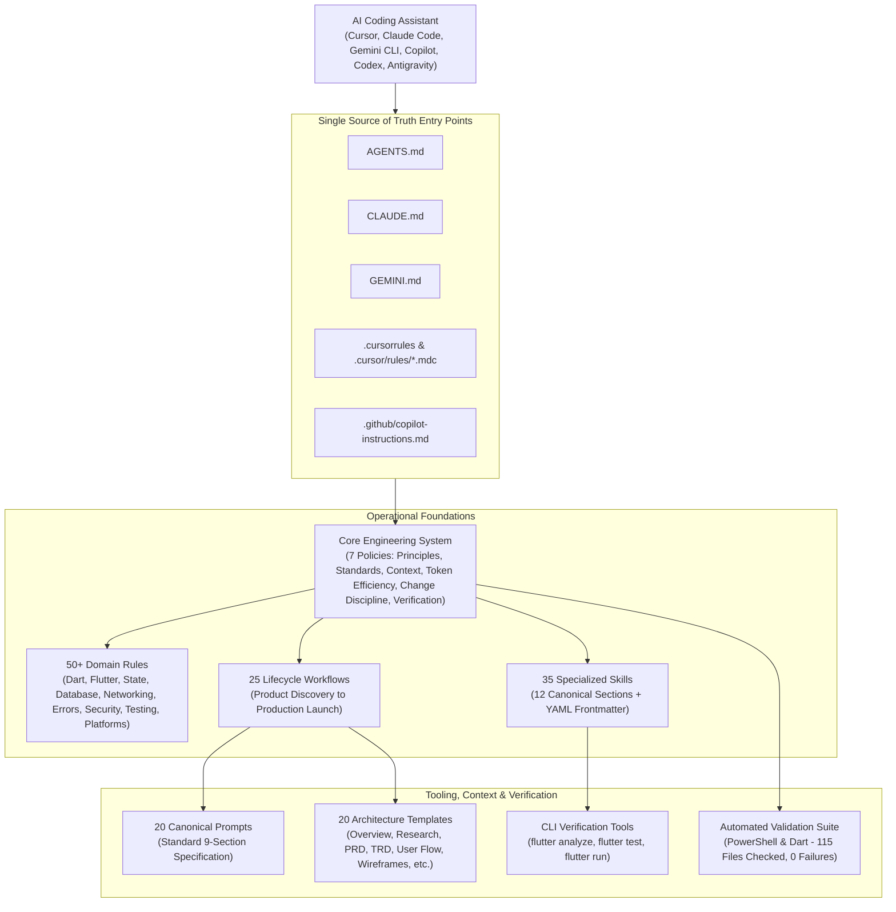

# Flutter Agent Kit 🚀

[](CHANGELOG.md)
[](LICENSE)
[](https://flutter.dev)
[](https://dart.dev)
[]()
[-brightgreen.svg)](docs/FINAL_QUALITY_AUDIT.md)
[](docs/AGENT_COMPATIBILITY.md)

A universal, production-ready engineering knowledge framework and operational toolkit that empowers AI coding assistants (**Cursor**, **Claude Code**, **Gemini CLI**, **GitHub Copilot**, **OpenAI Codex**, **Antigravity**) to architect, build, debug, optimize, review, and release high-performance Flutter and Dart applications with zero hallucinations, zero dummy data, and strict software craftsmanship.

---

## 💡 Why Flutter Agent Kit Exists

Standard AI coding agents struggle with Flutter beyond simple demos. Typical agent failure modes include:
- Hallucinating obsolete or non-existent packages.
- Rewriting entire 500-line files for a 3-line bug fix.
- Misusing `BuildContext` across asynchronous gaps without `mounted` checks.
- Generating static dummy records, fake statistics, or mock arrays in production code.
- Failing to handle all 4 mandatory UI states (Loading, Success, Empty, Error).
- Creating inconsistent UI styling, ad-hoc hex colors, and fragmented spacing.
- Overcrowding navigation bars with ambiguous icon-only buttons.
- Causing frame jank and memory leaks by omitting `const`, bloating `build()` methods, or forgetting controller `dispose()`.
- Treating desktop platforms like a mobile phone, ignoring single-instance mutex, DPI scaling, and system tray lifecycles.

The **Flutter Agent Kit** provides a battle-tested, structured engineering system that grounds AI agents in real production practices:
1. **Understand Before Building**: Non-destructive codebase discovery before modifying code (`core/project-understanding.md`).
2. **Surgical Precision**: Minimal correct vertical-slice diffs instead of destructive file rewrites (`core/change-discipline.md`).
3. **Modern Dart 3.x Standards**: Sound null safety, exhaustive pattern matching, sealed class hierarchies, and records (`core/engineering-standards.md`).
4. **Defense-in-Depth Error Handling**: Dual global interception hooks (`FlutterError.onError` + `PlatformDispatcher.onError`), typed sealed domain failures, and exponential retries with jitter (`skills/error-handling/`).
5. **Zero Dummy Data & Real Data Integrity**: Enforcing dynamic reactive data pipelines, honest empty states with CTAs, real calculated metrics, and isolated mocks (`docs/REAL_DATA_INTEGRITY.md`).
6. **Global Design Consistency**: Enforcing one unified visual identity across screens, 13 canonical color roles, 4pt/8pt spacing, reusable atomic components, and the 13-point design checklist (`docs/DESIGN_SYSTEM_STANDARDS.md`).
7. **Navigation Clarity & Discoverability**: Enforcing 3–5 mobile bottom nav destinations with visible text labels, unambiguous icons, action-descriptive a11y semantics, and destructive action confirmation (`docs/NAVIGATION_AND_ICON_STANDARDS.md`).
8. **Advanced Performance Engineering**: Algorithmic complexity analysis ($O(1)$ lookups, `StringBuffer`, lazy evaluations), pure `build()` methods, `const` subtrees, granular state rebuilds, resource disposal, image caching, and isolate offloading (`docs/PERFORMANCE_ENGINEERING_STANDARDS.md`).
9. **First-Class Windows Desktop Support**: Win32 single-instance mutex, Per-Monitor V2 DPI awareness, system tray utilities, window state machine precision, and signed MSIX packaging (`docs/WINDOWS_DEVELOPMENT.md`).
10. **Deterministic Proof of Work**: Mandatory verification via real CLI tools (`flutter analyze`, `flutter test`) with zero fabricated passes (`core/verification-policy.md`).
11. **Mandatory 15-Phase SDLC & Task Management**: Enforcing the 15-phase SDLC as the default lifecycle: $\text{Idea \& Research} \to \text{PRD} \to \text{User Flow} \to \text{Wireframe} \to \text{Design} \to \text{Architecture} \to \text{DB \& API} \to \text{Tasks} \to \text{Setup} \to \text{Development} \to \text{Integration} \to \text{Testing} \to \text{Security} \to \text{Deployment} \to \text{Maintenance}$ (`docs/TASK_MANAGEMENT_STANDARDS.md`).

---

## 🏛️ System Architecture



---

## 🛡️ The 5 Core Invariant Systems

The Flutter Agent Kit embeds five mandatory invariant systems across all agent entry points:

### 1. Zero Dummy Data & Real Data Integrity
- **Real Data Only**: AI agents must never introduce fake records, dummy metrics, or mock data fallbacks in production screens.
- **Honest Empty States**: Render an honest empty state with an actionable call-to-action button when zero records exist. Never populate fake records to make a screen look full.
- **Real Calculated Metrics**: All dashboard statistics and progress bars must be computed from actual database records.
- **Isolated Mocks**: Test fixtures and mocks remain 100% confined to `test/` and are never imported into `lib/`.
- *Specification*: [`docs/REAL_DATA_INTEGRITY.md`](docs/REAL_DATA_INTEGRITY.md) | Skill: `skills/real-data-integrity/` | Workflow: `workflows/real-data-audit/`

### 2. Global Design Consistency & Design System
- **One Coherent Design Language**: Every screen must feel like part of the same application with shared typography, colors, radii, and spacing.
- **Design System First**: Establish foundational tokens in `docs/DESIGN.md` across 13 color roles, typography scales, 4pt/8pt grid (`AppSpacing`), and corner radii (`AppRadii`).
- **Native Theming**: Hardcoding raw hex colors (`Color(0xFF...)`) or arbitrary margins inside widget files is strictly prohibited.
- **Atomic Component Reuse**: Reusable widgets (`AppButton`, `AppCard`, `AppTextField`, `AppEmptyState`, `AppErrorView`) reside in `lib/core/presentation/widgets/`.
- *Specification*: [`docs/DESIGN_SYSTEM_STANDARDS.md`](docs/DESIGN_SYSTEM_STANDARDS.md) | Skill: `skills/design-system/` | Workflow: `workflows/design-consistency-audit/`

### 3. Navigation Clarity, Icon Usability & Action Discoverability
- **3–5 Destinations Rule**: Mobile `NavigationBar` contains between 3 and 5 primary destinations with visible text labels. Secondary actions belong in menus or drawers.
- **No Mystery Meat Navigation**: Standalone `IconButton` widgets are restricted to universal conventions (Search, Back/Close, Settings, More, Play/Pause). Domain-specific actions must use visible text labels (`FilledButton.icon`, `OutlinedButton.icon`).
- **Action-Descriptive Accessibility Semantics**: Interactive icons must provide tooltips and semantic labels describing the action performed (`"Search transaction history"`), never the graphic name (`"search icon"`).
- **Destructive Action Confirmation**: Deletion and purge operations require explicit confirmation modals with red warning cues.
- *Specification*: [`docs/NAVIGATION_AND_ICON_STANDARDS.md`](docs/NAVIGATION_AND_ICON_STANDARDS.md) | Skill: `skills/navigation-clarity/` | Workflow: `workflows/navigation-usability-audit/`

### 4. Advanced Performance Engineering & Algorithmic Efficiency
- **Decision Hierarchy**: $\text{Correctness} > \text{Reliability} > \text{Maintainability} > \text{Measured Performance} > \text{Premature Optimization}$.
- **Computational Complexity**: Analyze Time and Auxiliary Space complexity. Pre-index collections with `Map`/`Set` ($O(1)$ lookups), use `StringBuffer` in loops, and evaluate iterables lazily.
- **Pure `build()` Methods**: Widget build methods must be pure functions with zero I/O, parsing, sorting, or heavy math. Maximize `const` subtrees.
- **Granular Rebuild Scoping**: Restrict rebuilds to the narrowest subtree using `context.select()`, `BlocSelector`, or `ValueListenableBuilder`.
- **Resource Disposal**: Explicitly dispose all controllers (`TextEditingController`, `AnimationController`, `ScrollController`, `FocusNode`), stream subscriptions, and timers in `dispose()`.
- **Image Decodes & Isolates**: Constrain decoded bitmaps with `cacheWidth`/`cacheHeight` factoring in DPR. Offload CPU-heavy operations ($> 8\,\text{ms}$) to `Isolate.run()`.
- *Specification*: [`docs/PERFORMANCE_ENGINEERING_STANDARDS.md`](docs/PERFORMANCE_ENGINEERING_STANDARDS.md) | Skill: `skills/performance-engineering/` | Workflow: `workflows/performance-audit/`

### 5. Task Management, In-Project Documentation & Incremental Execution
- **Plan First, Document Second, Implement Incrementally**: Never attempt to complete a large software project in one massive coding operation.
- **Hierarchical Task Breakdown**: Decompose requirements into Project $\to$ Modules $\to$ Features $\to$ Phases $\to$ Tasks in `tasks/TASKS.md` with explicit statuses.
- **Sequential Execution Loop**: Execute one task at a time; verify acceptance criteria and test coverage before moving to the next task.
- **In-Project Documentation Only**: All planning documents live inside `docs/` and `tasks/` in the project root. Never create global or temporary files.
- **Mandatory GitHub Protection**: Private AI documentation and task registries are excluded from Git via `.gitignore`.
- *Specification*: [`docs/TASK_MANAGEMENT_STANDARDS.md`](docs/TASK_MANAGEMENT_STANDARDS.md) | Skill: `skills/task-management/` | Workflow: `workflows/task-lifecycle/`

---

## 🤖 Multi-Agent Compatibility Matrix

The Flutter Agent Kit provides tailored entry points for all major AI coding environments:

| AI Agent / Tool | Entry File | Discovery Mechanism | Format & Features |
| :--- | :--- | :--- | :--- |
| **Cursor** | `.cursorrules` & `.cursor/rules/*.mdc` | Semantic file-match & glob triggers | Targeted rules triggered on `**/*.dart`, `test/**`, `windows/**` |
| **Claude Code** | `CLAUDE.md` | Automatic on CLI startup | Compact commands table, token-efficient surgical directives |
| **Gemini CLI** | `GEMINI.md` | Project root scan | Concentric-ring exploration leveraging 1M+ token context |
| **GitHub Copilot** | `.github/copilot-instructions.md` | Automatic IDE workspace scan | Concise inline completions & chat instructions |
| **OpenAI Codex / Antigravity** | `AGENTS.md` | Session initialization | Open Agent Skills format, universal decision hierarchy |

*See [docs/AGENT_COMPATIBILITY.md](docs/AGENT_COMPATIBILITY.md) for full configuration instructions.*

---

## 📦 What's Inside the Kit

### 1. Core Engineering System (`core/`)
The foundational policies governing AI agent behavior:
- `agent-principles.md`: The non-negotiable decision hierarchy and Karpathy engineering guidelines.
- `engineering-standards.md`: The single source of truth for Dart 3.x, Flutter composition, Greenfield/Brownfield patterns, and error handling.
- `project-understanding.md`: Non-destructive progressive disclosure and codebase inspection protocol.
- `context-management.md`: Managing context windows, concentric ring exploration, and state persistence.
- `token-efficiency.md`: Eliminating wasteful token dumping and optimizing interaction costs.
- `change-discipline.md`: Surgical vertical slice edits and zero collateral refactoring.
- `verification-policy.md`: Proof-of-work protocols, real test execution, and zero fake passes.

### 2. Specialized Skills System (35 Skills in `skills/`)
Each skill follows the open Agent Skills format with YAML frontmatter and 12 canonical sections:
- **Discovery & Architecture**: `project-analysis`, `task-management`, `flutter-architecture`, `dart-best-practices`.
- **UI & Graphics**: `ui-implementation`, `design-system`, `animations`, `custom-painter`, `responsive-design`.
- **Navigation & UX**: `navigation`, `navigation-clarity`.
- **Data & Networking**: `database-integration`, `api-integration`, `error-handling`, `real-data-integrity`.
- **State Management**: `state-management` (BLoC, Riverpod, Provider, ValueNotifier, GetX).
- **Platform & Systems**: `authentication`, `notifications`, `background-execution`, `file-system`, `desktop-development`, `windows-development`, `platform-channels`.
- **Quality & Verification**: `debugging`, `testing`, `golden-testing`, `code-review`, `security-audit`, `performance` (DevTools profiling & 60/120 FPS jank), `performance-engineering` (Big-O algorithmic complexity & memory lifecycles), `accessibility`, `localization`.
- **Release & Certification**: `packaging`, `msix-release`, `production-readiness`.

*See [docs/SKILLS_CATALOG.md](docs/SKILLS_CATALOG.md) for the complete directory.*

### 3. Engineering Lifecycle Workflows (25 Workflows in `workflows/`)
Step-by-step engineering protocols with Entry Conditions, Phased Procedures, and Exit Criteria:
1. `new-project`: Concept to runnable baseline.
2. `existing-project-analysis`: Deep brownfield codebase analysis.
3. `product-requirements`: PRD creation and scope boundary setting.
4. `architecture-planning`: Technical design and package slicing.
5. `design-system`: ThemeTokens and custom ThemeExtensions.
6. `database-integration`: Drift, Isar, and Hive persistence.
7. `api-integration`: Dio networking, interceptors, and error mapping.
8. `authentication`: Secure session management and biometric unlock.
9. `feature-development`: Vertical-slice implementation.
10. `ui-redesign`: Visual polish and 4 UI states implementation.
11. `refactoring`: Safe structural upgrades without regression.
12. `bug-investigation`: Triage and deterministic reproduction.
13. `real-data-audit`: Dummy data elimination and dynamic pipeline audit.
14. `root-cause-analysis`: 5-Whys diagnostic post-incident analysis.
15. `bug-fixing`: Surgical defect elimination and regression check.
16. `windows-desktop`: Single-instance mutex, DPI, tray, and toasts.
17. `testing-and-qa`: Automated unit, widget, golden, and integration QA.
18. `security-review`: Secret scanning and OWASP MASVS compliance.
19. `performance-review`: Rapid profiling, 60/120 FPS frame budget enforcement, and targeted jank remediation.
20. `release-preparation`: Obfuscated builds, signing, and packaging.
21. `production-audit`: 50-point pre-flight launch certification.
22. `design-consistency-audit`: Design drift detection, tokenization, and visual cohesion audit.
23. `navigation-usability-audit`: Icon clarity, action discoverability, a11y labels, and nav hierarchy audit.
24. `performance-audit`: Algorithmic complexity, memory lifecycle, rebuild scopes, and isolate concurrency audit.
25. `task-lifecycle`: Upfront analysis, in-project docs, task breakdown, sequential execution, and .gitignore protection.

*See [docs/WORKFLOWS.md](docs/WORKFLOWS.md) for the complete guide.*

### 4. Standardized Prompts Library (20 Prompts in `prompts/`)
All 20 prompts across 10 categories enforce the canonical 9-section context specification:
`PROJECT CONTEXT` | `OBJECTIVE` | `EXISTING BEHAVIOR` | `REQUIRED INVESTIGATION` | `CONSTRAINTS` | `ACCEPTANCE CRITERIA` | `EDGE CASES` | `TESTING REQUIREMENTS` | `EXPECTED OUTPUT`.

Categories:
- **Architecture**: `architecture-prompt.md`
- **Code Review**: `code-review-prompt.md`
- **Debugging**: `root-cause-prompt.md`, `vibe-fix-prompts.md`
- **Deployment**: `production-setup-prompt.md`, `monitoring-prompt.md`, `final-audit-prompt.md`
- **Feature Development**: `feature-prompt.md`, `auth-prompt.md`, `database-backend-prompt.md`
- **Performance**: `performance-optimization-prompt.md`, `algorithmic-efficiency-review.md`
- **Project Planning**: `prd-prompt.md`, `task-breakdown-prompt.md`
- **Security**: `security-hardening-prompt.md`
- **Testing**: `testing-qa-prompt.md`, `real-data-integrity-audit.md`
- **UI/UX**: `design-prompt.md`, `ui-redesign-prompt.md`, `design-consistency-audit.md`, `navigation-icon-audit.md`

### 5. Project Templates (20 Templates in `templates/`)
- `PROJECT_OVERVIEW.md`: Product vision, target audience, value proposition, and MVP scope (Phase 01).
- `RESEARCH.md`: Competitive analysis, market/technical feasibility research (Phase 01).
- `PRD.md`: Product Requirements Document template (Phase 02).
- `TRD.md`: Technical Requirements Document template (Phase 02).
- `USER_FLOW.md`: Navigation state machine, screen transitions, and user journeys (Phase 03).
- `SCREEN_LIST.md`: Inventory of all application screens, routes, and modal surfaces (Phase 03).
- `WIREFRAME.md`: Structural layout wireframes for all major screens and modals (Phase 04).
- `UI_UX_SPECIFICATION.md`: Interaction specifications, gesture behaviors, and accessibility (Phase 04).
- `DESIGN.md`: Complete Design System tokens specification (13 color roles, typography, spacing) (Phase 05).
- `ARCHITECTURE.md`: Architecture blueprint and system boundaries (Phase 06).
- `TECH_STACK.md`: Technology stack decision and trade-off analysis matrix (Phase 06).
- `DATABASE.md`: Schema, tables, relations, and indexing plan (Phase 07).
- `API.md`: REST/GraphQL contracts, endpoints, and error models (Phase 07).
- `TASKS.md`: Project execution roadmap with 13-field task specification schema (Phase 08).
- `IMPLEMENTATION_PLAN.md`: Phase roadmap, milestones, and deliverables (Phase 08).
- `TEST_PLAN.md`: Test strategy, coverage targets, and test matrices (Phase 12).
- `SECURITY.md`: Security controls, secret management, and threat model (Phase 13).
- `DECISIONS.md`: Architecture Decision Records (ADRs).
- `MEMORY.md`: Long-term project memory and agent state.
- `.env.example`: Secure environment variables blueprint.

### 6. Domain Engineering Rules (50+ Rules in `rules/`)
Deep technical guides across:
- `rules/dart/`: `effective-dart.md`, `null-safety.md`, `pattern-matching.md`, `async-concurrency.md`.
- `rules/flutter/`: `widget-lifecycle.md`, `build-context.md`, `layout-constraints.md`, `widget-keys.md`.
- `rules/architecture/`: `clean-architecture.md`, `feature-first.md`, `dependency-injection.md`, `modular.md`, `mvvm.md`.
- `rules/state-management/`: `bloc-cubit.md`, `riverpod.md`, `provider.md`, `value-notifier.md`, `getx.md`.
- `rules/database/`: `drift-sqlite.md`, `hive.md`, `isar.md`, `hive-isar.md`, `secure-storage.md`.
- `rules/networking/`: `dio-client.md`, `caching-offline.md`, `error-handling.md`.
- `rules/error-handling/`: `global-error-handling.md`, `domain-errors.md`, `recovery-retries.md`.
- `rules/security/`: `secrets-protection.md`, `data-sanitization.md`, `network-security.md`.
- `rules/testing/`: `unit-testing.md`, `widget-testing.md`, `golden-testing.md`, `mocking-guidelines.md`.
- `rules/performance/`: `const-constructors.md`, `jank-elimination.md`, `memory-leaks.md`.
- `rules/platform/`: `android/`, `ios/`, `macos/`, `linux/`, `web/`, `windows/`, `platform-channels.md`.

---

## 🪟 Dedicated Windows Desktop Engineering

The Flutter Agent Kit provides enterprise-grade Windows desktop capabilities:
- **Single-Instance Enforcement**: Native Win32 Mutex in `windows/runner/main.cpp` preventing duplicate processes and database file lock corruption.
- **Per-Monitor V2 DPI Awareness**: Configuring `DPI_AWARENESS_CONTEXT_PER_MONITOR_AWARE_V2` to ensure crisp text across mixed-scaling multi-monitor setups.
- **State Machine Precision**:
  $$\text{Window Closed} \ne \text{Window Minimized} \ne \text{System Tray} \ne \text{Background Service} \ne \text{Process Terminated}$$
- **System Tray Integration**: Persistent background utilities using `tray_manager` with customizable context menus.
- **Native Toast Notifications**: WinRT-backed notifications via `local_notifier` with foreground restoration callbacks.
- **Windows Registry Autostart**: Seamless startup on Windows user login (`HKCU\Software\Microsoft\Windows\CurrentVersion\Run`).
- **MSIX Packaging & Signing**: Automatic compilation and packaging of signed `.msix` installers using `dart run msix:create`.

*See [docs/WINDOWS_DEVELOPMENT.md](docs/WINDOWS_DEVELOPMENT.md) for the complete Windows guide.*

---

## 📚 Documentation Reference Library

| Document | Purpose |
| :--- | :--- |
| [`docs/GETTING_STARTED.md`](docs/GETTING_STARTED.md) | Step-by-step onboarding for new and brownfield projects |
| [`docs/AGENT_COMPATIBILITY.md`](docs/AGENT_COMPATIBILITY.md) | Multi-agent configuration guide (Cursor, Claude, Gemini, Copilot, Codex) |
| [`docs/REAL_DATA_INTEGRITY.md`](docs/REAL_DATA_INTEGRITY.md) | Zero Dummy Data policy & 12 prohibited practices |
| [`docs/DESIGN_SYSTEM_STANDARDS.md`](docs/DESIGN_SYSTEM_STANDARDS.md) | 13 color roles, typography scale, 4pt/8pt grid, and 13-point design checklist |
| [`docs/NAVIGATION_AND_ICON_STANDARDS.md`](docs/NAVIGATION_AND_ICON_STANDARDS.md) | 3–5 destinations rule, icon clarity, and 10-point navigation checklist |
| [`docs/PERFORMANCE_ENGINEERING_STANDARDS.md`](docs/PERFORMANCE_ENGINEERING_STANDARDS.md) | Big-O complexity, pure builds, isolate concurrency, and 15-point checklist |
| [`docs/WINDOWS_DEVELOPMENT.md`](docs/WINDOWS_DEVELOPMENT.md) | Win32 single-instance mutex, DPI awareness, tray, and MSIX packaging |
| [`docs/TASK_MANAGEMENT_STANDARDS.md`](docs/TASK_MANAGEMENT_STANDARDS.md) | Task breakdown, in-project documentation, sequential execution & .gitignore protection |
| [`docs/SKILLS_CATALOG.md`](docs/SKILLS_CATALOG.md) | Complete index and matrix of all 35 specialized skills |
| [`docs/WORKFLOWS.md`](docs/WORKFLOWS.md) | Complete directory and trigger conditions for all 25 workflows |
| [`docs/ARCHITECTURE.md`](docs/ARCHITECTURE.md) | System architecture blueprint and dependency relationships |
| [`docs/SKILL_SYSTEM_AUDIT.md`](docs/SKILL_SYSTEM_AUDIT.md) | Comprehensive audit report covering all skills, workflows, and rules |
| [`docs/FINAL_QUALITY_AUDIT.md`](docs/FINAL_QUALITY_AUDIT.md) | Formal quality certification & production launch audit |
| [`docs/AGENT_KIT_AUDIT.md`](docs/AGENT_KIT_AUDIT.md) | Phase 1 historical audit findings and remediation matrix |
| [`docs/EXTERNAL_RESEARCH.md`](docs/EXTERNAL_RESEARCH.md) | Ecosystem research and external benchmark analysis |
| [`docs/REFERENCE_AUDIT.md`](docs/REFERENCE_AUDIT.md) | Reference repository analysis and extraction catalog |
| [`docs/FAQ.md`](docs/FAQ.md) | Frequently asked questions and troubleshooting guide |

---

## 🧪 Automated Quality & Validation Suite

The kit includes automated validation tools that verify file integrity, skill manifests, YAML frontmatter, workflow completeness, and internal markdown link integrity:

```powershell
# 1. PowerShell Master Validator (103 files verified, 0 failures)
powershell -ExecutionPolicy Bypass -File scripts\PowerShell\validate-kit.ps1

# 2. Dart Structure & Manifest Integrity Validator
dart run scripts/validation/validate-structure.dart
```

### Standard Flutter Verification Commands
AI agents must execute and verify real CLI commands before claiming work is complete:

| Action | Command | Purpose |
| :--- | :--- | :--- |
| **Dart Static Analysis** | `flutter analyze` or `dart analyze` | Zero errors, zero warnings policy |
| **Run All Tests** | `flutter test` | Executes unit, widget, and state tests |
| **Run Targeted Test** | `flutter test test/features/auth/auth_bloc_test.dart` | Surgical verification of modified slice |
| **Test with Coverage** | `flutter test --coverage` | Generates LCOV coverage metrics |
| **Run Windows Desktop** | `flutter run -d windows` | Validates Windows desktop compilation |
| **Build Windows Release** | `flutter build windows --release` | Validates release compilation |
| **Create MSIX Package** | `dart run msix:create` | Generates signed Windows installer |

---

## 🚀 Quick Start: Using the Kit in 3 Steps

### Step 1: Add Configuration to Your Project
Copy or link the entry file matching your AI coding assistant into your Flutter project root:
- For **Cursor**: `.cursorrules` and `.cursor/rules/`
- For **Claude Code**: `CLAUDE.md`
- For **Gemini CLI**: `GEMINI.md`
- For **GitHub Copilot**: `.github/copilot-instructions.md`
- For **OpenAI Codex / Antigravity**: `AGENTS.md`

### Step 2: Onboard Your Agent
Prompt your agent to analyze the project non-destructively:
```text
Execute the Existing Project Analysis workflow (workflows/existing-project-analysis/WORKFLOW.md):
1. Inspect pubspec.yaml to identify SDK constraints and dependencies.
2. Inspect lib/ to determine the state management and architecture.
3. Report findings in docs/MEMORY.md without modifying any application code.
```

### Step 3: Implement with Surgical Precision
When asking your agent to build a feature or fix a bug:
```text
Implement [Feature Name] following core/change-discipline.md:
1. Follow the feature-development workflow (workflows/feature-development/WORKFLOW.md).
2. Adhere to the 4 UI states and the Zero Dummy Data standard.
3. Verify your work by running `flutter analyze` and `flutter test`.
```

---

## 📄 License & Attribution

Distributed under the [MIT License](LICENSE). 

Designed and maintained with engineering rigor. Portions of skills and behavioral discipline are synthesized from official Flutter documentation, Dart language specifications, and verified open-source engineering practices.
