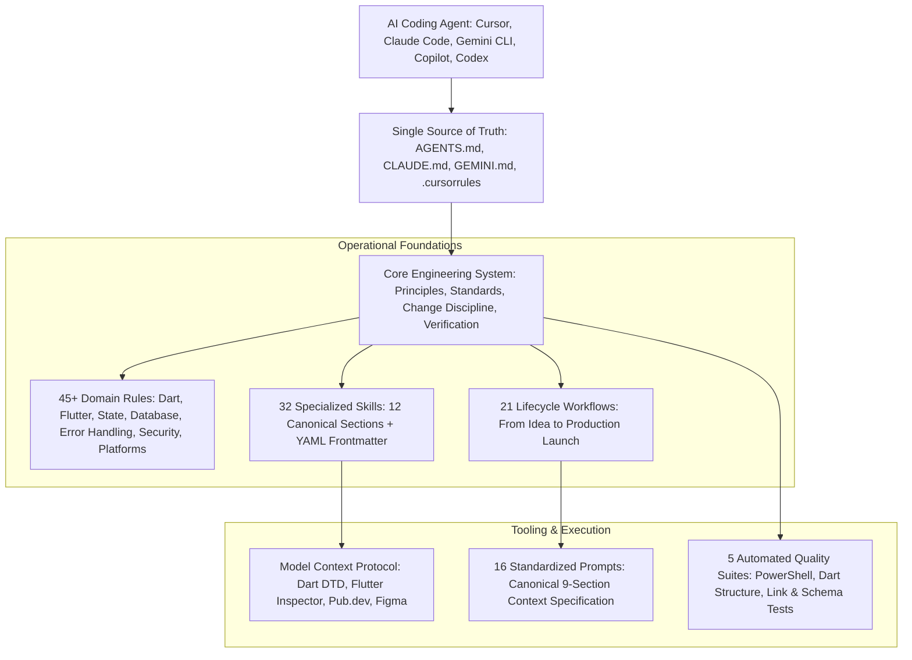

# Flutter Agent Kit 🚀

[](LICENSE)
[](https://flutter.dev)
[](https://dart.dev)
[]()
[](tests/AGENT_KIT_VALIDATION.md)

A universal, production-ready engineering system that empowers AI coding assistants (**Cursor**, **Claude Code**, **OpenAI Codex**, **Gemini CLI**, **GitHub Copilot**, **Antigravity**) to architect, build, debug, optimize, review, and release high-performance Flutter and Dart applications.

---

## 💡 Why Flutter Agent Kit Exists

Most AI coding agents struggle with Flutter beyond simple prototypes. They hallucinate non-existent packages, rewrite functioning code unnecessarily, misuse `BuildContext` across async gaps, fail to handle loading and empty states, cause `RenderFlex` overflows, and treat Windows Desktop like a mobile phone.

The **Flutter Agent Kit** transforms AI agents into disciplined, experienced Flutter engineers by providing:
1. **Understand Before Building**: Mandatory non-destructive project discovery before touching code (`core/project-understanding.md`).
2. **Surgical Precision**: Strict rules enforcing minimal correct diffs instead of destructive file rewrites (`core/change-discipline.md`).
3. **Sound Engineering Standards**: Modern Dart 3.x patterns, sound null safety, and clean separation of concerns (`core/engineering-standards.md`).
4. **Production Error Handling**: Dual global error interception (`FlutterError.onError` + `PlatformDispatcher.onError`), typed sealed failures, fallback UI, and safe exponential retries with jitter.
5. **First-Class Windows Desktop Support**: Native Win32 single-instance mutex, Per-Monitor V2 DPI awareness, system tray integration, window management, Toast notifications, registry autostart, and signed MSIX packaging.
6. **Deterministic Proof of Work**: A strict verification policy requiring real CLI checks (`flutter analyze`, `flutter test`) with zero fabricated passes (`core/verification-policy.md`).

---

## 🏛️ System Architecture



---

## 📦 What's Inside the Kit

### 1. Core Engineering System (`core/`)
- `agent-principles.md`: The 10 fundamental rules of AI agent development.
- `engineering-standards.md`: The single source of truth for Dart 3.x, Flutter widgets, Greenfield/Brownfield workflows, and error standards.
- `project-understanding.md`: Progressive disclosure and non-destructive codebase analysis.
- `context-management.md`: Managing context windows, concentric ring exploration, and state caching.
- `token-efficiency.md`: Eliminating wasteful token dumping and optimizing agent interaction cost.
- `change-discipline.md`: Surgical edits, vertical slices, and zero collateral refactoring.
- `verification-policy.md`: Proof-of-work protocols, real test execution, and zero fake passes.

### 2. Specialized Skills System (32 Skills in `skills/`)
Each skill follows the open Agent Skills format with YAML frontmatter and 12 canonical sections:
- **Discovery & Architecture**: `project-analysis`, `flutter-architecture`, `dart-best-practices`.
- **UI & Graphics**: `ui-implementation`, `design-system`, `animations`, `custom-painter`, `responsive-design`.
- **State & Routing**: `state-management`, `navigation`.
- **Data & Networking**: `database-integration`, `api-integration`, `error-handling`, `real-data-integrity`.
- **Platform & Systems**: `authentication`, `notifications`, `background-execution`, `file-system`, `desktop-development`, `windows-development`, `platform-channels`.
- **Quality & Verification**: `debugging`, `testing`, `golden-testing`, `code-review`, `security-audit`, `performance`, `accessibility`, `localization`.
- **Release & Certification**: `packaging`, `msix-release`, `production-readiness`.

*See [docs/SKILLS_CATALOG.md](docs/SKILLS_CATALOG.md) for the complete directory.*

### 3. Lifecycle Workflows (21 Workflows in `workflows/`)
Complete engineering protocols from product discovery to production release:
1. `new-project`: Concept to runnable baseline.
2. `existing-project-analysis`: Deep brownfield codebase analysis.
3. `product-requirements`: PRD creation and scope boundary setting.
4. `architecture-planning`: Technical design and package slicing.
5. `design-system`: ThemeTokens and custom ThemeExtensions.
6. `database-integration`: Drift, Isar, and Hive persistence.
7. `api-integration`: Dio networking, interceptors, and error mapping.
8. `authentication`: Secure session management and biometric unlock.
9. `feature-development`: Vertical-slice implementation.
10. `ui-redesign`: Visual polish and 4 UI states implementation.
11. `refactoring`: Safe structural upgrades without regression.
12. `bug-investigation`: Triage and deterministic reproduction.
13. `real-data-audit`: Dummy data elimination and dynamic pipeline audit.
14. `root-cause-analysis`: 5-Whys diagnostic post-incident analysis.
15. `bug-fixing`: Surgical defect elimination and regression check.
16. `windows-desktop`: Single-instance mutex, DPI, tray, and toasts.
17. `testing-and-qa`: Automated unit, widget, golden, and integration QA.
18. `security-review`: Secret scanning and OWASP MASVS compliance.
19. `performance-review`: 60/120 FPS profiling and isolate offloading.
20. `release-preparation`: Obfuscated builds, signing, and packaging.
21. `production-audit`: 50-point pre-flight launch certification.

*See [docs/WORKFLOWS.md](docs/WORKFLOWS.md) for the complete guide.*

### 4. Standardized 9-Section Prompts Library (`prompts/`)
All 16 prompts across 10 categories enforce the canonical 9-section context specification:
`PROJECT CONTEXT` | `OBJECTIVE` | `EXISTING BEHAVIOR` | `REQUIRED INVESTIGATION` | `CONSTRAINTS` | `ACCEPTANCE CRITERIA` | `EDGE CASES` | `TESTING REQUIREMENTS` | `EXPECTED OUTPUT`.

---

## 🪟 Dedicated Windows Desktop Engineering

The Flutter Agent Kit provides enterprise-grade Windows desktop capabilities:
- **Single-Instance Enforcement**: Native Win32 Mutex in `windows/runner/main.cpp` preventing duplicate processes and database file lock corruption.
- **Per-Monitor V2 DPI Awareness**: Configuring `DPI_AWARENESS_CONTEXT_PER_MONITOR_AWARE_V2` to ensure crisp text across mixed-scaling multi-monitor setups.
- **State Machine Precision**:
  $$\text{Window Closed} \ne \text{Window Minimized} \ne \text{System Tray} \ne \text{Background Service} \ne \text{Process Terminated}$$
- **System Tray Integration**: Persistent background utilities using `tray_manager` with customizable context menus.
- **Native Toast Notifications**: WinRT-backed notifications via `local_notifier` with foreground restoration callbacks.
- **Windows Registry Autostart**: Seamless startup on Windows user login (`HKCU\Software\Microsoft\Windows\CurrentVersion\Run`).
- **MSIX Packaging & Signing**: Automatic compilation and packaging of signed `.msix` installers using `dart run msix:create`.

*See [docs/WINDOWS_DEVELOPMENT.md](docs/WINDOWS_DEVELOPMENT.md) for the complete Windows guide.*

---

## 🧪 Automated Quality & Validation Suite

The kit includes an automated validation suite that verifies all skill manifests, YAML frontmatter, directory structures, and markdown link integrity:

```powershell
# 1. PowerShell Master Validator (91 files checked)
powershell -ExecutionPolicy Bypass -File scripts\PowerShell\validate-kit.ps1

# 2. Dart Structure & Manifest Integrity Validator
dart run scripts/validation/validate-structure.dart

# 3. Skill Frontmatter Test
dart run tests/validation/skill_schema_test.dart

# 4. Directory Structural Completeness Test
dart run tests/structure/structure_test.dart

# 5. Internal Markdown Link Validator (0 broken links)
dart run tests/links/link_validator_test.dart
```

*See [tests/AGENT_KIT_VALIDATION.md](tests/AGENT_KIT_VALIDATION.md) for full test evidence and thresholds.*

---

## 📄 License & Attribution

Distributed under the [MIT License](LICENSE). 

Designed and maintained with engineering rigor. Portions of skills and behavioral discipline are synthesized from official Flutter documentation, Dart language specifications, and verified open-source engineering practices.
