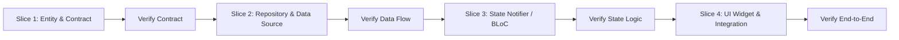

# Change Discipline & Minimal Diffs

This document defines the rules of change discipline: making surgical, verifiable modifications to Flutter codebases while preserving existing functionality and maintaining git hygiene.

---

## 1. The Surgical Change Doctrine

When modifying an existing codebase:
1. **Touch Only What You Must**: Limit changes to the minimum classes, functions, and lines required to implement the requirement or fix the bug.
2. **Never Refactor Working Unrelated Code**: If you encounter an adjacent widget that uses an older pattern or formatting, leave it alone. Do not refactor code outside your task scope.
3. **Match Existing Code Style**: Adopt the surrounding indentation, naming conventions, import ordering, and commenting density—even if it differs from your personal preference.
4. **Preserve Backward Compatibility**: Do not change public API signatures, route names, or database column names unless explicitly required.

---

## 2. Managing Orphans & Residue

When making modifications:
- **Clean Up Your Own Orphans**: If your changes render an import, local variable, or private helper unused, delete it immediately.
- **Do Not Delete Others' Dead Code**: If you notice unrelated unused code in a file you are touching, mention it in your final report; do not delete it unilaterally.
- **Remove Temporary Diagnostics**: Ensure all temporary `print()`, `debugPrint()`, or dummy fallback values are removed before completing the task.

---

## 3. Vertical Slice Implementation Strategy

Never attempt to build an entire feature by writing all backend models, all controllers, and all UI screens in one unverified step. Instead, build and verify in **vertical slices**:

### Why Vertical Slices Prevent AI Failures
1. If a compilation or logic error occurs, the cause is immediately isolated to the current small slice.
2. The agent avoids juggling 15 open files simultaneously.
3. Tests can be written and verified incrementally at each layer.

---

## 4. Git Hygiene & Rollback Readiness
- Run `git status` or `git diff` mentally before reporting completion.
- Verify that only intended files are modified.
- Keep commits focused on a single logical change with conventional commit messages (e.g., `feat(auth): add biometric login toggle`, `fix(navigation): prevent duplicate route pushes`).
