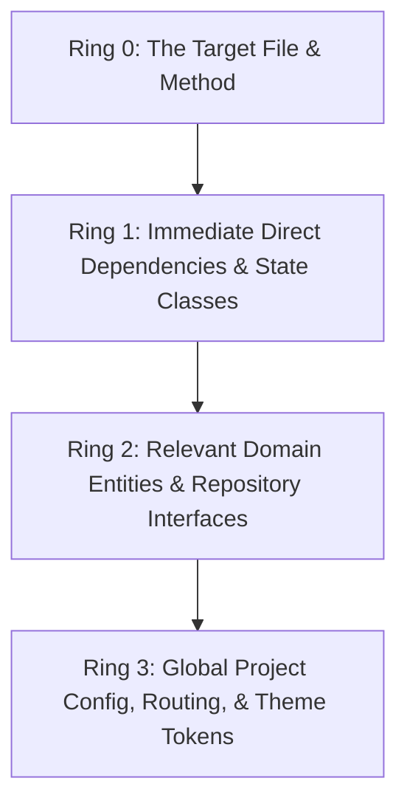

# Context Management & Budget Control

This document defines how AI coding agents must manage their prompt context window, prevent context pollution, and handle progressive context expansion during Flutter development.

---

## 1. The Principle of Minimal Context

AI coding agents perform best when provided with high-signal, relevant context rather than an uncurated dump of the entire repository. Unnecessary context increases inference latency, raises API costs, and degrades agent focus.

### The Concentric Radius Model
Agents must gather context in expanding concentric rings:

1. **Ring 0 (Target Focus)**: Read only the specific file or method that directly implements the requested behavior.
2. **Ring 1 (Immediate Dependencies)**: If Ring 0 imports a specific state class, cubit, or entity, read that imported file.
3. **Ring 2 (Contracts & Services)**: Read repository interfaces or data source contracts only when modifying data access.
4. **Ring 3 (Project Foundation)**: Read `pubspec.yaml`, route definitions, or theme tokens only when adding new dependencies, routes, or global styling.

---

## 2. Anti-Patterns to Strictly Avoid

- **Full-Repository Scans**: Never run recursive grep or whole-directory reads on large folders like `.dart_tool/`, `build/`, `windows/flutter/ephemeral/`, or `ios/Pods/`.
- **Repeatedly Reading Unchanged Files**: If a file was read in a previous turn of the same task, do not re-read it unless another tool or user has modified it.
- **Dumping Generated Code**: Never inject large generated files (`*.g.dart`, `*.freezed.dart`, `*.mocks.dart`) into context unless explicitly debugging a code-generation compilation error.
- **Bloated Conversational Summaries**: Do not output multi-page summaries of everything discovered. State findings concisely.

---

## 3. Managing Long-Running Sessions

When working on complex, multi-step Flutter features:
1. **Maintain `docs/MEMORY.md`**: Store persistent state, current tasks, and architectural decisions in `docs/MEMORY.md`.
2. **Commit Incremental Changes**: After verifying a vertical slice (e.g., Data Layer complete and tested), commit the code with git. This creates a clean rollback point and keeps the working diff small.
3. **Recommend Context Compaction**: When conversational turns exceed 20+ steps, recommend the user compact context or start a fresh prompt targeting the next item in `docs/TASKS.md`.
