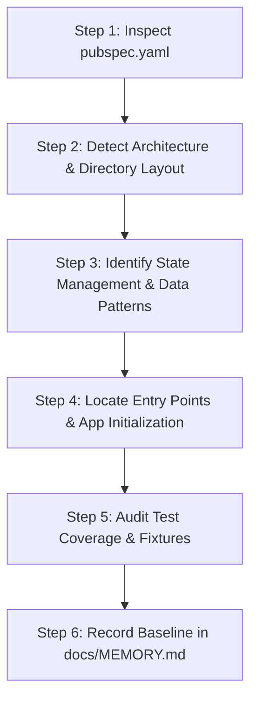

# Project Understanding Protocol

This document defines the mandatory discovery protocol an AI coding agent must execute when onboarding into an existing Flutter project before making any code modifications.

---

## 1. The Non-Destructive Discovery Rule

> [!IMPORTANT]
> **Observation Precedes Modification.**
> When starting in an existing codebase, the agent's first priority is to discover and understand the project's architecture, dependencies, state management approach, conventions, and test suite. Modifying code during the discovery phase is strictly prohibited.

---

## 2. Step-by-Step Discovery Protocol

### Step 1: Inspect `pubspec.yaml`
1. **Dart SDK Constraints**: Check the environment sdk constraint (`environment: sdk: ^3.x.y`) to determine supported Dart features.
2. **Core Dependencies**:
   - State management: `flutter_bloc`, `flutter_riverpod`, `provider`, `get`, `mobx`.
   - Routing: `go_router`, `auto_route`, or native `Navigator 2.0`.
   - Networking: `dio`, `http`, `retrofit`.
   - Persistence: `drift`, `hive`, `isar`, `shared_preferences`, `flutter_secure_storage`.
   - Platform packages: `window_manager`, `tray_manager`, `local_notifier`, `win32`.
3. **Dev Dependencies**: Note testing frameworks (`mocktail`, `mockito`, `patrol`, `golden_toolkit`) and code generators (`build_runner`, `freezed`, `json_serializable`).

### Step 2: Detect Architecture & Directory Layout
Inspect `lib/` directory structure:
- **Feature-First Architecture**: `lib/features/<feature_name>/{data, domain, presentation}`.
- **Layer-First Architecture**: `lib/{models, views, controllers, services}`.
- **Clean Architecture**: `lib/core/` alongside independent feature layers with explicit UseCase boundaries.

### Step 3: Identify State Management & Data Patterns
- Locate existing state stores or notifiers.
- Observe how dependencies are injected: `get_it`, `riverpod` providers, or `InheritedWidget`/`Provider`.
- Check how data flows between repositories and the UI.

### Step 4: Locate Entry Points & App Initialization
- Read `lib/main.dart` and `lib/app.dart`.
- Inspect asynchronous initialization: database warming, Firebase initialization, window manager setup, environment configuration loading.

### Step 5: Audit Test Suite
- Check `test/` directory.
- Determine if tests are unit tests, widget tests, or integration tests.
- Identify how test mocks are defined (e.g., `class MockAuthRepository extends Mock implements AuthRepository {}`).

### Step 6: Record Baseline in `docs/MEMORY.md`
Summarize the discovered project architecture, state management library, routing strategy, and known constraints in `docs/MEMORY.md`.

---

## 3. Ambiguity Resolution Protocol

If a project's architecture is ambiguous or mixed:
1. Identify the pattern used in the most recently authored feature files.
2. If multiple conflicting patterns exist, ask the user a single, concise clarification question:
   > *"I noticed this project contains both Provider and BLoC. Should new work on [Feature] follow the BLoC pattern established in `lib/features/auth` or the Provider pattern in `lib/features/settings`?"*
3. Never silently refactor an entire application from one state management library to another.
