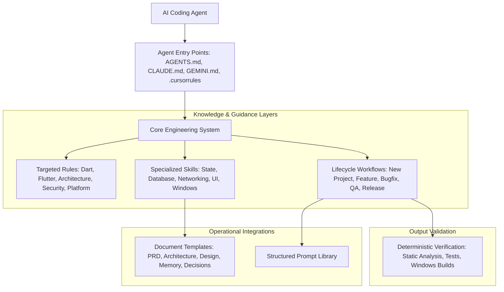

# Flutter Agent Kit: Architectural Blueprint

This document specifies the system architecture, component taxonomy, multi-agent design, and execution model of the **Flutter Agent Kit**.

---

## 1. Executive Overview

The **Flutter Agent Kit** is an open-standard, multi-agent engineering framework designed to guide AI coding agents (OpenAI Codex, Cursor, Claude Code, Gemini CLI, GitHub Copilot, Antigravity) through the complete lifecycle of production-grade Flutter and Dart applications.

Rather than relying on vague prompts or scattered rule files, the Agent Kit establishes a deterministic, layered engineering system:



---

## 2. Directory Layout & Layer Responsibilities

```text
flutter-agent-kit/
│
├── AGENTS.md                   # Universal entry point for Codex, Antigravity, OpenCode
├── CLAUDE.md                   # Compact entry point for Claude Code CLI
├── GEMINI.md                   # Compact entry point for Gemini CLI
├── .cursorrules                # Legacy & universal rules for Cursor
├── .cursor/rules/              # Modern Cursor .mdc rules for targeted auto-attachment
│
├── core/                       # Foundational engineering discipline (Always Enforced)
│   ├── agent-principles.md     # First principles: Think before coding, understand before building
│   ├── engineering-standards.md# Dart & Flutter code quality, null safety, error hygiene
│   ├── project-understanding.md# Context discovery & repository onboarding protocol
│   ├── context-management.md   # Progressive context expansion & budget controls
│   ├── token-efficiency.md     # Anti-bloat rules & targeted inspection tactics
│   ├── change-discipline.md    # Surgical changes, rollback safety, minimal diffs
│   └── verification-policy.md  # Proof-of-work: analyze, test, verify before reporting
│
├── rules/                      # Domain-specific constraints (Read on demand)
│   ├── dart/                   # Modern Dart 3.x, patterns, records, sealed classes, async
│   ├── flutter/                # Widget composition, keys, build context, layout constraints
│   ├── architecture/           # Feature-first, Clean Architecture, Repository pattern, DI
│   ├── ui-ux/                  # Material 3, custom themes, design tokens, responsive layout
│   ├── state-management/       # BLoC, Riverpod, Provider, ValueNotifier, ChangeNotifier
│   ├── database/               # Drift (SQLite), Hive, Isar, SecureStorage, SharedPreferences
│   ├── networking/             # Dio, HTTP, error mapping, caching interceptors, offline sync
│   ├── security/               # Secret isolation, secure storage, SSL pinning, permissions
│   ├── testing/                # Unit, widget, integration, mocking with mocktail, patrol
│   ├── performance/            # 60/120 FPS jank elimination, memory leaks, const constructors
│   └── platform/               # Platform-specific quirks & native boundaries
│       ├── windows/            # Win32, MSIX, system tray, notifications, window manager
│       ├── macos/              # Sandboxing, entitlements, Apple notarization
│       ├── linux/              # GTK, desktop files, DBus
│       ├── android/            # Gradle, ProGuard/R8, permissions, APK/AAB
│       ├── ios/                # CocoaPods, Swift Package Manager, signing, provisioning
│       └── web/                # CanvasKit, WASM, web renderer, PWA
│
├── skills/                     # Actionable procedures (Self-contained SKILL.md modules)
│   ├── project-analysis/       # Non-destructive project discovery & architecture diagnosis
│   ├── flutter-architecture/   # Layered clean architecture & feature-first implementations
│   ├── dart-best-practices/    # Idiomatic Dart 3 programming & functional patterns
│   ├── ui-implementation/      # Production widget building, micro-interactions, layouts
│   ├── design-system/          # Themes, typography scale, spacing grids, theme extensions
│   ├── responsive-design/      # Breakpoints, LayoutBuilder, adaptive master-detail views
│   ├── state-management/       # Reactive state refactoring, selector optimization
│   ├── navigation/             # Declarative routing with go_router, deep links, guards
│   ├── database-integration/   # Drift type-safe SQL, schema migrations, indexing
│   ├── api-integration/        # REST, WebSockets, Dio interceptors, auto-retries
│   ├── authentication/         # Token lifecycles, OAuth, biometrics, auto-refresh tokens
│   ├── notifications/          # Local notifications, push messaging, payload routing
│   ├── background-execution/   # Isolates, background tasks, workmanager, native services
│   ├── file-system/            # PathProvider, cross-platform file I/O, cache directories
│   ├── desktop-development/    # Desktop ergonomics, keyboard shortcuts, multi-window
│   ├── windows-development/    # System tray, Windows toast, startup registry, Win32 API
│   ├── debugging/              # Root cause isolation, stacktrace symbolization, layout overflow
│   ├── testing/                # Test fixtures, golden tests, WidgetTester, mocktail
│   ├── code-review/            # Severity-tiered reviews: Critical, High, Medium, Low
│   ├── security-audit/         # Threat modeling, secret leaks, reverse-engineering defense
│   ├── performance/            # DevTools timeline, memory snapshotting, repainting isolation
│   ├── performance-engineering/# Algorithmic efficiency, Big-O complexity, memory lifecycles, isolate concurrency
│   ├── accessibility/          # Semantics, screen readers, minimum tap targets, high contrast
│   ├── localization/           # intl, ARB translation files, l10n code generation
│   ├── packaging/              # Release builds, obfuscation, split debug info
│   ├── msix-release/           # Windows MSIX packaging, Store manifests, self-signing
│   └── production-readiness/   # 50-point pre-flight checklist before production deployment
│
├── workflows/                  # 24 End-to-end multi-step procedures (inc. performance-audit)
├── prompts/                    # 19 Standardized prompts (9-section context specification)
├── templates/                  # Standardized project documentation blueprints (PRD, DESIGN, etc.)
├── scripts/                    # Automation & validation scripts
└── docs/                       # Comprehensive documentation (inc. PERFORMANCE_ENGINEERING_STANDARDS.md)
```

---

## 3. Engineering Philosophy & Decision Hierarchy

The Flutter Agent Kit is built upon a non-negotiable decision hierarchy:

$$\text{Correctness} > \text{Requirement Compliance} > \text{Existing Code Consistency} > \text{Security/Reliability} > \text{Maintainability} > \text{Token Efficiency} > \text{Minimal Output}$$

### Key Engineering Invariants
1. **Understand Before Building**: An agent must never write or modify code before identifying the project's existing architecture, dependencies, state management solution, and naming conventions.
2. **Surgical Precision**: Changes must be isolated to the minimum lines necessary to achieve the requirement. Adjacent code, unrelated formatting, and functioning abstractions must not be refactored without explicit user instruction.
3. **Zero Speculative Abstraction**: Agents must never introduce design patterns, interfaces, generic wrappers, or utility classes for single-use implementations.
4. **Verified Completion**: A task is never marked complete until appropriate verification commands (`flutter analyze`, `flutter test`, or release compilation) have run and passed with zero errors.
5. **Real Data Integrity**: Never introduce fake dummy records, static sample arrays, or fabricated metrics in production code. UI components must subscribe reactively to real application state with honest empty and error states (`docs/REAL_DATA_INTEGRITY.md`).
6. **Global Design Consistency**: Every application must maintain one coherent visual identity across all screens. Bind all UI to centralized design tokens, 4pt/8pt modular spacing (`AppSpacing`), and reusable components; verify the 13-point design checklist (`docs/DESIGN_SYSTEM_STANDARDS.md`).
7. **Navigation Clarity & Action Discoverability**: Keep 3–5 mobile bottom nav destinations with visible labels. Restrict icon-only buttons to universal conventions; provide action-descriptive accessibility labels and require confirmation modals for destructive operations (`docs/NAVIGATION_AND_ICON_STANDARDS.md`).
8. **Performance Engineering & Algorithmic Efficiency**: Every implementation must consider Time and Auxiliary Space complexity. Enforce $O(1)$ lookups, `StringBuffer` in loops, pure `build()` methods, `const` subtrees, granular state rebuilds, resource disposal, image memory constraints, and isolate offloading (`docs/PERFORMANCE_ENGINEERING_STANDARDS.md`).

---

## 4. Multi-Agent Interoperability

Different AI coding tools read context in distinct manners. The Flutter Agent Kit maintains a single source of truth while accommodating the execution formats of major AI tools:

| Agent Harness | Entry File | Discovery Mechanism |
| :--- | :--- | :--- |
| **OpenAI Codex / Antigravity** | `AGENTS.md` | Read on session start; references `core/` and `skills/` |
| **Claude Code** | `CLAUDE.md` | Read automatically by CLI; concise instruction hooks |
| **Gemini CLI** | `GEMINI.md` | Session initialization context; points to `core/` |
| **Cursor** | `.cursorrules` & `.cursor/rules/*.mdc` | Semantic file-matching and global rule evaluation |
| **GitHub Copilot** | `.github/copilot-instructions.md` | Read automatically in VS Code / JetBrains workspaces |

---

## 5. Desktop-First & Windows Specialization

Flutter for desktop requires distinct architectural considerations from mobile:
- **Window State Machine**: Window Closed $\ne$ Minimized $\ne$ System Tray $\ne$ Process Terminated.
- **Hardware Integration**: High-DPI scaling, hardware acceleration flags, multi-monitor coordinates.
- **Operating System Services**: Windows Task Scheduler for background jobs when the UI process exits, system tray minimization for persistent desktop utilities, and MSIX packaging for enterprise deployment.
