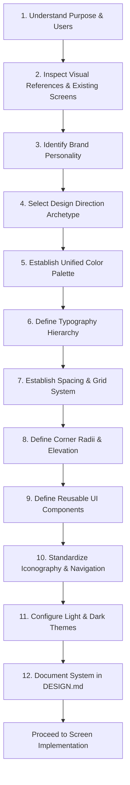
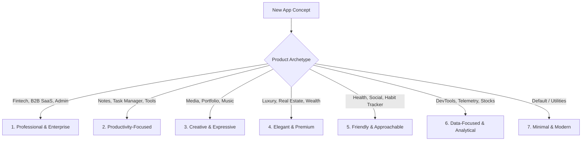

# Global Design Consistency & Design System Specification (DESIGN_SYSTEM_STANDARDS.md)

This document establishes the mandatory engineering standards, architectural patterns, token structures, and audit protocols for the **Global Design Consistency System** in the **Flutter Agent Kit**.

All AI coding agents (Cursor, Claude Code, OpenAI Codex, Gemini CLI, GitHub Copilot, Antigravity) must strictly adhere to these standards when creating, modifying, reviewing, or refactoring Flutter UI screens and components.

---

## 1. Core Design Principle: One Coherent Visual Identity

Every Flutter application must embody **one coherent visual identity**. 

While different screens serve distinct functional purposes (e.g., analytical dashboards, form inputs, settings lists, interactive maps), they must all feel like natural parts of the same cohesive product.

A professional Flutter application maintains:
1. **One Consistent Design Language**: Unified aesthetic, surface treatment, elevation model, and density.
2. **One Primary Color System**: Standardized semantic roles for light and dark modes derived from a central brand seed or explicit palette.
3. **One Typography System**: Scaled typographic hierarchy (`TextTheme`) using consistent font families, weights, letter spacings, and line heights.
4. **Consistent Spacing**: A strict 4pt/8pt modular grid (`AppSpacing`) governing margins, paddings, and flex gaps.
5. **Consistent Corner Radii**: Standardized geometric shapes across buttons, cards, text fields, dialogs, and sheets.
6. **Consistent Button Hierarchy**: Distinct, predictable styles for Primary, Secondary, Outlined, and Text/Ghost buttons.
7. **Consistent Card Styles**: Unified elevation, outline borders, inner padding, and hover states.
8. **Consistent Iconography**: A single icon family with uniform stroke weights, optical bounding boxes, and visual metaphors.
9. **Consistent Form Inputs & Dialogs**: Uniform border states (idle, focused, error, disabled) and modal treatments.
10. **Consistent Navigation Patterns**: Predictable navigation structures matching the platform (Bottom Bar on Mobile, Navigation Rail on Tablet, Persistent Sidebar on Desktop).
11. **Light & Dark Theme Parity**: Purposeful theme variants sharing the same design language without hard-coded color leaks.
12. **Purposeful Micro-Interactions**: Subtle, non-distracting animations reinforcing user feedback.

> [!IMPORTANT]
> **The Cohesion Invariant**: The objective is not to force every screen to look identical; the objective is to ensure every screen **feels like part of the same application**. AI agents must never independently invent unique buttons, cards, typography, or color palettes on isolated screens.

---

## 2. Mandatory Design System First Protocol

Before writing or modifying UI screen code, the AI agent must execute this 12-step discovery and tokenization protocol:



1. **Understand Purpose & Audience**: Identify what problem the app solves, who uses it, lighting environments (e.g. dark warehouse vs bright outdoors), and device form factors.
2. **Inspect Existing Screens**: Scan `lib/` for existing `ThemeData`, custom widgets, and established design tokens. Never invent new styles if an existing system is present.
3. **Identify Brand Personality**: Characterize the product (e.g., authoritative, playful, technical, tranquil).
4. **Select Appropriate Design Direction**: Choose from the 7 design direction archetypes (Section 6).
5. **Establish Unified Color Palette**: Define primary, secondary, neutral, and semantic colors.
6. **Define Typography Scale**: Map font family, weights, and sizes to Flutter's canonical `TextTheme`.
7. **Define Spacing Scale**: Standardize on the 4pt/8pt modular grid.
8. **Define Corner Radii & Elevation**: Standardize shape tokens for buttons, cards, inputs, and modals.
9. **Define Reusable Components**: Establish core buttons, inputs, cards, and feedback views.
10. **Define Iconography & Navigation**: Select one icon family and consistent responsive navigation wrappers.
11. **Configure Light & Dark Themes**: Ensure 100% color role parity and WCAG AA contrast in both modes.
12. **Document System**: Persist tokens in `docs/DESIGN.md` (using `templates/DESIGN.md`) before writing screen widgets.

---

## 3. Global Design Tokens Specification

Every application design system must tokenize six foundational layers:

### 3.1 Color Tokens (13 Canonical Roles)

All application colors must map to one of the 13 canonical color roles in both Light and Dark themes:

| Color Role | Semantic Purpose | Light Example (Hex) | Dark Example (Hex) | Flutter Theme Mapping |
| :--- | :--- | :--- | :--- | :--- |
| **Primary** | Key interactive elements, primary buttons, active state | `#4F46E5` (Indigo 600) | `#818CF8` (Indigo 400) | `colorScheme.primary` |
| **OnPrimary** | Text/icons displayed on top of Primary | `#FFFFFF` | `#0F172A` | `colorScheme.onPrimary` |
| **Secondary** | Secondary accents, floating action buttons, chips | `#06B6D4` (Cyan 600) | `#22D3EE` (Cyan 400) | `colorScheme.secondary` |
| **Tertiary** | Contrasting accents, highlights, badges | `#EC4899` (Pink 600) | `#F472B6` (Pink 400) | `colorScheme.tertiary` |
| **Background** | Underlying screen canvas | `#F8FAFC` (Slate 50) | `#0B0F19` (Slate 950) | `colorScheme.surface` |
| **Surface** | Cards, sheets, dialogs, app bars | `#FFFFFF` (White) | `#1E293B` (Slate 800) | `colorScheme.surfaceContainer` |
| **Surface Variant** | Form input fills, table header rows, secondary cards | `#F1F5F9` (Slate 100) | `#334155` (Slate 700) | `colorScheme.surfaceContainerHigh`|
| **Text Primary** | High-emphasis body copy, headings | `#0F172A` (Slate 900) | `#F8FAFC` (Slate 50) | `colorScheme.onSurface` |
| **Text Secondary** | Medium-emphasis captions, subtitles, helper text | `#64748B` (Slate 500) | `#94A3B8` (Slate 400) | `colorScheme.onSurfaceVariant` |
| **Border / Outline** | Card borders, dividers, inactive text field outlines | `#E2E8F0` (Slate 200) | `#334155` (Slate 700) | `colorScheme.outlineVariant` |
| **Success** | Successful operations, completed states, positive trends | `#10B981` (Emerald 500)| `#34D399` (Emerald 400)| `ThemeExtension` (Success) |
| **Warning** | Cautionary notices, pending tasks, warning badges | `#F59E0B` (Amber 500) | `#FBBF24` (Amber 400) | `ThemeExtension` (Warning) |
| **Error** | Form validation errors, failed requests, destructive actions| `#EF4444` (Red 500) | `#F87171` (Red 400) | `colorScheme.error` |
| **Disabled** | Inactive buttons, disabled inputs, muted labels | `#CBD5E1` (Slate 300) | `#475569` (Slate 600) | `colorScheme.onSurface.withOpacity(0.38)` |

### 3.2 Typography Tokens

Typography must map strictly to Flutter's `TextTheme`. Never instantiate ad-hoc `TextStyle(fontSize: 17.5, color: Colors.blue)` inside individual widgets.

```dart
abstract final class AppTypography {
  static const String fontFamily = 'Inter'; // Or platform system font

  static TextTheme textTheme(ColorScheme colorScheme) {
    return TextTheme(
      // Display: Hero banners, landing screens
      displayLarge: TextStyle(fontFamily: fontFamily, fontSize: 57, fontWeight: FontWeight.bold, color: colorScheme.onSurface, letterSpacing: -0.25),
      displayMedium: TextStyle(fontFamily: fontFamily, fontSize: 45, fontWeight: FontWeight.bold, color: colorScheme.onSurface),
      displaySmall: TextStyle(fontFamily: fontFamily, fontSize: 36, fontWeight: FontWeight.bold, color: colorScheme.onSurface),
      
      // Headlines: Screen headers, major sections
      headlineLarge: TextStyle(fontFamily: fontFamily, fontSize: 32, fontWeight: FontWeight.w700, color: colorScheme.onSurface),
      headlineMedium: TextStyle(fontFamily: fontFamily, fontSize: 28, fontWeight: FontWeight.w600, color: colorScheme.onSurface),
      headlineSmall: TextStyle(fontFamily: fontFamily, fontSize: 24, fontWeight: FontWeight.w600, color: colorScheme.onSurface),

      // Titles: Card titles, dialog headers, list section headers
      titleLarge: TextStyle(fontFamily: fontFamily, fontSize: 22, fontWeight: FontWeight.w600, color: colorScheme.onSurface),
      titleMedium: TextStyle(fontFamily: fontFamily, fontSize: 16, fontWeight: FontWeight.w600, color: colorScheme.onSurface, letterSpacing: 0.15),
      titleSmall: TextStyle(fontFamily: fontFamily, fontSize: 14, fontWeight: FontWeight.w600, color: colorScheme.onSurface, letterSpacing: 0.1),

      // Body: General reading text, table cells, descriptions
      bodyLarge: TextStyle(fontFamily: fontFamily, fontSize: 16, fontWeight: FontWeight.normal, color: colorScheme.onSurface, height: 1.5),
      bodyMedium: TextStyle(fontFamily: fontFamily, fontSize: 14, fontWeight: FontWeight.normal, color: colorScheme.onSurface, height: 1.4),
      bodySmall: TextStyle(fontFamily: fontFamily, fontSize: 12, fontWeight: FontWeight.normal, color: colorScheme.onSurfaceVariant, height: 1.3),

      // Labels: Buttons, chip labels, navigation items
      labelLarge: TextStyle(fontFamily: fontFamily, fontSize: 14, fontWeight: FontWeight.w600, color: colorScheme.onSurface, letterSpacing: 0.1),
      labelMedium: TextStyle(fontFamily: fontFamily, fontSize: 12, fontWeight: FontWeight.w500, color: colorScheme.onSurface, letterSpacing: 0.5),
      labelSmall: TextStyle(fontFamily: fontFamily, fontSize: 11, fontWeight: FontWeight.w500, color: colorScheme.onSurfaceVariant, letterSpacing: 0.5),
    );
  }
}
```

### 3.3 Spacing Scale (4pt/8pt Modular Grid)

All layout paddings, margins, and gaps must strictly consume the `AppSpacing` tokens:

```dart
abstract final class AppSpacing {
  static const double xxs = 4.0;   // Micro gap: badge padding, icon-text gap
  static const double xs  = 8.0;   // Tight spacing: chip padding, list item inner gap
  static const double sm  = 12.0;  // Compact spacing: card inner content padding
  static const double md  = 16.0;  // Standard layout padding: screen margins on mobile, card padding
  static const double lg  = 24.0;  // Section spacing: gap between major card groups
  static const double xl  = 32.0;  // Wide spacing: modal padding, page headers
  static const double xxl = 48.0;  // Hero spacing: desktop margins, empty state vertical gap
}
```

### 3.4 Shapes & Corner Radii

Never use arbitrary numbers like `BorderRadius.circular(13.7)`. Standardize on five geometric tokens:

```dart
abstract final class AppRadii {
  static const double none = 0.0;
  static const double sm   = 6.0;   // Small controls: tags, badges, progress bars
  static const double md   = 10.0;  // Medium controls: text fields, standard buttons
  static const double lg   = 16.0;  // Large containers: cards, dialogs, bottom sheets
  static const double xl   = 24.0;  // Floating surfaces: modal bottom sheets, banners
  static const double full = 999.0; // Pill buttons, avatars, circular chips

  static BorderRadius get radiusSm => BorderRadius.circular(sm);
  static BorderRadius get radiusMd => BorderRadius.circular(md);
  static BorderRadius get radiusLg => BorderRadius.circular(lg);
  static BorderRadius get radiusXl => BorderRadius.circular(xl);
  static BorderRadius get radiusFull => BorderRadius.circular(full);
}
```

### 3.5 Elevation & Borders

Material 3 uses surface tint and outline borders in place of heavy drop shadows:
- **Elevation 0 (Flat)**: Standard cards on surface background with an outline border (`colorScheme.outlineVariant`).
- **Elevation 1 (Resting)**: Floating action buttons, snackbars, subtle menus.
- **Elevation 2 (Raised)**: Dropdowns, hovered cards on desktop.
- **Elevation 3 (Modal)**: Dialogs, bottom sheets, navigation drawers.
- **Border Treatments**: Standard outline border is 1.0dp stroke width with `colorScheme.outlineVariant`. Never use 2.5dp black borders unless explicitly building a neo-brutalist UI.

### 3.6 Iconography Standards

1. **One Icon Library**: Standardize on a single icon family across the entire application (e.g., `Icons.*_rounded` or `Icons.*_outlined`). Do not mix rounded, sharp, and outlined icons haphazardly.
2. **Standard Optical Sizes**:
   - `16dp`: Micro icons (inside input field helper text, badge chips).
   - `20dp`: Standard control icons (inside buttons, list tiles).
   - `24dp`: Navigation and app bar icons.
   - `32dp`: Feature headers, summary cards.
   - `48dp+`: Empty state illustrations.
3. **Consistent Stroke Weight**: Avoid pairing ultra-thin custom SVG icons with heavy solid Material icons.

---

## 4. Flutter Native Design System Architecture

Always implement design systems using **Flutter's native theming architecture**. Avoid introducing third-party UI framework packages when Flutter's built-in tools provide first-class support.

### 4.1 Canonical ThemeData Architecture (`lib/core/theme/`)

Structure theme files cleanly:
```text
lib/core/theme/
├── app_theme.dart          # Master light and dark ThemeData factories
├── color_schemes.dart      # Light and Dark ColorScheme definitions
├── text_theme.dart         # Standardized TextTheme mapping
├── app_spacing.dart        # 4pt/8pt modular spacing constants
├── app_radii.dart          # Standardized shape & radius constants
└── extensions/
    └── brand_colors.dart   # ThemeExtension for success, warning, custom brand assets
```

### 4.2 Comprehensive Theme Implementation Example

```dart
// lib/core/theme/app_theme.dart
import 'package:flutter/material.dart';
import 'app_spacing.dart';
import 'app_radii.dart';
import 'extensions/brand_colors.dart';

abstract final class AppTheme {
  static ThemeData light() {
    final colorScheme = ColorScheme.fromSeed(
      seedColor: const Color(0xFF4F46E5),
      brightness: Brightness.light,
    );

    return _buildTheme(colorScheme, BrandColors.light);
  }

  static ThemeData dark() {
    final colorScheme = ColorScheme.fromSeed(
      seedColor: const Color(0xFF4F46E5),
      brightness: Brightness.dark,
    );

    return _buildTheme(colorScheme, BrandColors.dark);
  }

  static ThemeData _buildTheme(ColorScheme colorScheme, BrandColors brandColors) {
    return ThemeData(
      useMaterial3: true,
      colorScheme: colorScheme,
      scaffoldBackgroundColor: colorScheme.surface,
      extensions: [brandColors],

      // AppBar Theme
      appBarTheme: AppBarTheme(
        centerTitle: false,
        elevation: 0,
        scrolledUnderElevation: 0.5,
        backgroundColor: colorScheme.surface,
        foregroundColor: colorScheme.onSurface,
      ),

      // Card Theme (Clean outlined aesthetic)
      cardTheme: CardTheme(
        elevation: 0,
        color: colorScheme.surfaceContainer,
        shape: RoundedRectangleBorder(
          borderRadius: AppRadii.radiusLg,
          side: BorderSide(color: colorScheme.outlineVariant, width: 1),
        ),
        margin: EdgeInsets.zero,
      ),

      // Elevated Button Theme (Primary Action)
      elevatedButtonTheme: ElevatedButtonThemeData(
        style: ElevatedButton.styleFrom(
          elevation: 0,
          backgroundColor: colorScheme.primary,
          foregroundColor: colorScheme.onPrimary,
          minimumSize: const Size(0, 48), // 48dp tap target
          padding: const EdgeInsets.symmetric(horizontal: AppSpacing.lg, vertical: AppSpacing.sm),
          shape: RoundedRectangleBorder(borderRadius: AppRadii.radiusMd),
          textStyle: const TextStyle(fontWeight: FontWeight.w600, fontSize: 15),
        ),
      ),

      // Outlined Button Theme (Secondary Action)
      outlinedButtonTheme: OutlinedButtonThemeData(
        style: OutlinedButton.styleFrom(
          elevation: 0,
          foregroundColor: colorScheme.primary,
          minimumSize: const Size(0, 48),
          padding: const EdgeInsets.symmetric(horizontal: AppSpacing.lg, vertical: AppSpacing.sm),
          shape: RoundedRectangleBorder(borderRadius: AppRadii.radiusMd),
          side: BorderSide(color: colorScheme.outline, width: 1),
          textStyle: const TextStyle(fontWeight: FontWeight.w600, fontSize: 15),
        ),
      ),

      // Input Decoration Theme (Forms)
      inputDecorationTheme: InputDecorationTheme(
        filled: true,
        fillColor: colorScheme.surfaceContainerHighest.withOpacity(0.5),
        contentPadding: const EdgeInsets.symmetric(horizontal: AppSpacing.md, vertical: AppSpacing.md),
        border: OutlineInputBorder(borderRadius: AppRadii.radiusMd, borderSide: BorderSide(color: colorScheme.outlineVariant)),
        enabledBorder: OutlineInputBorder(borderRadius: AppRadii.radiusMd, borderSide: BorderSide(color: colorScheme.outlineVariant)),
        focusedBorder: OutlineInputBorder(borderRadius: AppRadii.radiusMd, borderSide: BorderSide(color: colorScheme.primary, width: 1.5)),
        errorBorder: OutlineInputBorder(borderRadius: AppRadii.radiusMd, borderSide: BorderSide(color: colorScheme.error, width: 1)),
        focusedErrorBorder: OutlineInputBorder(borderRadius: AppRadii.radiusMd, borderSide: BorderSide(color: colorScheme.error, width: 1.5)),
        hintStyle: TextStyle(color: colorScheme.onSurfaceVariant.withOpacity(0.7)),
      ),

      // Dialog Theme
      dialogTheme: DialogTheme(
        elevation: 3,
        backgroundColor: colorScheme.surfaceContainerHigh,
        shape: RoundedRectangleBorder(borderRadius: AppRadii.radiusXl),
      ),

      // Navigation Bar (Mobile)
      navigationBarTheme: NavigationBarThemeData(
        elevation: 0,
        backgroundColor: colorScheme.surface,
        indicatorColor: colorScheme.primaryContainer,
      ),
    );
  }
}
```

---

## 5. Screen-to-Screen Visual Consistency

Every screen in the application must strictly adhere to the global design tokens.

### 5.1 Cross-Screen Cohesion Requirements

| Screen Type | Purpose-Driven Layout | Mandatory Shared Design System Elements |
| :--- | :--- | :--- |
| **Dashboard** | At-a-glance metrics & status summaries | Same card radius (`AppRadii.lg`), same typography hierarchy, same brand colors |
| **Forms** | User data entry & editing | Identical text field padding, same focus highlight color, same error text style |
| **Lists** | Collections of records | Consistent row dividers (`outlineVariant`), consistent leading icon sizes (24dp) |
| **Details** | Deep dive into a single record | Identical section title typography (`titleLarge`), same back button placement |
| **Settings** | Configuration toggles & account info | Shared switch active colors (`colorScheme.primary`), same grouped card shapes |
| **Analytics** | Data visualization & charts | Chart series colors mapped directly to `primary`, `secondary`, `tertiary` |
| **Empty States** | No records available | Unified 48dp outlined icon, `titleMedium` header, `bodyMedium` prompt, shared CTA button |
| **Loading States**| Shimmer skeleton placeholders | Shimmer base (`surfaceContainerHighest`) and highlight matching active theme |
| **Error States** | Failed operations & retry actions | Shared `colorScheme.error` badge, localized error text, standard secondary button |

---

## 6. Design Direction Selection Framework

Do not force every application into a generic AI SaaS aesthetic. Select an intentional design direction based on the product requirements:



### The 7 Archetypal Design Directions

1. **Professional & Enterprise**:
   - *Aesthetic*: High information density, clean outlined cards, subdued slate/navy neutrals, crisp borders.
   - *Ideal For*: Financial dashboards, inventory management, healthcare portals, compliance software.
2. **Productivity-Focused**:
   - *Aesthetic*: Fast navigation, low visual clutter, generous keyboard shortcuts, compact list tiles.
   - *Ideal For*: To-do apps, markdown editors, document readers, developer tools.
3. **Creative & Expressive**:
   - *Aesthetic*: Expressive typography, vibrant accents, smooth staggered animations, asymmetric layouts.
   - *Ideal For*: Music players, video editors, art portfolios, lifestyle magazines.
4. **Elegant & Premium**:
   - *Aesthetic*: Generous whitespace, refined serif/geometric typography, muted gold/champagne/onyx tones, subtle border lines.
   - *Ideal For*: High-end retail, luxury travel, private banking, exclusive memberships.
5. **Friendly & Approachable**:
   - *Aesthetic*: Rounded geometry (`AppRadii.lg` & `xl`), warm pastel accents, cheerful illustrations, large tap targets.
   - *Ideal For*: Habit trackers, education apps, family organizers, wellness utilities.
6. **Data-Focused & Analytical**:
   - *Aesthetic*: Tabular numbers, multi-pane grids, dense data tables, high-contrast chart palettes.
   - *Ideal For*: Trading terminals, server monitors, telemetry viewers, log analyzers.
7. **Minimal & Modern**:
   - *Aesthetic*: Strict black-and-white foundation with a single vivid accent, generous line spacing, content-forward.
   - *Ideal For*: Reading apps, personal blogs, minimalist calculators, quick notes.

---

## 7. Light and Dark Theme Parity Standards

Applications supporting dark mode must guarantee **true thematic parity**:

1. **Shared Brand Identity**: The primary brand color must remain instantly recognizable in both modes (e.g. Indigo `#4F46E5` in light mode adjusts slightly to Indigo `#818CF8` in dark mode for optimal contrast against dark surfaces).
2. **Accessible Contrast (WCAG AA)**:
   - Normal text ($<18\text{pt}$): Contrast ratio $\ge 4.5:1$ against surface.
   - Large text ($\ge 18\text{pt}$): Contrast ratio $\ge 3:1$ against surface.
   - Interactive components: Contrast ratio $\ge 3:1$ against adjacent background.
3. **True Surface Depth in Dark Mode**: Dark mode is **not** pure black (`#000000`) everywhere. Use subtle tonal elevation layers:
   - Scaffold Canvas: `#0B0F19` (Deepest)
   - Resting Cards: `#1E293B` (Elevated)
   - Raised Modals & Menus: `#334155` (Highest)
4. **Zero Hardcoded Inverted Colors**: Never write `color: isDark ? Colors.white : Colors.black`. Always write `color: Theme.of(context).colorScheme.onSurface`.

---

## 8. Reusable Component System

To guarantee consistency and prevent code duplication, applications must maintain a reusable widget library in `lib/core/presentation/widgets/`:

```text
lib/core/presentation/widgets/
├── app_button.dart          # Primary, Secondary, Ghost, Loading, Disabled button
├── app_card.dart            # Outlined and elevated card with consistent padding
├── app_text_field.dart      # Standardized form input with label and validation
├── app_search_bar.dart      # Unified search input with debouncing and clear action
├── app_badge.dart           # Semantic status indicator (Success, Warning, Info, Error)
├── app_dialog.dart          # Standard confirmation & alert dialog wrapper
├── app_empty_state.dart     # Honest empty state with icon, title, and action button
├── app_error_view.dart      # Error state view with user-safe message and retry button
└── app_loading_skeleton.dart# Shimmer loading placeholder for content lists
```

### Component Reuse Protocol
- **Inspect Before Creating**: Before creating a new button, card, or dialog, check if an existing component in `lib/core/` satisfies the requirement.
- **Extend Rather Than Duplicate**: If a component needs a variant (e.g. a small icon-only button), add a constructor or parameter to the existing component rather than creating a second competing file.
- **No Speculative Abstractions**: Only extract a reusable component if it is utilized across at least two distinct screens or workflows.

---

## 9. Design Review Protocol & 13-Point Checklist

Before any UI task is marked complete, the AI agent must run the **13-Point Design Checklist**:

### The Mandatory 13-Point Design Checklist

- [ ] **1. Existing Design System Inspected**: Verified existing `lib/core/theme/` and `docs/DESIGN.md` before coding.
- [ ] **2. Reusable Components Reused**: Reused existing buttons, cards, text fields, and empty states from `lib/core/presentation/widgets/`.
- [ ] **3. One Design Language Maintained**: The screen matches the overall visual aesthetic and density of the app.
- [ ] **4. Global Color Tokens Used**: Zero hardcoded hex colors (`Color(0xFF...)`); all colors resolve from `Theme.of(context).colorScheme` or `ThemeExtension`.
- [ ] **5. Central Typography Followed**: All text widgets consume `Theme.of(context).textTheme`; zero arbitrary font sizes or local font family declarations.
- [ ] **6. Modular Spacing Preserved**: All margins, paddings, and gaps consume `AppSpacing` tokens (4, 8, 12, 16, 24, 32, 48dp).
- [ ] **7. Corner Radii Consistent**: All buttons, cards, inputs, and dialogs use standard `AppRadii` tokens.
- [ ] **8. Button Hierarchy Respected**: Exactly one primary action button per visual section; secondary actions use outlined or ghost styles.
- [ ] **9. Iconography Cohesion Verified**: All icons belong to the same family with standard optical sizes (16, 20, 24, 32dp).
- [ ] **10. Light & Dark Themes Validated**: The screen renders with accessible contrast and correct surface depths in both Light and Dark modes.
- [ ] **11. Responsive Adaptation Verified**: Layout adapts cleanly across mobile (<600dp), tablet (600-1024dp), and desktop (>1024dp) viewports without overflows.
- [ ] **12. Accessibility Standards Satisfied**: Touch targets meet minimum sizes (48x48dp mobile, 32x32dp desktop) with WCAG AA color contrast.
- [ ] **13. No Gratuitous Decoration**: Avoided unnecessary AI-generated gradients, multi-colored drop shadows, or unmotivated animations.

> [!CAUTION]
> **Honest Visual Verification Rule**: If an emulator, live preview, or screenshot capture tool is available, use it to inspect the rendered widget. **Never claim visual inspection was performed if no actual rendering or screenshot analysis occurred.**

---

## 10. Existing Project Design Inconsistency Audit

When working on existing (brownfield) Flutter applications, AI agents must detect and resolve design drift:

### Inconsistency Severity Matrix

| Severity | Inconsistency Type | Example Defect | Remediation Strategy |
| :--- | :--- | :--- | :--- |
| **Critical** | Unreadable Contrast / Hardcoded Themes | White text on white surface in Dark mode; hardcoded `Colors.black` on dark background | Replace hardcoded color with `colorScheme.onSurface` |
| **Major** | Conflicting Design Languages | Screen A uses Material 3 rounded cards; Screen B uses squared Windows 95 borders | Harmonize Screen B to use `AppRadii.radiusLg` and `CardTheme` |
| **Major** | Mixed Competing Icon Sets | Material rounded icons mixed with FontAwesome solid and Cupertino icons | Standardize all icons on `Icons.*_rounded` |
| **Minor** | Arbitrary Padding & Magic Numbers | `padding: EdgeInsets.all(17.3)` or `EdgeInsets.only(top: 23)` | Snap to standard `AppSpacing` scale (16dp, 24dp) |
| **Minor** | Duplicate Competing Buttons | Screen creates custom `MyCustomButton` while `AppButton` exists in `core/` | Refactor screen to consume shared `AppButton` |
| **Polish** | Inconsistent Elevation / Shadows | Inconsistent drop shadows on cards | Remove ad-hoc `BoxShadow` and inherit `CardTheme.elevation` |

### Audit Output Format
When auditing a project, report findings in structured markdown:
```markdown
### Design Inconsistency Report
- **Screen / Component**: `lib/features/profile/presentation/profile_page.dart`
- **Defect**: Hardcoded `Color(0xFF2563EB)` on save button instead of `colorScheme.primary`.
- **Severity**: Minor
- **Remediation**: Replaced with `Theme.of(context).colorScheme.primary`.
```

> [!NOTE]
> **Preserve Existing Brand Identity**: During an audit, do not perform unsolicited total visual redesigns. Fix inconsistencies to match the project's **established** brand unless the user explicitly requests a redesign.
