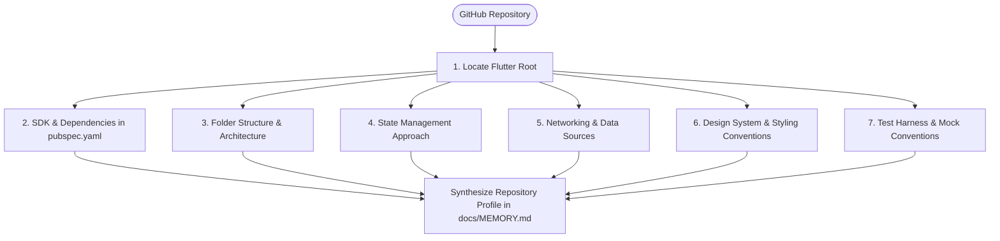

# GitHub Repository Integration & Adaptation Standards

> **Single Source of Truth**: This document defines the mandatory protocol for AI agents operating on any arbitrary GitHub repository URL. It extends `core/project-understanding.md`, `core/agent-principles.md`, and `docs/FLUTTER_CODING_STANDARDS.md`.

---

## 1. Scope & Objective

AI agents must be capable of onboarding into **any Flutter/Dart GitHub repository** without assuming:
- A fixed repository name or folder structure.
- A fixed architecture (Clean Architecture, Feature-First, Layer-First, MVC, MVVM, or Monolith).
- A fixed state management library (BLoC, Riverpod, Provider, GetX, MobX, Signals, ValueNotifier, or setState).
- A root-level Flutter workspace (Flutter apps may reside in subdirectories, monorepos, or Melos workspaces).

The primary goal is to **inspect, profile, adapt, implement, and verify** changes on any GitHub repository while strictly preserving existing functionality, respecting established conventions, and applying Flutter coding standards without unnecessary architectural churn.

---

## 2. GitHub URL Ingestion & Authorization Protocol

### 2.1 URL Validation & Missing URL Handling
- **When a GitHub URL is provided**: Parse and validate the URL (HTTPS, SSH, or GitHub CLI format):
  - HTTPS: `https://github.com/<owner>/<repo>(.git)?`
  - SSH: `git@github.com:<owner>/<repo>.git`
  - GitHub CLI: `gh repo clone <owner>/<repo>`
- **When a task references an external repository but NO URL is provided**:
  - **MANDATORY**: Immediately halt and ask the user for the GitHub repository link.
  - *Example prompt*:
    > "Please provide the GitHub repository URL (e.g., `https://github.com/owner/repository`) and any branch or access instructions so I can inspect and work on the project."
  - **Never guess or invent repository URLs.**

### 2.2 Access Control & Authorization Invariants
- **Never modify without authorization**: Verify whether the user has write access to the repository or if work should be conducted on a fork or local clone.
- **Branch Protection Guarantee**:
  - Never push commits directly to `main`, `master`, `release`, or `production` without explicit user consent.
  - Always create a dedicated, descriptively named working branch:
    ```bash
    git checkout -b feat/<feature-name> # or fix/<issue-name>
    ```
- **Security & Secret Handling**:
  - Never commit authentication tokens, personal access tokens (PAT), SSH private keys, or `.env` files to the repository.
  - Clone using configured local Git credentials or environment tokens securely.

---

## 3. Dynamic Repository Topology & Flutter Root Discovery

Repositories vary widely in structure. Never assume `pubspec.yaml` is in the root directory.

### Discovery Algorithm
1. **Root-Level Scan**: Check if `pubspec.yaml` exists in the repository root.
2. **Subdirectory & Monorepo Scan**: If absent from root, search subdirectories:
   - `apps/*` (e.g., `apps/mobile/pubspec.yaml`, `apps/flutter_app/pubspec.yaml`)
   - `packages/*` (e.g., `packages/client/pubspec.yaml`)
   - Root configuration files like `melos.yaml` (Melos monorepo) or `pubspec.yaml` with `workspace:`.
3. **Multi-Project Resolution**: If multiple Flutter/Dart packages are found:
   - Identify the main application target (typically containing `lib/main.dart` and platform folders `android/`, `ios/`, `windows/`).
   - If ambiguous, prompt the user for clarification before modifying code.
4. **Set Working Directory**: All subsequent `flutter` and `dart` commands must be executed within the detected Flutter project root directory.

---

## 4. Automated Architecture & Pattern Profiling Matrix

Before writing or modifying any code, the agent must inspect the repository across 6 diagnostic dimensions:



### Profiling Breakdown

| Dimension | Detection Targets | Actions & Adaptation Strategy |
| :--- | :--- | :--- |
| **Dart SDK** | `environment.sdk` in `pubspec.yaml` | Verify if Dart 3 patterns (records, sealed classes, switch expressions) are supported. If Dart < 3.0, adhere strictly to legacy Dart syntax. |
| **Architecture** | Directory layout in `lib/` | Classify: Feature-First (`lib/features/`), Layer-First (`lib/models/`, `lib/views/`), Clean Architecture (`lib/core/` + layers), or flat/MVC. **Never force Clean Architecture on a project that cleanly uses Layer-First or MVC.** |
| **State Management** | Dependencies & imports | Identify: `flutter_bloc` / Cubit, `flutter_riverpod`, `provider`, `get`, `mobx`, `signals`, or `ValueNotifier`. **Always implement new state logic using the established solution.** |
| **Routing** | Routing configuration | Identify: `go_router`, `auto_route`, `beamer`, `GetX navigation`, or native `Navigator 1.0/2.0`. Follow existing route declaration conventions. |
| **Networking & DB** | Network & DB dependencies | Identify: `dio`, `http`, `graphql_flutter`; `drift`, `hive`, `isar`, `shared_preferences`. Match existing DTO mapping and error handling patterns. |
| **Design & Theming** | Theme setup & UI widgets | Check `lib/` for existing theme (`ThemeData`, custom theme extension, or custom colors class). Reuse existing button and card components. |
| **Testing** | Directory `test/` | Identify: `test`, `mocktail`, `mockito`, `bloc_test`, `patrol`. Follow existing mocking styles and test structures. |

---

## 5. Adaptive Coding Standards Application

AI agents must apply Flutter Agent Kit coding standards **in harmony with the target repository**:

### 1. Zero Architectural Churn
- If a project uses simple `ChangeNotifier` and Layer-First (`lib/controllers/`, `lib/views/`), implement features using `ChangeNotifier` in that structure.
- Do **not** introduce BLoC or create `domain/usecases/` folders unless requested.
- Focus standards compliance on **code quality within existing layers**:
  - Sound null safety (no bare `!`, no `dynamic`).
  - Pure `build()` methods.
  - Proper resource disposal in `dispose()`.
  - Handling the 4 mandatory UI states (Loading, Success, Empty, Error).
  - Proper BuildContext safety (`if (!context.mounted) return;`).

### 2. Style & Convention Harmonization
- **Linter Rules**: Inspect `analysis_options.yaml`. Adhere strictly to the repository's active lint rules.
- **Formatting**: Run `dart format` to match repository formatting settings.
- **Naming Conventions**: Match existing variable, method, and file naming conventions.

### 3. Preserving Existing Functionality
- Treat existing tests as non-negotiable contracts.
- Never delete, disable, or relax existing assertions to pass tests.
- Only touch lines and files necessary for the requested task (Surgical Changes).

---

## 6. Goal-Driven Verification Pipeline

All changes in the target repository must pass real verification before reporting completion:

```bash
# 1. Dependency sync in the discovered Flutter root
flutter pub get

# 2. Formatting verification
dart format --output=none --set-exit-if-changed .

# 3. Static analysis (respecting existing baseline)
flutter analyze

# 4. Automated test suite execution
flutter test

# 5. Targeted test execution (for modified features)
flutter test test/path/to/relevant_test.dart
```

> [!NOTE]
> If the repository already has pre-existing analysis warnings prior to your changes, document them during Phase 3 (Baseline Pre-flight) so your report distinguishes pre-existing warnings from your changes. Your code must introduce **zero new warnings**.

---

## 7. Standardized GitHub Reporting Template

Upon completing work on any GitHub repository, provide a structured report following this format:

```markdown
## GitHub Repository Execution Summary

### 1. Repository Context
- **Repository URL**: `https://github.com/owner/repo`
- **Target Flutter Root**: `/path/to/flutter_project`
- **Working Branch**: `feat/user-profile-screen`
- **Discovered Architecture**: Feature-First with BLoC and Dio
- **Dart SDK Target**: `^3.2.0` (Dart 3 features active)

### 2. Changes Implemented
- `lib/features/profile/presentation/bloc/profile_bloc.dart`: Added profile update event handler.
- `lib/features/profile/presentation/screens/profile_screen.dart`: Integrated 4 UI states and mounted checks.
- `test/features/profile/profile_bloc_test.dart`: Added unit tests for profile update flow.

### 3. Verification & Test Results
- `dart format`: PASSED (0 unformatted files)
- `flutter analyze`: PASSED (0 new warnings introduced)
- `flutter test`: PASSED (14/14 tests passing, 3 new tests added)

### 4. Preserved Conventions & Adaptations
- Reused existing `AppColors` and `CustomButton` from `lib/core/widgets/`.
- Maintained existing BLoC pattern without introducing foreign dependencies.
- Zero unrelated files touched.

### 5. Remaining Risks / Next Steps
- Recommended running golden tests on physical devices if visual regression baseline is required.
```

---

## 8. Related Skills & Workflows

- [`skills/github-repository/SKILL.md`](file:///D:/Flutter/Flutter%20Agent-Kit/flutter-agent-kit/skills/github-repository/SKILL.md) — Companion skill for GitHub repository execution
- [`workflows/github-repository/WORKFLOW.md`](file:///D:/Flutter/Flutter%20Agent-Kit/flutter-agent-kit/workflows/github-repository/WORKFLOW.md) — 7-phase lifecycle workflow for repository tasks
- [`docs/FLUTTER_CODING_STANDARDS.md`](file:///D:/Flutter/Flutter%20Agent-Kit/flutter-agent-kit/docs/FLUTTER_CODING_STANDARDS.md) — Shared Flutter & Dart coding standards
- [`skills/project-analysis/SKILL.md`](file:///D:/Flutter/Flutter%20Agent-Kit/flutter-agent-kit/skills/project-analysis/SKILL.md) — Non-destructive codebase discovery
- [`core/project-understanding.md`](file:///D:/Flutter/Flutter%20Agent-Kit/flutter-agent-kit/core/project-understanding.md) — Core project understanding protocol
