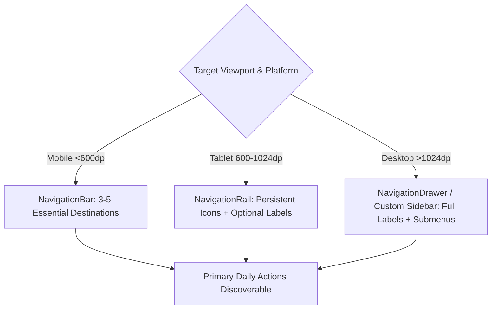
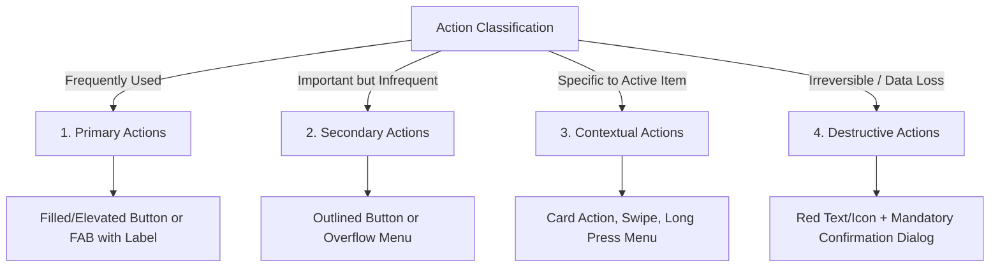

# Navigation Clarity, Icon Usability & Action Discoverability Standards (NAVIGATION_AND_ICON_STANDARDS.md)

This document establishes the official engineering standards, architectural patterns, accessibility mandates, and audit protocols for navigation systems, interactive icons, and action discoverability within the **Flutter Agent Kit**.

All AI coding agents (Cursor, Claude Code, OpenAI Codex, Gemini CLI, GitHub Copilot, Antigravity) must strictly adhere to these standards when creating, modifying, reviewing, or refactoring Flutter UI screens and navigation flows.

---

## 1. Core Principle: Clear Purpose & Action Discoverability

Every navigation item, button, and interactive control must **communicate its purpose clearly and unambiguously**.

Users should never have to guess what an icon does or experiment with taps to discover fundamental application behavior.

### Prohibited UX Anti-Patterns
- **Unnecessary Icon-Only Buttons**: Using bare icons for domain-specific or ambiguous operations without visible text labels.
- **Overcrowded Navigation Bars**: Cramming 6+ destinations or non-essential actions into mobile bottom navigation.
- **Hidden Daily Actions**: Burying primary or daily workflow actions inside deeply nested sub-menus.
- **Ambiguous Icons**: Using abstract or generic icons (e.g. shapes, stars, sparkles, ambiguous arrows) that lack universal convention.
- **Inconsistent Icon Styles**: Mixing outline, filled, sharp, two-tone, and rounded icons on the same screen or across adjacent routes.
- **Excessive Navigation Destinations**: Presenting confusing, redundant paths to reach the same underlying screen.
- **Tooltip Reliance on Mobile**: Relying exclusively on desktop hover `Tooltip` widgets to explain critical touch interactions where hovers do not exist on touchscreens.

> [!IMPORTANT]
> **The Discoverability Invariant**: Recognizable icons, visible text labels, and predictable navigation patterns always supersede clever minimalism. If an action's purpose is not immediately obvious from its icon alone, pair the icon with a visible text label.

---

## 2. Platform Navigation Architecture Rules

Navigation must adapt to the platform and screen geometry rather than blindly forcing mobile patterns onto desktop or vice versa:



### 2.1 Mobile Applications (<600dp Viewport)
1. **The 3–5 Destination Rule**: Bottom navigation (`NavigationBar`) must contain **at least 3 and at most 5** primary destinations.
   - Fewer than 3 destinations: Bottom navigation feels sparse; prefer tabs or direct views.
   - More than 5 destinations: Causes overcrowding, truncated labels, and missed taps.
2. **Prioritize Daily Frequencies**: Only place frequently accessed, top-level domains in the primary navigation bar (e.g., *Home*, *Search*, *Orders*, *Profile*).
3. **Readable Visible Labels**: Always configure `NavigationBar` with `labelBehavior: NavigationDestinationLabelBehavior.alwaysShow` or `onlyShowSelected` when justified. Never hide labels completely on all destinations.
4. **Move Secondary Items to Menus**: Infrequent actions (*Settings*, *Help*, *Legal*, *Export*) belong in secondary navigation (an app bar overflow menu, user profile sheet, or secondary drawer).
5. **Preserve Existing Navigation Structures**: On existing (brownfield) projects, never restructure top-level routes without explicit user approval.

### 2.2 Desktop Applications (>1024dp Viewport)
1. **Screen-Space Appropriate Navigation**: Use `NavigationDrawer`, persistent sidebars, or `NavigationRail` to exploit horizontal desktop real estate.
2. **Never Blindly Port Mobile Bottom Bars**: Placing a 60dp bottom navigation bar spanning a 2560px ultrawide monitor is strictly prohibited.
3. **Keyboard Navigation Support**: All desktop navigation destinations must be reachable via `Tab` focus traversal and activatable via `Enter` or `Space`.

---

## 3. Icon-Only Button Policy & Classification

Bare icon-only buttons (`IconButton`) are permitted **only** when the icon's meaning is universally understood across digital interfaces or the immediate contextual container makes its action unmistakable.

### 3.1 Universally Recognizable Icons (Permitted Icon-Only)
The following universal conventions may be used as standalone `IconButton` controls provided they include an accessibility `tooltip` and semantic label:

| Universal Icon | Standard Meaning | Contextual Requirement |
| :--- | :--- | :--- |
| `Icons.arrow_back_rounded` / `close_rounded` | Navigate back / Dismiss modal | Screen or modal header |
| `Icons.search_rounded` | Open search interface | App bar header or search card |
| `Icons.settings_rounded` | Open application settings | Header or profile pane |
| `Icons.more_vert_rounded` / `more_horiz_rounded`| Open overflow action menu | Trailing position in card or app bar |
| `Icons.play_arrow_rounded` / `pause_rounded` | Play / Pause media | Media player controls |
| `Icons.refresh_rounded` | Reload data / Retry request | Header or error state card |
| `Icons.delete_outline_rounded` | Delete / Remove item | Must trigger confirmation modal |

### 3.2 Ambiguous or Domain-Specific Actions (Visible Label Mandatory)
Any action that represents domain logic, financial transactions, multi-step operations, or unfamiliar business workflows **must not be icon-only**.

AI agents must use one of the following labeled patterns:
1. **Icon + Visible Text Button**:
   ```dart
   FilledButton.icon(
     onPressed: _exportReport,
     icon: const Icon(Icons.file_download_outlined),
     label: const Text('Export CSV'),
   )
   ```
2. **Outlined Action Button**:
   ```dart
   OutlinedButton.icon(
     onPressed: _reconcileLedger,
     icon: const Icon(Icons.sync_alt_rounded),
     label: const Text('Reconcile'),
   )
   ```
3. **Menu Item with Icon and Label**:
   ```dart
   MenuItemButton(
     leadingIcon: const Icon(Icons.archive_outlined),
     onPressed: _archiveBatch,
     child: const Text('Archive Batch'),
   )
   ```

> [!CAUTION]
> **Tooltip Failure Invariant**: Tooltips do not activate on mobile touchscreens without a long-press gesture. Never rely on `IconButton.tooltip` as the primary cognitive explanation of an ambiguous action.

---

## 4. Accessibility & Screen Reader Semantics

Every interactive button, icon, and navigation destination must announce its true operational purpose to screen readers (TalkBack on Android, VoiceOver on iOS, Narrator on Windows).

### 4.1 Action-Based Semantic Descriptions
- **Prohibited**: Naming the icon graphic (e.g. `"icon search"`, `"magnifying glass"`, `"asset 104"`, `"button"`).
- **Mandatory**: Describing the actual resulting action (e.g. `"Search transaction history"`, `"Delete draft invoice"`, `"Close filter dialog"`).

### 4.2 Flutter Accessibility Implementation Standards

```dart
// 1. IconButton with descriptive tooltip & semantic label
IconButton(
  icon: const Icon(Icons.filter_list_rounded),
  tooltip: 'Filter transactions by date and category',
  onPressed: _openFilterSheet,
)

// 2. Custom interactive widget with explicit Semantics
Semantics(
  button: true,
  enabled: true,
  label: 'Add item to shopping bag',
  hint: 'Double tap to add one unit',
  child: InkWell(
    onTap: _addItem,
    child: const Icon(Icons.add_shopping_cart_rounded),
  ),
)

// 3. Excluding decorative icons adjacent to text to prevent duplicate announcements
Row(
  children: [
    const Icon(Icons.check_circle_rounded, excludeFromSemantics: true),
    const SizedBox(width: 8),
    const Text('Order confirmed'), // Screen reader reads only this once
  ],
)
```

### 4.3 Touch Target Compliance
- **Mobile**: Minimum interactive tap area of **48 × 48 dp**.
- **Desktop**: Minimum clickable target area of **32 × 32 dp**.
- When visual icon sizes are smaller (e.g. 20dp), use `IconButton` with default padding or wrap with `Padding` to maintain the 48dp bounding box.

---

## 5. Menu Architecture & Secondary Action Hierarchy

Overflow and contextual menus must keep screens clutter-free while ensuring secondary actions remain intuitive to locate:

### 5.1 Menu Organization Rules
1. **Logical Grouping**: Group related actions with `PopupMenuDivider` or distinct visual sections (e.g., Export/Share group separated from Delete/Archive).
2. **Consistent Menu Placement**: Overflow menus belong in the trailing corner of app bars (`AppBar.actions`) or list item cards (`ListTile.trailing`).
3. **Prioritized Content**: Primary daily actions must never be tucked away inside a generic hamburger menu.
4. **Descriptive Labels**: Every menu item must feature a visible text label. Icons in menus are optional enhancements, not replacements.

### 5.2 Native Flutter Menu Implementations (`PopupMenuButton` / `MenuAnchor`)

```dart
// Modern Material 3 MenuAnchor implementation
MenuAnchor(
  builder: (context, controller, child) {
    return IconButton(
      icon: const Icon(Icons.more_vert_rounded),
      tooltip: 'More invoice options',
      onPressed: () {
        if (controller.isOpen) {
          controller.close();
        } else {
          controller.open();
        }
      },
    );
  },
  menuChildren: [
    MenuItemButton(
      leadingIcon: const Icon(Icons.share_outlined),
      onPressed: _shareInvoice,
      child: const Text('Share Invoice'),
    ),
    MenuItemButton(
      leadingIcon: const Icon(Icons.print_outlined),
      onPressed: _printInvoice,
      child: const Text('Print PDF'),
    ),
    const PopupMenuDivider(),
    MenuItemButton(
      leadingIcon: const Icon(Icons.delete_outline, color: Colors.red),
      onPressed: _confirmDelete,
      child: const Text('Delete Invoice', style: TextStyle(color: Colors.red)),
    ),
  ],
)
```

---

## 6. Action Prioritization Matrix

Every interactive element in an application belongs to one of four priority tiers:



### 6.1 The 4 Action Tiers

| Tier | Characteristics | UX Treatment | Example |
| :--- | :--- | :--- | :--- |
| **1. Primary** | Core user goal, frequent use | High visual weight, prominent placement, visible label or primary FAB | "Save Changes", "Send Message", "Create Project" |
| **2. Secondary** | Important supporting tasks | Outlined or text button, secondary header position | "Cancel", "Save as Draft", "Export" |
| **3. Contextual** | Bound to a single record | Inline list actions, swipe actions, trailing card buttons | "Edit Row", "Copy Link", "Pin" |
| **4. Destructive**| Permanent data deletion or reset | Red semantic tint (`colorScheme.error`), **mandatory confirmation modal** | "Delete Account", "Purge Records", "Reset Database" |

> [!CAUTION]
> **Destructive Action Safety Rule**: Destructive actions must never be triggered by an ambiguous icon-only button without an explicit confirmation dialog. The confirmation dialog must clearly explain the consequences and require a deliberate confirm tap.

---

## 7. Existing Application Navigation Audit Protocol

When auditing an existing codebase for navigation clarity and icon usability, follow this systematic procedure:

### 7.1 Audit Matrix Template

Document all interactive buttons and navigation structures in a markdown table:

| Screen Name | File Path | Control Type | Visual Icon | Actual Action | Universally Recognizable? | Visible Label Required? | A11y Label Defined? | Recommendation |
| :--- | :--- | :--- | :--- | :--- | :--- | :--- | :--- | :--- |
| `DashboardPage` | `lib/features/home/dashboard.dart` | `IconButton` | `Icons.tune` | Open analytics filters | No (ambiguous) | Yes | Missing | Convert to `OutlinedButton.icon` with "Filters" |
| `ProfilePage` | `lib/features/profile/profile.dart` | `IconButton` | `Icons.logout` | Log out user | Yes | No | Present | Retain with tooltip "Log out of account" |
| `InvoiceDetail` | `lib/features/invoices/detail.dart`| `IconButton` | `Icons.bolt` | Fast instant payout | No (confusing) | Yes | Present | Convert to `FilledButton.icon` with "Instant Payout" |

### 7.2 Non-Destructive Proposal Rule
On existing applications:
1. Conduct the inspection and author the proposed audit matrix.
2. Present the findings to the user with severity ratings.
3. **Do not modify working navigation code without explicit user consent.**
4. Apply approved changes incrementally, one screen at a time.

---

## 8. Mandatory 10-Point Navigation & Icon Checklist

Before completing any UI screen or navigation feature, verify:

- [ ] **1. Clear Purpose**: Every icon and interactive control communicates its purpose clearly.
- [ ] **2. No Unnecessary Icon-Only Buttons**: Ambiguous or domain-specific actions use visible text labels.
- [ ] **3. Primary Navigation Scaled (3-5 Destinations)**: Mobile `NavigationBar` contains only 3–5 essential destinations.
- [ ] **4. Secondary Actions Organized**: Infrequent actions are cleanly grouped inside overflow menus or secondary drawers.
- [ ] **5. Daily Actions Discoverable**: Primary workflows are prominent and never buried inside obscure menus.
- [ ] **6. Readable Menu Labels**: All popup and dropdown menu items feature legible text labels.
- [ ] **7. Action-Descriptive A11y Labels**: Semantic labels and tooltips describe the resulting action, not merely the graphic name.
- [ ] **8. Touch Targets Compliant**: Mobile interactive bounds meet 48x48dp; desktop bounds meet 32x32dp.
- [ ] **9. Desktop Keyboard Accessibility**: All destinations and menus support `Tab` navigation, `Enter`/`Space` triggers, and desktop tooltips.
- [ ] **10. Destructive Action Safeguards**: All destructive operations have explicit confirmation modals with red warning styling.

---

## 9. Mandatory Testing & Verification

1. **Automated Semantic Label Tests**:
   ```dart
   testWidgets('Every icon-only button on Dashboard has valid semantic label', (tester) async {
     await tester.pumpWidget(const MyApp());
     final iconButtons = find.byType(IconButton);
     
     for (final button in iconButtons.evaluate()) {
       final semantics = tester.getSemantics(find.byWidget(button.widget));
       expect(semantics.label, isNotEmpty, reason: 'IconButton missing semantic label');
       expect(semantics.label.toLowerCase(), isNot(contains('icon')), reason: 'Label should describe action, not graphic');
     }
   });
   ```
2. **Navigation Flow Verification**: Verify that tapping each destination updates the route and activates the corresponding tab without page reconstruction flickers.
3. **Static Analysis**: Verify `flutter analyze` passes with 0 warnings.
