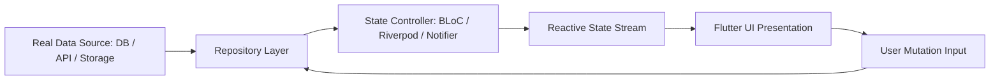

# Real Data Integrity & Zero Dummy Data Specification

This document defines the production engineering standard, architectural requirements, and auditing rules for **Real Data Integrity** across all applications developed or maintained under the **Flutter Agent Kit**.

---

## 1. Core Principle: Real Data Only

> [!IMPORTANT]
> **AI coding agents must NEVER introduce fake, dummy, static, hard-coded, or fabricated application data and present it as real user data.**
>
> If real data is unavailable, the application must display an honest **Empty**, **Loading**, or **Error** state. Never invent data to make an interface appear functional, complete, or populated.

All application data presented to users must originate from legitimate, verified sources:
1. **Actual User Input**: Forms, touch inputs, file selections, camera/sensor captures, user preferences.
2. **Configured Database**: Local persistence layers (Drift/SQLite, Isar, Hive) storing actual records.
3. **Real API Responses**: Remote HTTP/REST/GraphQL server responses through verified endpoints.
4. **Existing Application Services**: Hardware sensors, connectivity monitors, geolocation services, platform channels.
5. **Actual Local Storage**: Secure storage keys, device file system records.
6. **Legitimate Derived Calculations**: Metrics, sums, averages, and aggregations mathematically calculated from real underlying records.

---

## 2. The 12 Strict Prohibited Practices

AI agents are strictly forbidden from implementing the following anti-patterns in production code:

1. **Hard-Coded Sample Records**: Adding static item lists (e.g. `final sampleHabits = [Habit('Workout', ...)]`) into production widget trees or services.
2. **Fabricated Domain Entities**: Displaying fake users, avatars, transactions, products, messages, chat sessions, or health logs.
3. **Static JSON/Array Substitutes**: Using local JSON files or static in-memory lists as substitutes for actual database or API integrations.
4. **Fabricated Dashboard Statistics**: Hardcoding dashboard metrics (e.g. `totalRevenue = "$12,450"`, `activeUsers = 128`, `completionRate = 85%`).
5. **Fake API Success Responses**: Returning mock 200 OK payloads from repositories when an external API is unconfigured or failing.
6. **Placeholder Records to Hide Empty States**: Populating databases with default fake records upon first launch just to make the app look populated.
7. **Randomized Production Metrics**: Using `Random().nextInt()` or pseudo-random generators to simulate real-time metrics, heartbeats, or sensor graphs.
8. **Hard-Coded Authentication States**: Bypassing login screens with hard-coded dummy user profiles (`User(id: "1", name: "John Doe")`).
9. **Dummy Fallbacks on Network Failure**: Silently displaying dummy fallback lists when an API or database query fails.
10. **Orphaned Mock Data in Production**: Leaving debug mock classes, dummy repositories, or test fixtures inside `lib/` after development.
11. **Fake Activity History & Notifications**: Displaying pre-populated notification feeds or audit logs that never actually occurred.
12. **Fabricated Operation Success**: Displaying success SnackBars or navigation redirects when an underlying mutation actually failed or was not implemented.

---

## 3. Dynamic Data Implementation Standards

For every screen, widget, or feature, the agent must adhere to this data pipeline:



1. **Identify the True Source**: Determine where the feature's data legitimately lives (remote endpoint, local database table, hardware sensor).
2. **Inspect Existing Architecture**: Inspect existing models, DAOs, repositories, and services. Never create duplicate storage engines or competing databases.
3. **Reactive UI Binding**: Connect UI components to reactive state streams (`watch()`, `StreamBuilder`, `BlocBuilder`, `ListenableBuilder`). When data changes in the database, the UI must update automatically.
4. **Implement Genuine CRUD**: Form submissions must genuinely persist to the database or dispatch actual API mutations.
5. **Persistence Across Restarts**: Application state must survive process termination. After restarting the app, saved records must reload intact.
6. **Input Validation**: Validate all inputs at domain boundaries before saving.
7. **Safe Nullability**: Handle missing, null, or empty fields safely using sound null safety and pattern matching. Never force-unwrap with `!`.

---

## 4. Honest Empty States (Never Fake Population)

When a query returns zero records, the agent must render a professional, actionable empty state rather than inserting fake data:

```dart
// CORRECT: Honest Empty State with Actionable Call-to-Action
class HabitsEmptyView extends StatelessWidget {
  final VoidCallback onCreateHabit;

  const HabitsEmptyView({super.key, required this.onCreateHabit});

  @override
  Widget build(BuildContext context) {
    return Center(
      child: Padding(
        padding: const EdgeInsets.all(32.0),
        child: Column(
          mainAxisSize: MainAxisSize.min,
          children: [
            Icon(Icons.track_changes_outlined, size: 64, color: Theme.of(context).colorScheme.outline),
            const SizedBox(height: 16),
            Text(
              'No habits tracked yet',
              style: Theme.of(context).textTheme.titleLarge,
            ),
            const SizedBox(height: 8),
            Text(
              'Start building your daily routine by creating your first habit.',
              textAlign: TextAlign.center,
              style: Theme.of(context).textTheme.bodyMedium?.copyWith(
                color: Theme.of(context).colorScheme.onSurfaceVariant,
              ),
            ),
            const SizedBox(height: 24),
            ElevatedButton.icon(
              onPressed: onCreateHabit,
              icon: const Icon(Icons.add),
              label: const Text('Create First Habit'),
            ),
          ],
        ),
      ),
    );
  }
}
```

---

## 5. Controlled Exceptions: Mock Data Isolation

Mock data is permitted **exclusively** under the following controlled conditions:

| Allowed Context | Directory / Scope | Mandatory Restrictions |
| :--- | :--- | :--- |
| **Unit & Widget Tests** | `test/` | Fixture data must be strictly isolated to `test/fixtures/`. Never import from `test/` into `lib/`. |
| **Integration Tests** | `integration_test/` | Mock servers must be configured via test runners; production targets must never link mock servers. |
| **Widget Previews** | `lib/.../*.preview.dart` | Must be gated behind debug flags or dedicated preview files excluded from release builds. |
| **Explicit Demo Mode** | Documented Demo Flavor | Must require an explicit build flag (e.g. `--dart-define=DEMO_MODE=true`), display a permanent visual "DEMO MODE" watermark banner, and never mix with production user databases. |

### Strict Isolation Rules
- **No Test Imports in Production**: `import '../../test/...'` inside `lib/` is a build-breaking violation.
- **No Mock Repositories in Release**: `MockRepository` classes must never be registered in production dependency injection containers.
- **No Silent Fallback to Mock Data**: If remote services fail in production, the app must display an honest error—never switch to mock data silently.

---

## 6. Real Analytics & Metric Calculations

All dashboard cards, progress percentages, charts, and summary statistics must be mathematically calculated from actual records:

$$\text{Completion Rate} = \frac{\sum \text{Completed Items}}{\text{Total Tracked Items}} \times 100\%$$

- **Sufficient Data**: If records exist, calculate and render the chart.
- **Insufficient Data**: If zero or inadequate records exist, display an **Insufficient Data State**:
  > *"Not enough history to generate weekly insights. Complete at least 3 sessions to view trends."*
- **Prohibited**: Never hardcode progress arcs (`progress: 0.78`) or sparkline coordinates without binding to real data series.

---

## 7. Honest API & Database Failure Handling

When a data source fails or is unavailable:
1. **Display an Honest Error State**: Inform the user clearly what failed without technical jargon or stack traces.
2. **Provide Actionable Retry**: Include a functional **Retry** button wired to reload the query.
3. **Preserve Valid Cached Data with Clear Indicator**: If offline cache exists, display it accompanied by a non-intrusive warning:
   > *"Displaying cached data from 2 hours ago. Tap to refresh."*
4. **Never Mask Failure with Fake Success**: Never show "Saved successfully!" if the database transaction or API request threw an exception.

---

## 8. Data Classification Matrix (8 Tiers)

Before modifying code or auditing existing projects, classify every data structure:

| Tier | Category | Definition | Status |
| :---: | :--- | :--- | :---: |
| **1** | **Real User Data** | Data entered by the user, persisted locally or remotely | **Mandatory** |
| **2** | **Real API Data** | Dynamic payloads returned by live backend endpoints | **Mandatory** |
| **3** | **Real Database Data** | Records stored in Drift/Isar/Hive local storage tables | **Mandatory** |
| **4** | **Legitimate Calculated Data** | Values mathematically derived from Tier 1, 2, or 3 records | **Mandatory** |
| **5** | **Config & Business Constants** | Enums, theme colors, route paths, fixed tax rates, validation limits | **Permitted** (Do not flag as dummy) |
| **6** | **Test Fixtures** | Isolated mock objects located in `test/fixtures/` | **Permitted in tests only** |
| **7** | **Demo Flavor Data** | Sandboxed demo records under explicit `--dart-define=DEMO_MODE=true` | **Permitted with banner** |
| **8** | **Fabricated / Dummy Data** | Hard-coded entities, static sample lists, fake dashboard stats in `lib/` | **STRICTLY PROHIBITED** |

---

## 9. Pre-Flight Real Data Verification Checklist

Before certifying any feature as complete, the agent must verify:
- [ ] No hardcoded sample records exist in production code (`lib/`).
- [ ] No static business metrics or fake numbers are rendered on dashboards.
- [ ] UI components subscribe reactively to actual application state.
- [ ] Database and API operations are genuinely implemented and functional.
- [ ] Empty states display honest empty UI with a call-to-action (zero dummy records).
- [ ] Error states report actual failures with working retry buttons (zero fake success).
- [ ] All charts, progress bars, and metrics are calculated from real data.
- [ ] Mock and fixture data are 100% isolated to `test/` or explicitly watermarked demo modes.
- [ ] Data consistency persists across complete application process restart.
- [ ] Automated tests verify empty state, real record CRUD, and error handling.
