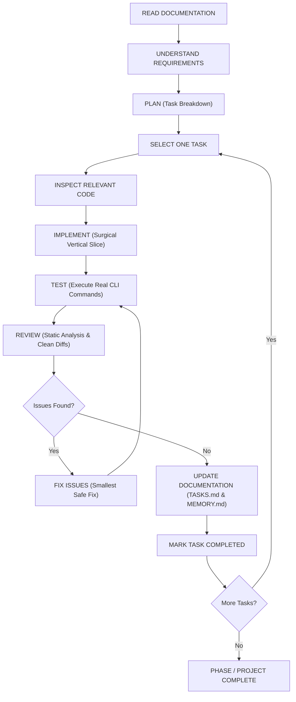

# Professional Task Management, Documentation & Incremental Development Standards

This document defines the production-grade software engineering, task management, project documentation, and incremental development standard for the **Flutter Agent Kit**. All AI coding agents (**Cursor**, **Claude Code**, **Gemini CLI**, **GitHub Copilot**, **OpenAI Codex**, **Antigravity**) must strictly adhere to these standards across all software projects, including Flutter, Dart, React, Next.js, Node.js, Python, and other stacks.

---

## 1. Core Philosophy & Non-Negotiable Golden Rule

$$\mathbf{PLAN\ FIRST} \longrightarrow \mathbf{DOCUMENT\ SECOND} \longrightarrow \mathbf{BREAK\ DOWN\ WORK} \longrightarrow \mathbf{ONE\ TASK\ AT\ A\ TIME} \longrightarrow \mathbf{TEST\ \&\ VERIFY} \longrightarrow \mathbf{UPDATE\ DOCS} \longrightarrow \mathbf{NEXT\ TASK}$$

> [!IMPORTANT]
> **NEVER attempt to complete a large, complex software project in one massive coding operation.**
> AI coding agents must never produce sprawling, unverified multi-file diffs. Every project must be developed systematically through disciplined upfront analysis, structured in-project documentation, granular independent tasks, incremental implementation slices, automated verification, and continuous progress recording.

---

## 2. Mandatory Project Analysis (Pre-Implementation Discovery)

Before writing or modifying any project code, the AI agent must systematically execute these 7 discovery steps:

1. **Inspect Existing Project Structure**: Examine directory trees, package layouts, configuration files, and asset locations.
2. **Understand Architecture & Technology Stack**: Identify frameworks, libraries, runtime versions, and language constraints (e.g. Flutter 3.x, Dart 3.x, React 19, Next.js 15, FastAPI).
3. **Read Existing Documentation & AI Directives**: Inspect `AGENTS.md`, `CLAUDE.md`, `GEMINI.md`, `.cursorrules`, `README.md`, and any existing architectural blueprints.
4. **Identify Existing Features & Conventions**: Note state management approaches (BLoC, Riverpod, Provider, Zustand, Redux), data access patterns, styling solutions, naming conventions, and folder organization.
5. **Understand User Requirements**: Analyze the user's explicit objective, constraints, and operational goals.
6. **Identify Missing Information & Surface Assumptions**: If requirements contain ambiguities or unstated platform constraints, state reasonable assumptions explicitly or ask targeted clarifying questions.
7. **Classify Project & Task Complexity**:
   - **Small Task** (Single bug fix, isolated method edit, localized tweak): Can be implemented directly with surgical precision and immediate verification.
   - **Medium Task** (Single new screen, API client integration, state migration): Requires a lightweight task breakdown and sequential slice execution.
   - **Large / Complex Project** (New greenfield application, multi-feature module, cross-cutting architectural refactor): **Mandates the full Task Breakdown System, Phase Planning, and In-Project Documentation.**

> [!NOTE]
> Never assume that every project requires the exact same architecture or documentation. Preserve existing project conventions and avoid unnecessary restructuring or speculative abstractions.

---

## 3. Large Task Breakdown System

Whenever a task is large, complex, or touches multiple independent features, **the AI agent is strictly forbidden from implementing everything in one operation.**

### Hierarchical Decomposition
The work must be systematically divided into:
$$\text{Project} \longrightarrow \text{Modules} \longrightarrow \text{Features} \longrightarrow \text{Sub-features} \longrightarrow \text{Development Phases} \longrightarrow \text{Individual Tasks} \longrightarrow \text{Testing Tasks}$$

Every individual task must be sized to be implemented, tested, reviewed, and completed **independently** within a single focused context window.

### Mandatory 13-Point Task Specification Schema
For every task in `tasks/TASKS.md` (or `TASKS.md`), the agent must define:

| # | Field | Description |
| :---: | :--- | :--- |
| 1 | **Task ID** | Unique, sequential identifier (e.g. `TASK-001`, `TASK-002`). |
| 2 | **Task Title** | Clear, action-oriented title summarizing the specific change. |
| 3 | **Description** | Concise summary of the implementation scope. |
| 4 | **Objective** | The technical or business purpose achieved by this task. |
| 5 | **Requirements** | Specific functional or architectural criteria that must be satisfied. |
| 6 | **Files Affected** | List of specific files or modules expected to be created or modified. |
| 7 | **Dependencies** | Prerequisite Task IDs that must be completed before starting this task. |
| 8 | **Implementation Steps** | Ordered, granular steps required to implement the task. |
| 9 | **Acceptance Criteria** | Concrete, verifiable conditions that define task completion. |
| 10 | **Testing Requirements** | Unit, widget, integration, or manual test steps required to verify the task. |
| 11 | **Expected Outcome** | Measurable state of the codebase after successful task completion. |
| 12 | **Priority** | `High` \| `Medium` \| `Low` |
| 13 | **Status** | Current operational status. |

### The 5 Standard Task Statuses
- **`Not Started`**: Task is specified and waiting for prerequisites to be satisfied.
- **`In Progress`**: Currently the single active task being implemented.
- **`Blocked`**: Task cannot proceed due to an external dependency, failing upstream test, or critical user ambiguity.
- **`Testing`**: Code implementation is complete; automated test suites or manual verification are currently executing.
- **`Completed`**: Code implemented, all acceptance criteria verified by actual test execution, code reviewed, and documentation updated.

---

## 4. Sequential Task Execution Protocol

The agent must execute work using this exact loop:



### The 10 Golden Execution Rules
1. **One Task at a Time**: Work strictly sequentially on one implementation task. Never begin coding a second task until the first task is verified and marked completed.
2. **Prerequisites First**: Never start a task whose dependencies are not marked `Completed`.
3. **No Premature Completion**: Writing code does NOT make a task complete. A task is completed **only** after its acceptance criteria are empirically proven via tests.
4. **Fix Before Moving On**: If testing or analysis fails, fix the issue immediately before selecting the next task. Never carry forward broken code.
5. **Immediate Status Synchronization**: Update `TASKS.md` immediately upon completing each task.
6. **Continuous Context Persistence**: Update `MEMORY.md` with active state, decisions, and next steps after every meaningful milestone.
7. **Never Silently Skip**: Never omit or silently skip an unfinished task. If a task cannot be completed, mark it `Blocked` and document the blocker in `MEMORY.md`.
8. **Surface Critical Blockers**: If blocked by a missing credential, conflicting business logic, or critical ambiguity, pause and ask the user concisely.
9. **Autonomous Routine Execution**: Do not ask the user for approval for routine, authorized implementation tasks that were already planned. Proceed through the planned tasks autonomously.
10. **Phase-by-Phase Execution**: For very large projects, complete and certify one development phase at a time before proceeding to subsequent phases.

---

## 5. Automatic In-Project Documentation Architecture

All AI-generated project planning, architectural designs, and development documentation **MUST be stored inside the project's root directory.**

> [!CAUTION]
> **NEVER create project documentation in global user folders, temporary OS directories, or outside the project repository.** Documentation must reside directly inside the project repository where the application code lives.

### Standard In-Project Folder Structure
```text
project-root/
│
├── docs/                      # Architectural specifications & design documents
│   ├── PRD.md                 # Product Requirements Document
│   ├── TRD.md                 # Technical Requirements Document
│   ├── ARCHITECTURE.md        # System architecture, layers, data flow
│   ├── DESIGN.md              # Design system tokens, colors, typography, UI specs
│   ├── DATABASE.md            # Schema, tables, relationships, indexes, migrations
│   ├── API.md                 # Endpoints, requests, responses, authentication
│   ├── SECURITY.md            # Security controls, data protection, threat model
│   ├── TEST_PLAN.md           # Testing strategy, matrices, coverage targets
│   ├── IMPLEMENTATION_PLAN.md # Phase roadmap, milestone dependencies
│   ├── DECISIONS.md           # Architecture Decision Records (ADR)
│   ├── MEMORY.md              # Active working context, phase state, next actions
│   └── CHANGELOG.md           # Versioned history of notable changes
│
├── tasks/                     # Task management system
│   ├── TASKS.md               # Master task registry with statuses
│   └── phases/                # Multi-phase project task files (for large projects)
│       ├── PHASE_01.md
│       ├── PHASE_02.md
│       └── PHASE_03.md
│
├── lib/ (or src/)             # Application source code
├── test/ (or tests/)          # Automated test suites
├── AGENTS.md                  # Permanent AI agent operating instructions
├── .gitignore                 # Version control exclusions
└── README.md                  # Public project documentation & onboarding guide
```

*Note: Adapt this structure to the size and needs of the project. Do not create empty, useless documents for trivial tasks.*

---

## 6. Comprehensive Documentation Specifications

When creating project documents, adhere to these content specifications:

### 1. `PRD.md` — Product Requirements Document
- **Product Overview & Problem Statement**: What problem does this solve and why?
- **Target Audience & Personas**: Who are the primary and secondary users?
- **Product Goals & Success Metrics**: Measurable business/user objectives.
- **User Journeys & User Stories**: Given-When-Then acceptance criteria.
- **Functional Requirements**: Granular capability specifications.
- **Non-Functional Requirements**: Performance, availability, accessibility benchmarks.
- **MVP Scope vs. Out-of-Scope**: Explicit boundaries defining what is and is NOT in scope.

### 2. `TRD.md` — Technical Requirements Document
- **Technical Objectives**: System scale, target throughput, and latency ceilings.
- **Technology Requirements**: Languages, runtimes, frameworks, and third-party SDKs.
- **Platform & Hardware Requirements**: Minimum OS versions, display scaling, memory limits.
- **Functional Technical Requirements**: Protocols, data structures, background execution models.
- **Non-Functional Technical Requirements**: Frame budgets ($\le 16.6\,\text{ms}$), cold start ($< 1.5\,\text{s}$).
- **Compatibility & Integration**: APIs, database migrations, legacy systems.
- **Infrastructure & CI/CD**: Build pipelines, code signing, deployment targets.

### 3. `ARCHITECTURE.md` — System Architecture Blueprint
- **Architecture Pattern**: Clean Architecture, Feature-First modularity, MVVM, or Hexagonal.
- **Application Layers**: Domain (pure entities/use cases), Data (repositories, data sources), Presentation (widgets, state controllers).
- **Data Flow & State Lifecycle**: Unidirectional state flow, event dispatching, reactive streams.
- **Folder Structure**: Canonical directory organization and file naming conventions.
- **Component Relationships**: Dependency graph and dependency injection strategy (`get_it`, Riverpod).
- **Error Handling Architecture**: Global interception hooks, sealed typed domain failures.

### 4. `DESIGN.md` — Design System & Visual Specification
- **Visual Direction & Archetype**: Intentional aesthetic direction (Professional Enterprise, Creative, etc.).
- **13 Canonical Color Roles**: Primary, OnPrimary, Secondary, Surface, SurfaceContainer, Background, Error, Outline, etc.
- **Typography Scale**: Display, Headline, Title, Body, Label with explicit weights and line heights.
- **Modular Spacing Grid**: 4pt/8pt scale (`AppSpacing.xs` through `AppSpacing.xxl`).
- **Corner Radii & Elevation**: Standardized radii (`AppRadii`) and surface shadows.
- **Reusable Component Specifications**: Buttons (`AppButton`), Cards (`AppCard`), TextFields (`AppTextField`), Loading skeletons, Empty states, and Error views.
- **Navigation & Accessibility**: Bottom navigation rules (3–5 destinations), a11y labels, WCAG AA contrast.

### 5. `DATABASE.md` — Data Architecture & Persistence
- **Database Engine**: Drift (SQLite), PostgreSQL, Prisma, Hive, or Isar.
- **Schema & Entity Definitions**: Tables, columns, data types, constraints, default values.
- **Relationships & Keys**: Primary keys, foreign keys, cascade rules, composite indexes.
- **Data Integrity & Validation**: Check constraints, domain validation rules.
- **Migration Strategy**: Versioned schema migrations, destructive alter prevention.
- **Backup, Recovery & Encryption**: At-rest encryption (SQLCipher) and backup triggers.

### 6. `API.md` — Networking & API Contract Specification
- **Endpoint Catalog**: Method, URI, route parameters, query parameters.
- **Request / Response Schemas**: JSON contracts, nullability, headers.
- **Authentication & Authorization**: Bearer tokens, API keys, OAuth2 refresh lifecycles.
- **Typed Error Conventions**: Status codes mapped to typed domain `Failure` instances.
- **Rate Limiting & Resiliency**: Exponential backoff, jitter, offline degradation.

### 7. `SECURITY.md` — Security Controls & Threat Model
- **Secret Management**: Zero hardcoded credentials; use `--dart-define` or encrypted vaults.
- **At-Rest Protection**: Hardware-backed secure storage (`flutter_secure_storage`).
- **In-Transit Protection**: TLS 1.3, HTTPS enforcement, optional certificate pinning.
- **Input Sanitization**: SQL injection, XSS, and command injection prevention.
- **Logging Hygiene**: Never log passwords, tokens, PII, or raw credit card data.

### 8. `TEST_PLAN.md` — Quality Assurance & Testing Strategy
- **Testing Pyramid**: Unit tests ($\sim 70\%$), Widget/Component tests ($\sim 20\%$), Integration tests ($\sim 10\%$).
- **Test Matrices**: Multi-platform matrix (Windows, Android, iOS, Web).
- **Edge Cases & Failure Testing**: Network drops, empty databases, invalid inputs, locale changes.
- **Regression & Performance Testing**: Golden pixel tests, frame rate profiling benchmarks.

### 9. `IMPLEMENTATION_PLAN.md` — Phase Roadmap & Objectives
- **Phase Breakdown**: Phased sequence of delivery milestones.
- **Phase Deliverables**: Concrete deliverables per phase.
- **Dependencies & Blockers**: Inter-phase dependencies and critical path analysis.
- **Sign-off Criteria**: Quantitative conditions required to transition between phases.

### 10. `TASKS.md` — Master Task Registry
- **Active Phase**: The current operational phase.
- **Task Catalog**: All tasks populated with the 13 mandatory fields and statuses.
- **Next Recommended Task**: Immediate next step for the AI agent.

### 11. `DECISIONS.md` — Architecture Decision Records (ADR)
- **Context**: The problem being solved and constraints.
- **Decision**: The selected architectural approach.
- **Alternatives Considered**: Other approaches evaluated and why they were rejected.
- **Consequences**: Positive trade-offs, negative trade-offs, and technical debt incurred.

### 12. `MEMORY.md` — Dynamic Project Context & State Persistence
- **Current Development Phase**: Where the project is right now.
- **Completed Phases & Tasks**: Verified progress log.
- **Active Task Details**: Current task ID, objective, working files, and sub-steps.
- **Known Issues & Blockers**: Active defects, technical debt, or blocked tasks.
- **Next Recommended Action**: The exact next operational step.

---

## 7. GitHub Protection — Mandatory `.gitignore` Rules

> [!CAUTION]
> **CRITICAL RULE**: All private AI-generated planning documents, task files, development memory, and technical analyses must remain local and must **NOT** be pushed to public Git remotes.

### Mandatory `.gitignore` Block
Append the following block to the project's existing `.gitignore`:

```gitignore
# ==============================================================================
# AI Generated Project Documentation & Task Management (Local Only)
# ==============================================================================
/docs/
/tasks/
/MEMORY.md
/DECISIONS.md
/IMPLEMENTATION_PLAN.md
/PROJECT_ANALYSIS.md
/TECHNICAL_ANALYSIS.md
```

### Essential `.gitignore` Discipline
1. **Inspect Before Modifying**: Always read the existing `.gitignore` before appending rules.
2. **Append, Never Overwrite**: Add missing exclusion rules to the bottom; never erase existing framework rules.
3. **Never Ignore Source Code or Assets**: Never exclude `lib/`, `src/`, `test/`, `pubspec.yaml`, `package.json`, or assets.
4. **Preserve Public Documentation**: Do **not** ignore `README.md`, `LICENSE`, `CHANGELOG.md`, or public contributing guides.
5. **Verify with `git check-ignore`**: Test rules using `git check-ignore -v <path>` to confirm exclusion.
6. **Tracked Files Nuance**: Adding an existing, tracked file to `.gitignore` does **not** automatically untrack it. If a file was previously committed to git, explain to the user that it remains tracked until explicitly untracked with `git rm --cached`, and do not run untrack commands without explicit authorization.

---

## 8. Permanent AI Agent Instructions (`AGENTS.md`)

Every project must maintain an `AGENTS.md` in its root directory instructing all future AI coding assistants to obey the 14 permanent engineering directives:

1. **Read Project Documentation First**: Inspect `docs/PRD.md`, `docs/ARCHITECTURE.md`, `docs/DESIGN.md`, and `docs/MEMORY.md` before writing code.
2. **Follow the Task Breakdown System**: Break down large tasks in `tasks/TASKS.md`.
3. **One Task at a Time**: Work sequentially on a single implementation task.
4. **Follow Discovered Architecture**: Strictly respect established folder structure, naming conventions, and state management.
5. **Follow Design System Tokens**: Consume `Theme.of(context)`, `ColorScheme`, and `AppSpacing`. Never hardcode raw hex colors or arbitrary paddings.
6. **Follow Real Data Integrity**: Enforce real data flow. Provide honest empty states with call-to-action buttons; zero fake dummy records in production.
7. **Enforce Navigation Clarity**: Maintain 3–5 mobile bottom nav destinations with visible labels; no ambiguous icon-only buttons.
8. **Follow Performance Engineering**: Keep `build()` methods pure, enforce `const`, use granular selectors (`context.select`), and explicitly dispose controllers in `dispose()`.
9. **Update MEMORY.md Continuously**: Record milestones, active task state, and next actions after meaningful progress.
10. **Record Technical Decisions**: Add ADR entries to `docs/DECISIONS.md` whenever making non-trivial architectural choices.
11. **Run Real Verification Commands**: Execute `flutter analyze` and `flutter test` before marking any task complete. Zero fake passes.
12. **Surgical Changes Only**: Modify only the lines and files required for the active task. Never reformat or rewrite adjacent functioning code.
13. **Protect Secrets**: Never hardcode private API keys, passwords, or tokens in source code.
14. **Check Acceptance Criteria**: Verify all 12 points of the Task Completion Checklist before marking a task `Completed`.

---

## 9. The 12-Point Task Completion Verification Checklist

Before marking any task `Completed` in `TASKS.md`, the AI agent must pass every item on this checklist:

- [ ] **1. Requirements Understood**: The specific technical objective and requirements were reviewed and satisfied.
- [ ] **2. Relevant Code Inspected**: Existing codebase conventions, dependencies, and adjacent code were inspected first.
- [ ] **3. Implementation Completed**: Minimal correct code was written following architectural standards.
- [ ] **4. Existing Functionality Preserved**: No regression or breaking change was introduced to existing features.
- [ ] **5. Error Handling Implemented**: Failures are caught and converted to typed domain failures with user-safe messages.
- [ ] **6. Build / Static Analysis Clean**: `flutter analyze` passes with 0 errors and 0 warnings.
- [ ] **7. Relevant Tests Executed**: Unit, widget, or integration tests covering the change pass cleanly.
- [ ] **8. Zero Dummy Data**: No static mock arrays, fake statistics, or dummy records exist in production code.
- [ ] **9. Code Reviewed**: The generated diff is minimal, readable, idiomatic, and cleanly scoped.
- [ ] **10. In-Project Docs Updated**: `docs/ARCHITECTURE.md`, `docs/API.md`, or relevant specifications updated if contracts changed.
- [ ] **11. TASKS.md Updated**: The active task status is updated to `Completed`.
- [ ] **12. MEMORY.md Updated**: Project memory records the completed task, active milestone, and next recommended task.

---

## 10. Failed Task Diagnosis & Remediation Protocol

If a task fails during testing or verification, the AI agent must execute this 7-step protocol:

1. **Isolate Root Cause**: Read compiler errors, test failure logs, and stack traces. Determine the exact failure mechanism.
2. **Inspect Relevant Code**: Review the specific method or widget causing the failure without scanning unrelated files.
3. **Determine Smallest Safe Fix**: Formulate a surgical, targeted fix that addresses the root cause directly.
4. **Apply Surgical Fix**: Modify only the offending lines.
5. **Re-execute Tests**: Run the targeted test command to verify the fix.
6. **Check for Regressions**: Run the wider test suite and static analysis to ensure no collateral breakage occurred.
7. **Record in MEMORY.md**: If the issue cannot be resolved cleanly without user input, mark the task `Blocked`, record the technical details and logs in `MEMORY.md`, and report the blocker to the user.

> [!CAUTION]
> **NEVER suppress errors, delete failing test assertions, or fabricate a passing result.** Diagnose and fix the actual root cause.

---

## 11. Token Efficiency & Context Management

To maintain high speed and prevent context window exhaustion:
- **Concentric Reading**: Read files in concentric circles. Inspect `pubspec.yaml` and top-level architecture first; read implementation files only when actively editing them.
- **Avoid Redundant Re-Reading**: Rely on `MEMORY.md` as an in-context cache rather than repeatedly re-scanning unchanged documentation.
- **Never Scan the Entire Repo Blindly**: Use targeted glob searches or directory listings.
- **Concise, High-Signal Diffs**: Produce targeted diffs or minimal method replacements. Avoid rewriting entire 500-line files.
- **Maintain Token-Efficient Task Descriptions**: Keep task specifications focused and direct without unnecessary prose padding.

---

## 12. Initial Project Setup Workflow

When an AI coding assistant begins work on a new project or receives a major development request:

```text
STEP 1: Mandatory Project Analysis (7 pre-implementation discovery checks).
STEP 2: Classify Project & Task Complexity (Small, Medium, Large).
STEP 3: Identify Required In-Project Documentation.
STEP 4: Initialize In-Project Documentation (docs/PRD.md, docs/ARCHITECTURE.md, docs/DESIGN.md, etc.).
STEP 5: Create Detailed Task Breakdown (tasks/TASKS.md with Phase and Task IDs).
STEP 6: Configure .gitignore Protection for AI docs and task files.
STEP 7: Create or Update AGENTS.md with permanent AI directives.
STEP 8: Present Initial Analysis, Plan, and First Task to User.
STEP 9: Start Implementation ONLY when authorized by the user request.
```

---

## 13. Standardized Reporting Formats

### 1. Task Completion Report
After completing each implementation task, provide a concise, structured report:

```markdown
### Task Completion Report: [TASK-ID] — [Task Title]
- **Status**: Completed
- **What Was Implemented**: [2-3 sentence summary of changes]
- **Files Modified**:
  - `path/to/modified_file.dart`
- **Verification Commands Executed**:
  - `flutter analyze` (0 errors, 0 warnings)
  - `flutter test test/path/to/test.dart` (All tests passed)
- **Documentation Updated**: `tasks/TASKS.md`, `docs/MEMORY.md`
- **Remaining Issues / Blockers**: None
- **Next Recommended Task**: `[TASK-ID+1]` — `[Next Task Title]`
```

### 2. Phase Completion Summary
At the conclusion of each development phase, provide a phase summary:

```markdown
### Phase Completion Summary: Phase [N] — [Phase Name]
- **Phase Status**: Completed
- **Tasks Completed**: [N] / [N] tasks
- **Key Milestones Delivered**:
  - Milestone 1
  - Milestone 2
- **Verification Summary**: Full test suite passing; static analysis clean.
- **Ready for Next Phase**: Phase [N+1] — [Next Phase Name]
```
