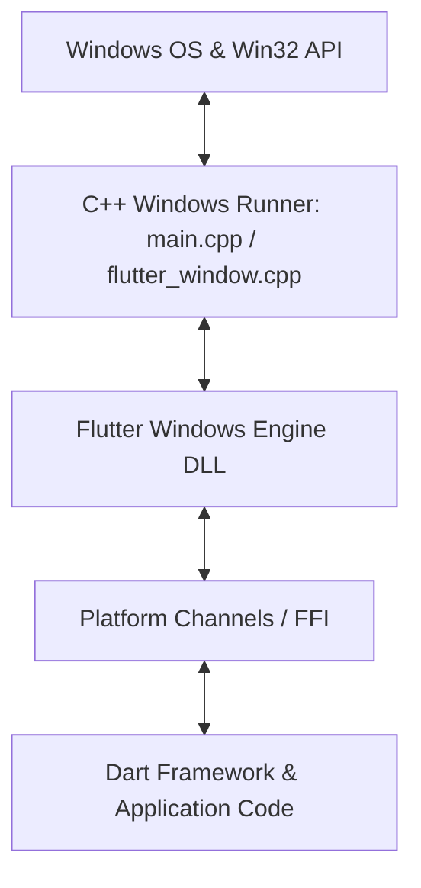
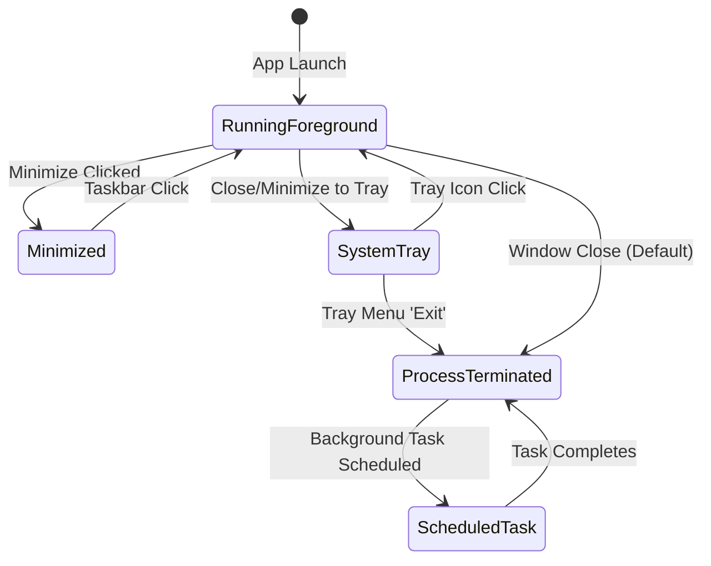

# Windows Desktop Development Guide

This guide establishes production engineering standards for developing, debugging, packaging, and releasing Flutter applications for **Windows Desktop**.

---

## 1. Windows Desktop Architecture in Flutter

A Flutter Windows application consists of two distinct layers:
1. **The Native C++ Windows Runner (`windows/runner/`)**: A standard Win32 desktop application that hosts the Flutter Engine, handles the native Windows window message loop (`WndProc`), manages high-DPI scaling, and dispatches native events.
2. **The Flutter Framework & Dart Engine**: The cross-platform rendering engine that draws widgets via Skia/Impeller onto an OpenGL/DirectX surface embedded inside the Win32 window.



---

## 2. Process Lifecycle vs. Window State Machine

> [!CAUTION]
> **Closing a Window $\ne$ Process Termination.**
> An AI agent must never assume that closing a Flutter window terminates the background process, nor that Dart code continues executing after the OS process terminates.

The Flutter Windows runtime operates under 5 mutually exclusive operational states:



| State | Window Visibility | Taskbar Icon | Dart Isolate Executing? | Persistence Mechanism |
| :--- | :--- | :--- | :--- | :--- |
| **1. Running Foreground** | Visible | Present | Yes | Active UI loop |
| **2. Minimized** | Hidden (Minimized) | Present | Yes | Standard Win32 minimize |
| **3. System Tray Active** | Hidden | Hidden | Yes (Full app alive) | `tray_manager` keeps message loop alive |
| **4. Background Service** | No UI window | Hidden | Yes (Separate headless process)| Win32 background service / headless isolate |
| **5. Process Terminated** | None | None | **NO (Memory wiped)** | **Only Windows Task Scheduler (`schtasks`) or Win32 Service can awaken** |

### Critical Rule for Background Tasks
If the user requires notifications, background data sync, or scheduled checks to trigger **after the application process has terminated**, Dart code in the app cannot execute on its own. You **MUST** register a task with the native **Windows Task Scheduler** (`schtasks.exe`) or invoke a native Windows background service.

---

## 3. Window Management & Minimize-to-Tray

Using the production-standard `window_manager` and `tray_manager` packages:

### Window Initialization (`lib/main.dart`)
```dart
import 'package:flutter/material.dart';
import 'package:window_manager/window_manager.dart';
import 'package:tray_manager/tray_manager.dart';

Future<void> main() async {
  WidgetsFlutterBinding.ensureInitialized();
  await windowManager.ensureInitialized();

  const windowOptions = WindowOptions(
    size: Size(1100, 750),
    minimumSize: Size(800, 600),
    center: true,
    backgroundColor: Colors.transparent,
    skipTaskbar: false,
    titleBarStyle: TitleBarStyle.normal,
    title: 'Enterprise Flutter Windows App',
  );

  await windowManager.waitUntilReadyToShow(windowOptions, () async {
    await windowManager.show();
    await windowManager.focus();
  });

  runApp(const WindowsApp());
}
```

### Implementing Minimize-to-Tray
```dart
class _WindowsAppState extends State<WindowsApp> with WindowListener, TrayListener {
  @override
  void initState() {
    super.initState();
    windowManager.addListener(this);
    trayManager.addListener(this);
    _initSystemTray();
  }

  @override
  void dispose() {
    windowManager.removeListener(this);
    trayManager.removeListener(this);
    super.dispose();
  }

  Future<void> _initSystemTray() async {
    await trayManager.setIcon('assets/icons/app_icon.ico');
    final menu = Menu(items: [
      MenuItem(key: 'show_window', label: 'Open App'),
      MenuItem.separator(),
      MenuItem(key: 'exit_app', label: 'Exit'),
    ]);
    await trayManager.setContextMenu(menu);
  }

  @override
  void onWindowClose() async {
    // Prevent process exit; minimize to tray instead
    final isPreventClose = await windowManager.isPreventClose();
    if (isPreventClose) {
      await windowManager.hide();
      await windowManager.setSkipTaskbar(true);
    }
  }

  @override
  void onMenuItemSelected(MenuItem menuItem) async {
    if (menuItem.key == 'show_window') {
      await windowManager.show();
      await windowManager.setSkipTaskbar(false);
      await windowManager.focus();
    } else if (menuItem.key == 'exit_app') {
      await windowManager.destroy(); // Terminates the process
    }
  }
}
```

---

## 4. Native Windows Toast Notifications

Native Windows 10/11 Toast notifications require WinRT integration. Use `local_notifier`:

```dart
import 'package:local_notifier/local_notifier.dart';

Future<void> initWindowsNotifications() async {
  await localNotifier.setup(
    appName: 'Enterprise Flutter App',
    shortcutPolicy: ShortcutPolicy.requireCreate,
  );
}

void showWindowsToast({required String title, required String body}) {
  final notification = LocalNotification(
    title: title,
    body: body,
    silent: false,
  );
  notification.show();
}
```

---

## 5. Launch on Windows Startup

To automatically start the application when the user logs into Windows, configure the Windows Registry:

- **Registry Key**: `HKEY_CURRENT_USER\Software\Microsoft\Windows\CurrentVersion\Run`
- **Value Name**: `<Your_App_Name>`
- **Value Data**: `"C:\Path\To\YourApp.exe" --autostart`

Using `package:win32` or `launch_at_startup`:
```dart
import 'dart:io';
import 'package:launch_at_startup/launch_at_startup.dart';
import 'package:package_info_plus/package_info_plus.dart';

Future<void> configureLaunchAtStartup({required bool enable}) async {
  final packageInfo = await PackageInfo.fromPlatform();
  launchAtStartup.setup(
    appName: packageInfo.appName,
    appPath: Platform.resolvedExecutable,
  );

  if (enable) {
    await launchAtStartup.enable();
  } else {
    await launchAtStartup.disable();
  }
}
```

---

## 6. Windows File System & Known Folders

Windows enforces strict user directory boundaries. Never hardcode drive letters (`C:\`) or relative paths for persistent data.

Use `path_provider`:
- `getApplicationSupportDirectory()`: Resolves to `C:\Users\<User>\AppData\Roaming\<Org>\<App>`. Ideal for databases, settings, and persistent data.
- `getTemporaryDirectory()`: Resolves to `C:\Users\<User>\AppData\Local\Temp`. Ideal for transient caches.
- `getDownloadsDirectory()`: Resolves to `C:\Users\<User>\Downloads`. Ideal for user exports.

```dart
import 'dart:io';
import 'package:path/path.dart' as p;
import 'package:path_provider/path_provider.dart';

Future<File> getSecureDatabaseFile() async {
  final appDir = await getApplicationSupportDirectory();
  final dbPath = p.join(appDir.path, 'database', 'app_production.sqlite');
  final file = File(dbPath);
  if (!await file.parent.exists()) {
    await file.parent.create(recursive: true);
  }
  return file;
}
```

---

## 7. MSIX Packaging & Microsoft Store Distribution

The modern, secure installer format for Windows is **MSIX**. It supports auto-updates, clean uninstallation, sandboxed registry virtualisation, and Microsoft Store submission.

### 1. Configure `pubspec.yaml`
```yaml
dev_dependencies:
  msix: ^3.16.7

msix_config:
  display_name: Enterprise Flutter App
  publisher_display_name: Enterprise Software Corp
  identity_name: com.enterprise.flutterapp
  msix_version: 1.0.0.0
  logo_path: assets/icons/app_icon_512.png
  start_menu_icon_path: assets/icons/app_icon_44.png
  tile_icon_path: assets/icons/app_icon_150.png
  capabilities:
    - internetClient
    - runFullTrust
```

### 2. Generate Release Build & MSIX Package
```bash
# Compile release binary
flutter build windows --release

# Generate MSIX package
dart run msix:create
```

The resulting package is placed in `build/windows/runner/Release/<app_name>.msix`.

### 3. Signing the MSIX for Local Testing (Sideloading)
For internal enterprise distribution without the Microsoft Store, generate and install a self-signed certificate:
```powershell
# Create self-signed certificate
New-SelfSignedCertificate -Type Custom -Subject "CN=Enterprise Software Corp" `
  -KeyUsage DigitalSignature -FriendlyName "Enterprise App Cert" `
  -CertStoreLocation "Cert:\CurrentUser\My"

# Export to PFX
$cert = Get-ChildItem -Path Cert:\CurrentUser\My | Where-Object { $_.Subject -match "Enterprise Software Corp" } | Select-Object -First 1
Export-PfxCertificate -Cert $cert -FilePath "windows_cert.pfx" -Password (ConvertTo-SecureString -String "Password123" -Force -AsPlainText)
```
Add to `pubspec.yaml`:
```yaml
msix_config:
  certificate_path: windows_cert.pfx
  certificate_password: Password123
```

---

## 8. Windows Verification & Testing Checklist

Before certifying a Windows build:
- [ ] Application compiles with `flutter build windows --release`.
- [ ] Single-instance Mutex prevents launching duplicate instances.
- [ ] Per-Monitor V2 DPI awareness prevents blurry rendering across mixed-scaling monitors.
- [ ] High-DPI scaling functions correctly at 100%, 125%, 150%, and 200% OS scaling.
- [ ] Window boundaries obey minimum width and height constraints.
- [ ] Minimize to tray hides window from taskbar and keeps process alive.
- [ ] Restoring from tray brings window to foreground with focus.
- [ ] Windows Toast notifications trigger and clicking them restores window focus.
- [ ] Database files persist in AppData and survive application updates.
- [ ] MSIX installer installs cleanly without corrupting previous version data.
- [ ] Application uninstalls cleanly without leaving orphan files outside AppData.

---

## 9. Win32 Single-Instance Mutex Enforcement

In enterprise deployments, running duplicate instances of the same desktop app can corrupt local SQLite/Isar database locks, trigger concurrent sync conflicts, or cause duplicate background timers.

### Native C++ Mutex Implementation (`windows/runner/main.cpp`)
```cpp
// Near the start of wWinMain:
HANDLE hMutex = CreateMutexW(NULL, TRUE, L"Global\\MyEnterpriseFlutterApp_SingleInstanceMutex");
if (GetLastError() == ERROR_ALREADY_EXISTS) {
  // Find the running window and restore it
  HWND existingHwnd = FindWindowW(L"FLUTTER_RUNNER_WIN32_WINDOW", L"Enterprise Windows App");
  if (existingHwnd) {
    if (IsIconic(existingHwnd)) ShowWindow(existingHwnd, SW_RESTORE);
    SetForegroundWindow(existingHwnd);
  }
  CloseHandle(hMutex);
  return 0; // Terminate duplicate instance immediately
}
```

---

## 10. High-DPI Scaling & Per-Monitor V2 DPI Awareness

Windows users frequently use multi-monitor configurations with mixed DPI scaling (e.g. 100% on external monitor, 150% on laptop screen). Without Per-Monitor V2 DPI awareness, Windows stretches the bitmap when dragging windows between monitors, resulting in blurry text and blurry icons.

### Configuration in `windows/runner/main.cpp`
```cpp
int APIENTRY wWinMain(_In_ HINSTANCE hInstance, _In_opt_ HINSTANCE hPrevInstance,
                      _In_ PWSTR pCmdLine, _In_ int nCmdShow) {
  // Configure Per-Monitor V2 DPI Awareness before creating the window
  SetProcessDpiAwarenessContext(DPI_AWARENESS_CONTEXT_PER_MONITOR_AWARE_V2);

  // Initialize COM and Flutter Window...
  ::CoInitializeEx(nullptr, COINIT_APARTMENTTHREADED);
  // ...
}
```
This guarantees that Flutter re-renders natively at the correct device pixel ratio whenever the window crosses monitor boundaries.

