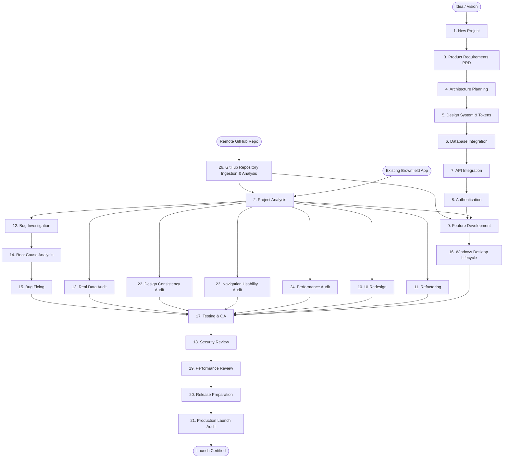

# Flutter Agent Kit: Lifecycle Workflows Guide

This guide details the 26 end-to-end engineering workflows supported by the **Flutter Agent Kit**. Each workflow represents a rigorous protocol with defined entry conditions, sequential phases, quality gates, and completion criteria.

---

## Complete Engineering Lifecycle Overview (26 Workflows)

---

## Master Workflow Directory & Index

| # | Workflow Directory | Primary Scope & Objective |
| :--- | :--- | :--- |
| **1** | [`new-project`](file:///D:/Flutter/Flutter%20Agent-Kit/flutter-agent-kit/workflows/new-project/WORKFLOW.md) | Takes an app idea from concept to a runnable, well-architected baseline |
| **2** | [`existing-project-analysis`](file:///D:/Flutter/Flutter%20Agent-Kit/flutter-agent-kit/workflows/existing-project-analysis/WORKFLOW.md) | Non-destructive audit of existing architecture, dependencies, and state patterns |
| **3** | [`product-requirements`](file:///D:/Flutter/Flutter%20Agent-Kit/flutter-agent-kit/workflows/product-requirements/WORKFLOW.md) | Discovers, scopes, and authors `docs/PRD.md` with numbered functional requirements |
| **4** | [`architecture-planning`](file:///D:/Flutter/Flutter%20Agent-Kit/flutter-agent-kit/workflows/architecture-planning/WORKFLOW.md) | Formulates architecture, package slicing, dependency injection, and data flow |
| **5** | [`design-system`](file:///D:/Flutter/Flutter%20Agent-Kit/flutter-agent-kit/workflows/design-system/WORKFLOW.md) | Authors `docs/DESIGN.md` and implements Material 3 `ThemeData` & `ThemeExtension` |
| **6** | [`database-integration`](file:///D:/Flutter/Flutter%20Agent-Kit/flutter-agent-kit/workflows/database-integration/WORKFLOW.md) | Implements local persistence (Drift, Isar, Hive), schema migrations, and DAOs |
| **7** | [`api-integration`](file:///D:/Flutter/Flutter%20Agent-Kit/flutter-agent-kit/workflows/api-integration/WORKFLOW.md) | Connects remote REST/GraphQL endpoints with Dio, interceptors, and DTO mappers |
| **8** | [`authentication`](file:///D:/Flutter/Flutter%20Agent-Kit/flutter-agent-kit/workflows/authentication/WORKFLOW.md) | Secure token storage, queued 401 token refresh, biometric auth, and route guards |
| **9** | [`feature-development`](file:///D:/Flutter/Flutter%20Agent-Kit/flutter-agent-kit/workflows/feature-development/WORKFLOW.md) | Vertical-slice implementation (Domain $\rightarrow$ Data $\rightarrow$ State $\rightarrow$ UI) |
| **10** | [`ui-redesign`](file:///D:/Flutter/Flutter%20Agent-Kit/flutter-agent-kit/workflows/ui-redesign/WORKFLOW.md) | Upgrades screens to design system tokens, 4 UI states, and responsive layouts |
| **11** | [`refactoring`](file:///D:/Flutter/Flutter%20Agent-Kit/flutter-agent-kit/workflows/refactoring/WORKFLOW.md) | Restructures legacy code, eliminates duplication, and improves testability safely |
| **12** | [`bug-investigation`](file:///D:/Flutter/Flutter%20Agent-Kit/flutter-agent-kit/workflows/bug-investigation/WORKFLOW.md) | Triage, stacktrace analysis, and deterministic reproduction of defects |
| **13** | [`real-data-audit`](file:///D:/Flutter/Flutter%20Agent-Kit/flutter-agent-kit/workflows/real-data-audit/WORKFLOW.md) | Scans, audits, and eliminates hardcoded dummy data, fake metrics, and mock data leaks |
| **14** | [`root-cause-analysis`](file:///D:/Flutter/Flutter%20Agent-Kit/flutter-agent-kit/workflows/root-cause-analysis/WORKFLOW.md) | 5-Whys diagnostic analysis, post-incident reporting, and defect recurrence prevention |
| **15** | [`bug-fixing`](file:///D:/Flutter/Flutter%20Agent-Kit/flutter-agent-kit/workflows/bug-fixing/WORKFLOW.md) | Surgical root-cause defect elimination, reproduction test, and regression checks |
| **16** | [`windows-desktop`](file:///D:/Flutter/Flutter%20Agent-Kit/flutter-agent-kit/workflows/windows-desktop/WORKFLOW.md) | Single-instance mutex, Per-Monitor V2 DPI, system tray, toast notifications |
| **17** | [`testing-and-qa`](file:///D:/Flutter/Flutter%20Agent-Kit/flutter-agent-kit/workflows/testing-and-qa/WORKFLOW.md) | Unit, widget, golden visual, and integration test execution with coverage |
| **18** | [`security-review`](file:///D:/Flutter/Flutter%20Agent-Kit/flutter-agent-kit/workflows/security-review/WORKFLOW.md) | Secret scanning, storage encryption audit, OWASP MASVS compliance check |
| **19** | [`performance-review`](file:///D:/Flutter/Flutter%20Agent-Kit/flutter-agent-kit/workflows/performance-review/WORKFLOW.md) | Rapid profiling, 60/120 FPS frame budget enforcement, and targeted jank remediation |
| **20** | [`release-preparation`](file:///D:/Flutter/Flutter%20Agent-Kit/flutter-agent-kit/workflows/release-preparation/WORKFLOW.md) | Version bumping, code signing, obfuscated compilation, and MSIX/AAB packaging |
| **21** | [`production-audit`](file:///D:/Flutter/Flutter%20Agent-Kit/flutter-agent-kit/workflows/production-audit/WORKFLOW.md) | 50-point pre-flight launch audit and formal deployment readiness certification |
| **22** | [`design-consistency-audit`](file:///D:/Flutter/Flutter%20Agent-Kit/flutter-agent-kit/workflows/design-consistency-audit/WORKFLOW.md) | Audits, detects, and harmonizes design drift, hardcoded styling, and theme contrast |
| **23** | [`navigation-usability-audit`](file:///D:/Flutter/Flutter%20Agent-Kit/flutter-agent-kit/workflows/navigation-usability-audit/WORKFLOW.md) | Audits icon clarity, action discoverability, a11y labels, and nav hierarchy |
| **24** | [`performance-audit`](file:///D:/Flutter/Flutter%20Agent-Kit/flutter-agent-kit/workflows/performance-audit/WORKFLOW.md) | Audits algorithmic complexity, memory lifecycles, rebuild scopes, and isolate concurrency |
| **25** | [`task-lifecycle`](file:///D:/Flutter/Flutter%20Agent-Kit/flutter-agent-kit/workflows/task-lifecycle/WORKFLOW.md) | Mandatory 15-phase SDLC, in-project documentation, task breakdown, sequential execution, and .gitignore protection |
| **26** | [`github-repository`](file:///D:/Flutter/Flutter%20Agent-Kit/flutter-agent-kit/workflows/github-repository/WORKFLOW.md) | Ingestion, topology discovery, automated profiling, adaptive development, and verification on any GitHub repository |

---

## Workflow Execution Protocol

For every workflow:
1. **Confirm Entry Conditions**: Ensure required inputs, dependencies, or preceding workflow artifacts exist.
2. **Execute In Sequence**: Do not skip intermediate phases.
3. **Verify Quality Gates**: Run the specified commands (`flutter analyze`, `flutter test`, `flutter build`).
4. **Document Output**: Update `docs/TASKS.md`, `docs/MEMORY.md`, and relevant feature documentation upon completion.
