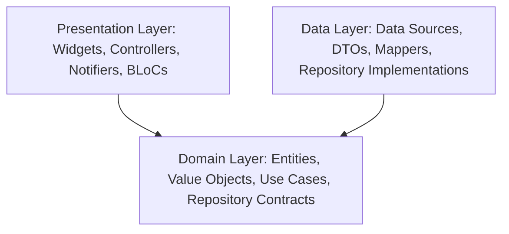

# Clean Architecture & Separation of Concerns

These rules govern Clean Architecture layering and boundaries in Flutter applications.

---

## 1. The Three Primary Layers



### 1. Presentation Layer (`presentation/`)
- **Responsibilities**: Rendering UI, capturing user gestures, observing state notifiers, animating transitions, and presenting feedback (snackbars, dialogs).
- **Rule**: Contains zero business logic, zero raw SQL queries, and zero direct HTTP requests.

### 2. Domain Layer (`domain/`)
- **Responsibilities**: The heart of the application. Contains business entities, domain validations, business logic rules, and abstract repository contracts.
- **Rule**: **Pure Dart**. Must not import `package:flutter`, `dio`, `sqflite`, or any presentation/infrastructure library.

### 3. Data Layer (`data/`)
- **Responsibilities**: Fetching data from external sources (REST APIs, GraphQL, WebSockets, local SQLite, SecureStorage), deserializing raw JSON into DTOs, mapping DTOs into domain entities, and implementing the abstract repository contracts defined in the Domain layer.

---

## 2. Inversion of Dependencies
Repositories are declared as abstract contracts in `domain/` and implemented in `data/`:

### Contract in `domain/repositories/task_repository.dart`:
```dart
abstract interface class TaskRepository {
  Future<List<TaskEntity>> getTasks();
  Future<void> saveTask(TaskEntity task);
}
```

### Implementation in `data/repositories/task_repository_impl.dart`:
```dart
class TaskRepositoryImpl implements TaskRepository {
  final TaskRemoteDataSource remoteDataSource;
  final TaskLocalDataSource localDataSource;

  const TaskRepositoryImpl({
    required this.remoteDataSource,
    required this.localDataSource,
  });

  @override
  Future<List<TaskEntity>> getTasks() async {
    final dtos = await remoteDataSource.fetchTasks();
    return dtos.map((dto) => dto.toEntity()).toList();
  }

  @override
  Future<void> saveTask(TaskEntity task) async {
    await remoteDataSource.uploadTask(TaskDto.fromEntity(task));
    await localDataSource.cacheTask(TaskDto.fromEntity(task));
  }
}
```

---

## 3. When Clean Architecture is Appropriate
- **Use when**: Building large, long-lived enterprise applications with complex business rules, multiple data sources, and strict testing requirements.
- **Do not over-engineer**: For simple CRUD applications, having separate UseCase classes for every single repository call (`GetTasksUseCase`, `DeleteTaskUseCase`) adds boilerplate without value. Directly injecting the `TaskRepository` into the BLoC/Notifier is acceptable and recommended for mid-sized apps.
