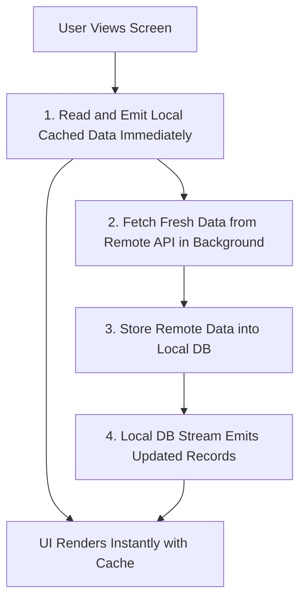

# Offline-First & HTTP Caching Rules

These rules govern offline data availability, caching interceptors (`dio_cache_interceptor`), and optimistic updates in Flutter.

---

## 1. Offline-First Repository Strategy

Follow the **Cache-Then-Network** pattern for read operations:



### Dart Implementation:
```dart
Stream<List<ItemEntity>> watchItems() async* {
  // 1. Emit local cached items immediately
  yield* localDataSource.watchCachedItems().map((dtos) => dtos.toEntities());

  // 2. Fetch fresh from remote and update local storage
  try {
    final remoteDtos = await remoteDataSource.fetchItems();
    await localDataSource.replaceItems(remoteDtos);
  } catch (e) {
    // If offline, local cache is already showing; log silently or report sync error
  }
}
```

---

## 2. Using `dio_cache_interceptor`

For read-only GET requests, attach `dio_cache_interceptor` with a persistent store:
```dart
import 'package:dio_cache_interceptor/dio_cache_interceptor.dart';

final cacheOptions = CacheOptions(
  store: MemCacheStore(), // Or HiveCacheStore / DriftCacheStore for persistence
  policy: CachePolicy.refreshForceCache, // Returns cache if offline, refreshes if online
  hitCacheOnErrorExcept: [401, 403], // Return cache on 500 or timeout
  maxStale: const Duration(days: 7),
  priority: CachePriority.normal,
);

dio.interceptors.add(DioCacheInterceptor(options: cacheOptions));
```

---

## 3. Rules for Optimistic UI Updates
1. **Allowed for Low-Risk Actions**: Allowed for toggling favorites, likes, archiving notes, or marking items as read.
2. **Forbidden for High-Risk Actions**: Strictly prohibited for payments, checkout completion, account deletion, or irreversible data modifications.
3. **Mandatory Rollback**: If an optimistic update fails on the server, the UI **must** roll back immediately to the previous state and display an error toast with a retry option.
