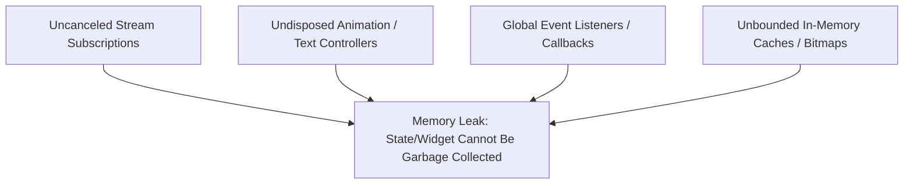

# Memory Leaks & Resource Hygiene Rules

These rules prevent Dart memory leaks, retain cycles, and native texture resource bloat.

---

## 1. The Most Common Dart Memory Leaks in Flutter



---

## 2. Mandatory Disposal Invariants

### 1. Controllers & Nodes
Every instance of the following classes **must** have its `dispose()` method called in the owning `State`'s `dispose()`:
- `AnimationController`
- `TextEditingController`
- `ScrollController`
- `FocusNode`
- `TabController`
- `PageController`

```dart
@override
void dispose() {
  _textController.dispose();
  _focusNode.dispose();
  _scrollController.dispose();
  super.dispose();
}
```

### 2. Stream & Event Subscriptions
Never instantiate `Stream.listen()` inside `initState()` or a service without assigning it to a `StreamSubscription` variable that is cancelled:
```dart
StreamSubscription<dynamic>? _subscription;

@override
void initState() {
  super.initState();
  _subscription = eventBus.stream.listen(_handleEvent);
}

@override
void dispose() {
  _subscription?.cancel();
  super.dispose();
}
```

### 3. Image Memory Management
When rendering high-resolution images from network or disk:
- Always specify `cacheWidth` or `cacheHeight` on `Image.network` or `ResizeImage` to downscale bitmaps before uploading them to GPU texture memory:
  ```dart
  Image.network(
    user.highResAvatarUrl,
    cacheWidth: 120, // Decodes at 120px instead of 4000px, saving 98% RAM
    cacheHeight: 120,
  )
  ```
