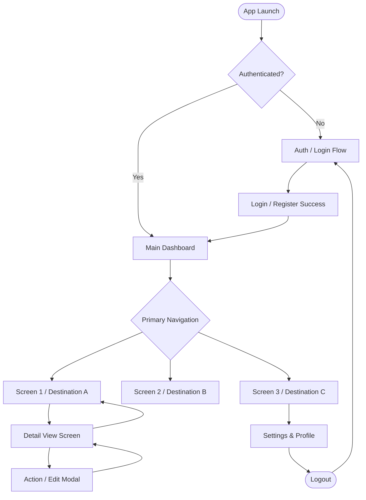

# User Flow & Navigation Architecture: [Project Name]

## 1. Overview
This document defines all end-to-end user navigation flows, interaction state machines, screen transitions, and modal surfaces for **[Project Name]**.

---

## 2. Navigation State Machine (Mermaid)

---

## 3. Primary User Journeys

### Journey 1: [Onboarding & Authentication Flow]
1. **Entry Point**: App launch without active session.
2. **Steps**:
   - Splash / Check session $\to$ Welcome Screen.
   - Enter credentials $\to$ Trigger auth API $\to$ Receive token & profile.
3. **Happy Path**: Successful authentication routes immediately to `MainDashboard`.
4. **Failure Path**: Invalid credentials display inline error with shake animation; remains on `AuthScreen`.

### Journey 2: [Core Feature Workflow]
1. **Entry Point**: `MainDashboard` $\to$ Tap [Primary Action Button].
2. **Steps**:
   - Open [Feature Screen].
   - Enter data or interact with elements.
   - Tap `Save / Submit`.
3. **State Transitions**:
   - `Idle` $\to$ `Submitting (Loading Skeleton/Spinner)` $\to$ `Success (Toast / Snack)`.
4. **Failure Recovery**: Network failure displays retryable banner; user retains input state.

---

## 4. Universal State Handling Matrix

| State Type | Visual Representation | User Action Available |
| :--- | :--- | :--- |
| **Loading** | Shimmer skeleton matching item layout | Back navigation, cancel request |
| **Empty** | Helpful illustration, title, description, clear CTA | Tap CTA to create first item |
| **Partial / Offline** | Cached data with "Offline" indicator pill | View cached items, tap to refresh |
| **Error (Transient)** | Inline error banner or toast with "Retry" | Tap "Retry" or dismiss |
| **Error (Fatal)** | Full-screen error state with recovery action | Restart app, re-authenticate |

---

## 5. Edge Cases & Exception Flows
- **Session Expiry During Active Form**: Persist form state locally, present modal login dialog, resume upon success.
- **Network Disconnect**: Queue mutations offline, show non-intrusive offline status banner.
- **Hardware Back / Window Close**: If uncommitted edits exist, display confirmation dialog before exiting.
