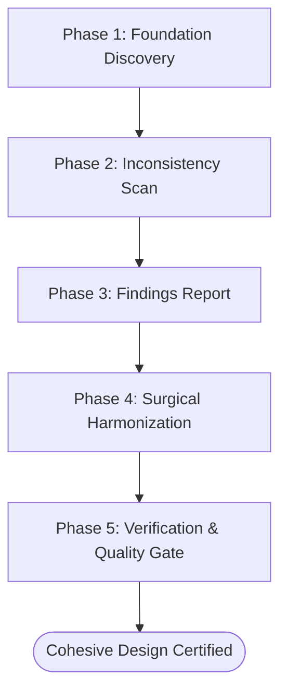

# Workflow: Design Consistency Audit (design-consistency-audit)

This workflow defines the systematic 5-phase procedure for auditing, detecting, and harmonizing visual design inconsistencies across Flutter applications to enforce the **One Coherent Design Language** principle (`docs/DESIGN_SYSTEM_STANDARDS.md`).

---

## 1. Entry Conditions
- An existing Flutter codebase with multiple screens, or a freshly assembled application prior to release.
- Suspected design drift: inconsistent button styles, hardcoded colors, mismatched corner radii, competing icon sets, or unreadable dark theme contrast.
- Access to `docs/DESIGN_SYSTEM_STANDARDS.md` and `templates/DESIGN.md`.

---

## 2. Step-by-Step Procedure



### Phase 1: Brand & Visual Foundation Discovery
1. **Inspect Existing Theme Configuration**:
   - Check `lib/core/theme/` or wherever `ThemeData` is configured in `main.dart`.
   - Identify existing primary seed colors, typography choices, and custom `ThemeExtension` classes.
2. **Review or Create `docs/DESIGN.md`**:
   - If `docs/DESIGN.md` exists, review established tokens.
   - If missing, extract the predominant visual identity and author `docs/DESIGN.md` using `templates/DESIGN.md`.
3. **Classify App Archetype**:
   - Align the product with one of the 7 archetypes from `docs/DESIGN_SYSTEM_STANDARDS.md` (e.g. Professional & Enterprise, Productivity-Focused, Data-Focused).
   - Preserve the existing brand personality; do not perform an unsolicited total redesign.

### Phase 2: Inconsistency Scan & Classification
Execute systematic checks across all presentation widgets in `lib/`:
1. **Hardcoded Color Scan**:
   - Search for raw `Color(0x...)` or `Colors.<color>` invocations inside widget `build()` methods.
   - Verify if text on surfaces uses `colorScheme.onSurface` or has hardcoded light-only/dark-only values.
2. **Magic Spacing & Margins**:
   - Search for arbitrary padding numbers (e.g. `11.0`, `13.5`, `17.0`, `22.0`).
   - Check alignment with the 4pt/8pt modular grid (`AppSpacing`: 4, 8, 12, 16, 24, 32, 48dp).
3. **Corner Radius & Shape Variations**:
   - Search for mismatched `BorderRadius.circular(...)` values on similar components (e.g. cards with 4dp on screen A vs 16dp on screen B).
4. **Button & Card Fragmentations**:
   - Detect independently styled buttons or custom wrapper widgets recreating standard button behavior.
5. **Mixed Icon Libraries**:
   - Check if multiple conflicting icon sets (CupertinoIcons, Material sharp, Material rounded, third-party packs) are mixed across adjacent screens.
6. **Dark Theme Readability**:
   - Audit contrast in dark mode to ensure text remains legible and surfaces do not wash out.

### Phase 3: Audit Findings Report Generation
Document all identified inconsistencies in a structured audit table:

| Screen / Component | File Path | Inconsistency Type | Severity | Recommended Remediation |
| :--- | :--- | :--- | :--- | :--- |
| `ProductCard` | `lib/features/shop/presentation/product_card.dart` | Hardcoded `Color(0xFF6366F1)` | Minor | Migrate to `Theme.of(context).colorScheme.primary` |
| `SettingsPage` | `lib/features/settings/presentation/settings_page.dart` | Card radius 4dp vs app standard 16dp | Minor | Standardize on `AppRadii.radiusLg` |
| `ProfileHeader`| `lib/features/profile/presentation/profile_header.dart`| Hardcoded black text in dark mode | Critical | Change to `colorScheme.onSurface` |
| `CheckoutPage` | `lib/features/checkout/presentation/checkout_page.dart`| Mixed Cupertino & Material icons | Major | Harmonize to standard `Icons.*_rounded` |

### Phase 4: Surgical Harmonization
1. **Centralize Design Tokens**:
   - Consolidate colors into `ColorScheme` and `BrandColors` extension.
   - Consolidate spacing into `AppSpacing` and radii into `AppRadii`.
2. **Refactor Inconsistent Widgets**:
   - Replace hardcoded colors with `Theme.of(context).colorScheme` or `Theme.of(context).extension<BrandColors>()`.
   - Snap arbitrary padding values to standard `AppSpacing` tokens.
   - Harmonize corner radii to standard `AppRadii` tokens.
   - Replace duplicate button implementations with shared `AppButton` from `lib/core/presentation/widgets/`.
3. **Enforce Light/Dark Mode Parity**:
   - Ensure all elevated surfaces utilize appropriate tonal containers in dark mode.
   - Verify WCAG AA contrast (4.5:1 for body copy).

### Phase 5: Verification & Quality Gate
1. **Execute 13-Point Design Checklist**:
   - Verify every modified screen against the 13 points in `docs/DESIGN_SYSTEM_STANDARDS.md`.
2. **Visual Inspection**:
   - If an emulator, live preview, or desktop window is active, visually inspect rendered screens across Light and Dark themes. Never claim visual verification occurred if no visual inspection took place.
3. **Automated Verification**:
   ```bash
   flutter analyze
   flutter test test/widgets/
   flutter test --tags=golden
   ```

---

## 3. Exit Criteria & Quality Gates
- [ ] Complete Audit Findings Report documented with severity classifications.
- [ ] All Critical and Major design inconsistencies resolved.
- [ ] Zero hardcoded hex colors remaining in presentation widget build methods.
- [ ] 4pt/8pt spacing scale and standardized corner radii enforced across all screens.
- [ ] Both Light and Dark modes render with accessible contrast and cohesive visual identity.
- [ ] All 13 items in the Mandatory Design Checklist verified.
- [ ] `flutter analyze` passes with 0 errors and 0 warnings.

---

## 4. Related Skills & Rules
- `skills/design-system/`
- `skills/ui-implementation/`
- `skills/responsive-design/`
- `skills/golden-testing/`
- `rules/ui-ux/design-tokens.md`
- `rules/ui-ux/material-3.md`
- `docs/DESIGN_SYSTEM_STANDARDS.md`
