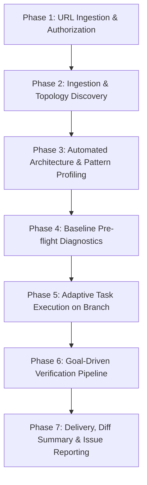

# Workflow: GitHub Repository Ingestion, Analysis & Adaptive Development

This workflow defines the end-to-end engineering protocol for onboarding into, analyzing, developing on, and verifying changes across any arbitrary Flutter codebase hosted on GitHub.

---

## 1. Entry Conditions
- User provides a GitHub repository URL, OR
- User requests an audit, feature implementation, bugfix, or refactor on an external GitHub repository.
- Local Git environment and Flutter SDK are installed and operational.

---

## 2. Step-by-Step Procedure



### Phase 1: URL Ingestion & Authorization Check
1. **Validate GitHub URL**:
   - Check if the provided link is valid HTTPS (`https://github.com/owner/repo`) or SSH (`git@github.com:owner/repo.git`).
   - **If NO URL was provided**: Stop and immediately prompt the user:
     > *"Please share the GitHub repository link (e.g., `https://github.com/owner/repo`) so I can clone and analyze the codebase."*
2. **Access Control & Authorization**:
   - Confirm whether operations are read-only (analysis/audit) or read-write (feature/bugfix).
   - Enforce branch protection: Never push or commit directly to default branches (`main`/`master`).
   - If write access is unauthorized, prepare local branches or clean patch sets.

### Phase 2: Ingestion & Topology Discovery
1. **Clone or Fetch Repository**:
   ```bash
   git clone --depth 50 <REPO_URL> <TARGET_DIR>
   cd <TARGET_DIR>
   ```
2. **Locate Flutter Project Root**:
   - Scan for `pubspec.yaml` in the root.
   - If not found at root, recursively locate all `pubspec.yaml` files (e.g., `apps/mobile/`, `packages/app/`).
   - Check for Melos workspace (`melos.yaml`).
   - Change active working directory to the primary Flutter app root.

### Phase 3: Automated Architecture & Pattern Profiling
1. **Read `pubspec.yaml`**:
   - Note Dart SDK constraint (Dart 2 vs Dart 3 language capabilities).
   - Identify state management: BLoC, Riverpod, Provider, GetX, MobX, Signals, ValueNotifier.
   - Identify network client (`dio`, `http`), database (`drift`, `hive`, `isar`, `shared_preferences`), and routing (`go_router`, `auto_route`, `Navigator`).
2. **Inspect Directory Layout**:
   - Determine layout: Feature-First (`lib/features/`), Layer-First (`lib/models/`, `lib/views/`), or Clean Architecture.
3. **Inspect Linter & Style**:
   - Read `analysis_options.yaml` to extract active lint rules and strictness.
4. **Document Findings**:
   - Record discovered patterns in `docs/MEMORY.md`.

### Phase 4: Baseline Pre-flight Diagnostics
1. Run non-destructive baseline checks from the discovered Flutter root:
   ```bash
   flutter pub get
   flutter analyze
   flutter test
   ```
2. Note any pre-existing warnings or failing tests to ensure they are isolated from new changes.

### Phase 5: Adaptive Task Execution
1. Create a dedicated working branch:
   ```bash
   git checkout -b feat/<task-name>
   ```
2. Implement requested changes following:
   - Established state management and directory patterns (no forced rewrites).
   - Existing component and design system conventions.
   - Flutter coding standards: 4 UI states (Loading/Success/Empty/Error), `dispose()` calls, `if (!context.mounted) return;` safety, pure `build()`.
3. Adhere to surgical change discipline: touch only target files.

### Phase 6: Goal-Driven Verification Pipeline
1. Execute formatting and static analysis:
   ```bash
   dart format --output=none --set-exit-if-changed .
   flutter analyze
   ```
2. Run automated test suites:
   ```bash
   flutter test
   ```
3. Verify zero new warnings and 100% test pass rate.

### Phase 7: Delivery, Diff Summary & Issue Reporting
1. Review Git diff:
   ```bash
   git status --short
   git diff --stat
   ```
2. Provide a structured execution report following `docs/GITHUB_REPOSITORY_STANDARDS.md`:
   - Repository URL and discovered Flutter root path.
   - Architecture and state management summary.
   - Files modified/created.
   - Verification and test output.
   - Remaining risks or recommendations.

---

## 3. Exit Criteria
- Discovered Flutter root correctly identified.
- Pre-flight baseline established.
- Changes implemented on a dedicated feature branch.
- Zero architectural churn or unrequested restructuring.
- All new/modified UI screens handle the 4 mandatory states.
- `dart format`, `flutter analyze`, and `flutter test` pass with 0 new issues.
- Structured report delivered to user.

---

## 4. Related Skills & Rules
- `skills/github-repository/`
- `skills/project-analysis/`
- `skills/coding-standards/`
- `docs/GITHUB_REPOSITORY_STANDARDS.md`
- `docs/FLUTTER_CODING_STANDARDS.md`
- `core/project-understanding.md`
- `core/agent-principles.md`
