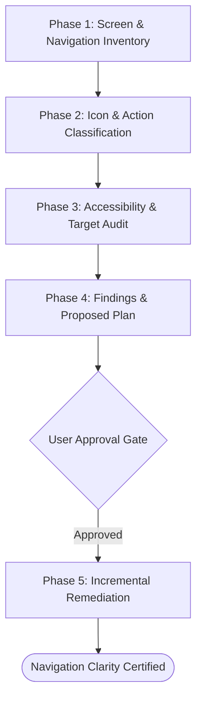

# Workflow: Navigation Usability & Icon Clarity Audit (navigation-usability-audit)

This workflow defines the systematic 5-phase procedure for inspecting, auditing, and upgrading navigation structures, icon usability, and action discoverability across Flutter applications (`docs/NAVIGATION_AND_ICON_STANDARDS.md`).

---

## 1. Entry Conditions
- An existing Flutter application with multiple screens, bottom navigation, or app bar action buttons.
- Suspected usability issues: ambiguous icon-only buttons, overcrowded navigation bars, buried core workflows, or missing accessibility labels.
- Reference to `docs/NAVIGATION_AND_ICON_STANDARDS.md`.

---

## 2. Step-by-Step Procedure

### Phase 1: Screen & Navigation Inventory
1. **Map Top-Level Navigation**:
   - Inspect `lib/core/routing/` and primary scaffold (`NavigationBar`, `NavigationRail`, or `NavigationDrawer`).
   - Count bottom navigation destinations. If on mobile and destination count is $>5$ or $<3$, mark as an architectural issue.
2. **Catalog All Screens**:
   - List every user-facing route/screen in the application.
3. **Verify Platform Appropriateness**:
   - Confirm whether desktop views use persistent sidebars or rails instead of stretched mobile bottom navigation bars.

### Phase 2: Icon Usability & Action Classification
1. **Catalog Every Interactive Icon Button**:
   - Search for `IconButton`, `InkWell(child: Icon(...))`, and `GestureDetector(child: Icon(...))` in each screen.
2. **Evaluate Icon Recognizability**:
   - Is the icon universally understood (e.g. Search, Settings, Close, Play)?
   - If domain-specific or ambiguous (e.g. `Icons.auto_awesome`, `Icons.flare`, `Icons.layers`), flag for label pairing.
3. **Classify Action Tiers**:
   - Assign each action to:
     - **Primary**: Core daily workflow (must be visible and prominent).
     - **Secondary**: Infrequent task (move into an overflow menu if crowding screen).
     - **Contextual**: Bound to specific record.
     - **Destructive**: Permanent deletion (must have red styling and confirmation dialog).

### Phase 3: Accessibility & Touch Target Audit
1. **Audit Semantic Announcements**:
   - Verify that every `IconButton` provides a `tooltip` or `Semantics(label: ...)` describing the **action**, not the graphic.
   - Example: `"Search customer orders"` (PASS) vs `"search icon"` (FAIL).
2. **Audit Touch & Click Targets**:
   - Verify interactive areas meet 48x48dp on mobile and 32x32dp on desktop.
3. **Desktop Keyboard Traversal**:
   - Verify all interactive controls are reachable via `Tab` key and activate on `Enter`/`Space`.

### Phase 4: Non-Destructive Findings & Proposal Generation
Generate the formal **Navigation Usability Audit Report**:

| Screen Name | File Path | Control Type | Visual Icon | Actual Action | Universally Recognizable? | Visible Label Required? | A11y Label Defined? | Recommended Remediation |
| :--- | :--- | :--- | :--- | :--- | :--- | :--- | :--- | :--- |
| `DashboardPage` | `lib/features/home/dashboard.dart` | `IconButton` | `Icons.tune` | Open analytics filters | No (ambiguous) | Yes | Missing | Convert to `OutlinedButton.icon` with "Filters" |
| `OrdersPage` | `lib/features/orders/orders.dart` | `NavigationBar` | 6 destinations | Top-level routing | Overcrowded | N/A | Present | Consolidate to 4 primary tabs; move 2 to drawer |
| `InvoiceDetail` | `lib/features/invoices/detail.dart`| `IconButton` | `Icons.bolt` | Instant payout | No (confusing) | Yes | Present | Convert to `FilledButton.icon` with "Instant Payout" |

> [!IMPORTANT]
> **User Approval Gate**: For brownfield applications, present the audit findings to the user and **do not modify working code until the proposed changes are approved**.

### Phase 5: Incremental Remediation & Quality Gate
Apply approved improvements incrementally, one screen at a time:
1. **Refactor Ambiguous Icons**: Convert to `FilledButton.icon` or `OutlinedButton.icon`.
2. **Consolidate Navigation**: Adjust `NavigationBar` to 3–5 essential destinations. Move secondary destinations to `MenuAnchor` or drawer.
3. **Add Action-Descriptive Semantics**: Provide precise tooltips and semantic labels.
4. **Enforce Destructive Confirmation**: Wrap deletion actions in confirmation dialogs.
5. **Verify 10-Point Checklist**: Run through the checklist in `docs/NAVIGATION_AND_ICON_STANDARDS.md`.

---

## 3. Exit Criteria & Quality Gates
- [ ] Complete Navigation Usability Audit Report authored.
- [ ] Mobile bottom navigation contains exactly 3–5 clearly labeled destinations.
- [ ] All ambiguous or domain-specific icon-only buttons replaced with labeled controls.
- [ ] 100% of interactive icon buttons provide action-descriptive semantic labels/tooltips.
- [ ] Touch targets satisfy 48x48dp mobile / 32x32dp desktop dimensions.
- [ ] Destructive operations protected by explicit confirmation modals.
- [ ] All 10 items in the Mandatory Navigation Checklist verified.
- [ ] `flutter analyze` passes cleanly with 0 warnings.

---

## 4. Related Skills & Rules
- `skills/navigation-clarity/`
- `skills/navigation/`
- `skills/accessibility/`
- `skills/ui-implementation/`
- `rules/ui-ux/accessibility.md`
- `docs/NAVIGATION_AND_ICON_STANDARDS.md`
